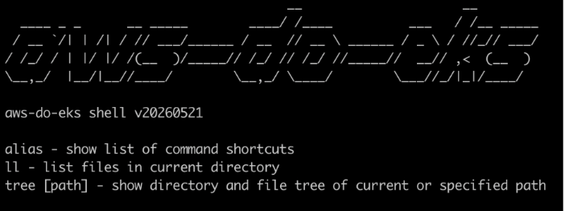
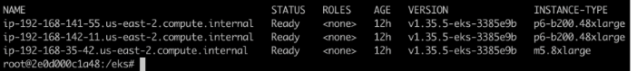
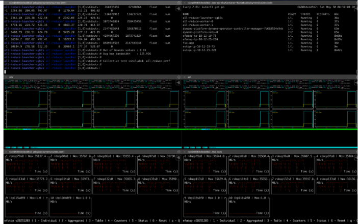
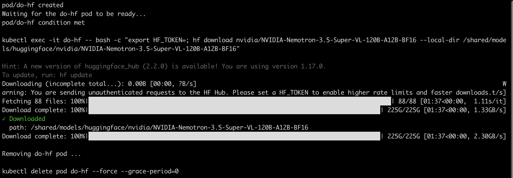
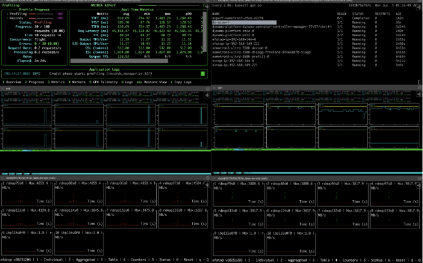
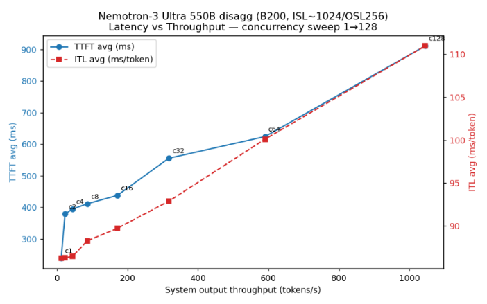

# Walkthrough: Run NVIDIA Nemotron models on AWS

This walkthrough provides step-by-step, end-to-end instructions for running NVIDIA Nemotron models on AWS using the Kubernetes API. It guides you through creating a cluster, deploying kubernetes drivers, plugins, and operators, running validation tests, downloading the model weights, deploying the model, testing and benchmarking the model, finally ending with removing all resources you created to bring back your account to its original condition.  

The following options have been validated and you may choose the ones that best suit your desired configuration: 

Orchestrator

- Amazon EKS Auto Mode
- Standard Amazon EKS
- SageMaker HyperPod EKS

Storage
- EBS + FSx
- FSx only

NVIDIA Nemotron models

- NVIDIA Nemotron 3 Ultra 550B 55A
- NVIDIA Nemotron 3.5 Super 120B 12A

Precisions

- BF16
- NVFP4

Topologies

- Aggregated
- Disaggregated (encode, prefill, decode)

Parallelism

- Tensor
- Pipeline
- Expert
- Data

Manifest type
- Deployment
- Leader Worker Set
- Dynamo Graph Deployment

Model server
- NVIDIA Dynamo with vLLM backend


## 1. Prerequisites 

Before getting started, make sure you have the following prerequisites: 

- An [AWS account](https://portal.aws.amazon.com/billing/signup#/start/email) with access to EC2 P5en.48xlarge or P6-b200.48xlarge instances (you might need to [request a quota increase,](https://docs.aws.amazon.com/AWSEC2/latest/UserGuide/ec2-resource-limits.html) and obtain a capacity reservation) 
- Access to a terminal that has [git](https://git-scm.com/) and [Docker](https://www.docker.com/get-started/) installed 
- [AWS credentials](https://docs.aws.amazon.com/cli/latest/userguide/cli-configure-files.html) with access to manage EC2, EKS, and FSxL in the account  

 
## 2. Create Amazon EKS or SageMaker HyperPod EKS cluster 

You can use your preferred method of creating a cluster. In this walkthrough, we are using the [do-framework](https://bit.ly/do-framework) project [aws-do-eks](https://github.com/aws-samples/aws-do-eks) to create an Amazon EKS cluster with a simple [cluster manifest](https://github.com/aws-samples/aws-do-eks/blob/main/wd/conf/eksctl/yaml/eks-gpu-p6-b200-cbr.yaml) and the [eksctl](https://github.com/eksctl-io/eksctl) CLI. Alternatively, you can create an [Amazon EKS Auto Mode cluster](https://github.com/aws-samples/aws-do-eks/blob/main/wd/conf/eksctl/yaml/eks-auto-mode-gpu-efa/README.md), using an [auto mode cluster manifest](https://github.com/aws-samples/aws-do-eks/blob/main/wd/conf/eksctl/yaml/eks-auto-mode-gpu-efa.yaml).If you prefer to create a HyperPod EKS cluster, you can follow one of the methods described in the HyperPod EKS [workshop,](https://bit.ly/smhp-eks-workshop) use the [aws-do-hyperpod](https://github.com/aws-samples/aws-do-hyperpod) project, or the [AWS Management Console](https://us-east-1.console.aws.amazon.com/sagemaker/home?region=us-east-1#/cluster-management/create-hp-eks).  
 

Let's walk through creating an EKS cluster using the aws-do-eks project. 

### 2.1. Clone the aws-do-eks source from GitHub

```bash
git clone https://github.com/aws-samples/aws-do-eks
cd aws-do-eks 
```

### 2.2. Configure the AWS\_DEFAULT\_REGION

```bash
./config.sh 
```
Set your region in the .env file by editing the following line:  

```log
export AWS_DEFAULT_REGION=<your_cluster_region> 
```

### 2.3. Build the project

```bash
./build.sh 
```
This will create a local aws-do-eks Docker image, which has all tools and automation scripts necessary to simplify creation and management of EKS clusters as well as running and monitoring workloads on them. 

### 2.4. Run the aws-do-eks container

```bash
./run.sh 
```

### 2.5. Check the status of the aws-do-eks container

```bash
./status.sh 
```
You should see that the container is up. 

### 2.6. Open a container shell (exec into the container)

```bash
./exec.sh 
```
Expected output: 



The `aws-do-eks` shell is enabled with the AWS Command Line Interface (AWS CLI), eksctl, kubectl, and other helper utilities which are ready to run. If you have multiple shell windows, by running `./exec.sh` you can open multiple `aws-do-eks` shells concurrently into the same container instance. 

### 2.7. Configure your AWS credentials

```bash
aws configure 
```
Follow the prompts to insert your AWS Access Key, Secret Access Key, region, and specify json as the output format. 

### 2.8. Configure the location of your cluster manifest

```bash
./env-config.sh 
```
This command opens the /eks/conf/env.conf file. 

Modify the active export CONF= setting to:

```log   
export CONF=conf/eksctl/yaml/eks-gpu-p6-b200-cbr.yaml 
```

### 2.9. Configure your cluster

```bash
./eks-config.sh 
```

This opens your cluster manifest and allows you to edit settings like cluster name, region, instance types, volume size, capacity block reservation id, etc.

### 2.10. Create your cluster

```bash
./eks-create.sh 
```
The `eks-create.sh` script is a utility that creates an eks cluster based on the configured implementation. In this case, the implementation is eksctl with a cluster manifest.  The actual command executed by the utility is `eksctl create cluster –f conf/eksctl/yaml/eks-gpu-p6-b200-cbr.yaml`   
This operation creates a dedicated VPC, subnets, NAT Gateways, Security groups, Cluster control plane, node groups, etc. The entire process may take up to 30 minutes.

If you prefer to use `terraform` instead of `eksctl`, you can `export IMPL=impl/terraform` in `/wd/conf/env.conf` and then set `CONF=` to the variables file of your desired terraform template (e.g. `export CONF=conf/terraform/eks-auto-mode-gpu-efa/variables.tf`). When you execute `./eks-create.sh` the actual command executed by the utility will be `terraform init && terraform plan -out tfplan && terraform apply -auto-approve tfplan`.

  
### 2.11. After cluster creation is complete, list the cluster nodes

```bash
kubectl get nodes 
```

or simply 

```bash
kgn 
```

Expected output similar to: 



*Note:* The aws-do-eks container shell is equipped with many useful aliases like kgn. To see a full list, type `alias` 


## 3. Deploy additional cluster resources 

### 3.1. Enable EFA support for your instance type (if needed)

EFA support should already be enabled on EKS Auto Mode clusters or SageMaker HyperPod EKS clusters.
At the time of writing this walkthrough, the eksctl CLI does not automatically enable Elastic Fabric Adapter (EFA) support for instances from the P6 family. Please check if your instance type is supported by showing the status of the EFA device plugin daemonset. 

```bash
k get ds –A 
```

If the status shows 0 Ready pods for `aws-efa-k8s-device-plugin` then apply the patch below to add your instance type to the supported list.  

```bash
kubectl patch daemonset aws-efa-k8s-device-plugin -n kube-system --type=json -p '[{"op":"add","path":"/spec/template/spec/affinity/nodeAffinity/requiredDuringSchedulingIgnoredDuringExecution/nodeSelectorTerms/0/matchExpressions/0/values/-","value":"p6-b200.48xlarge"}]' 
```

When you check the status again, you should see that the number of ready pods for the device plugin equals the number of your GPU nodes. In the event the numbers do not match, manually edit the daemonset using the command `k edit ds aws-efa-k8s-device-plugin -n kube-system` and make sure that your instance type is listed within the nodeSelectorTerms section of the manifest. 


### 3.2. Install EBS CSI drivers

The EBS CSI drivers are needed by Dynamo since two of its components (ETCD and NATS) rely on persistent storage. By default, they use EBS volumes. If using SageMaker HyperPod EKS, please enable EBS CSI following the [instructions](https://docs.aws.amazon.com/sagemaker/latest/dg/sagemaker-hyperpod-eks-ebs.html) in the service documentation. In EKS Auto Mode, EBS CSI is enabled by default. For Standard EKS, you can follow the instructions below. 

```bash
cd /eks/deployment/csi/ebs 
./deploy.sh 
```

Set the default storage class to gp2 (ebs) 

```bash
cd /eks/deployment/csi 
./sc-set.sh gp2 
```

Note: If you prefer not to use EBS volumes, you can opt to use FSx only by modifying the `values.yaml` file in the dynamo deployment. 

### 3.3. Install FSx CSI drivers and create an FSx volume

A shared Amazon FSx for Lustre volume is used to store the model weights. To install the FSx CSI drivers on the cluster, we'll use automation included in the aws-do-eks container, customizable through /eks/deployment/csi/fsx/fsx.conf. From the container shell, execute the following:

```bash
cd /eks/deployment/csi/fsx 
./deploy.sh 
```

This script  analyzes your current EKS cluster, creates the necessary permission policy, security group, and the fsx-sc storage class. 

To create an FSx for Lustre shared volume in your current namespace, apply: 

```bash
k apply –f ./fsx-pvc-dynamic.yaml 
```
  

If you would like to monitor the status of the FSx volume, use the ./fsx-list.sh script: 

```bash
watch ./fsx-list.sh 
```

You should see a volume in CREATING state. Once the state changes to AVAILABLE, the pvc creation is complete. 

You can confirm with 

```bash
kubectl get pvc 
```

Expected output:      

```log
NAME      STATUS   VOLUME                                     CAPACITY   ACCESS MODES   STORAGECLASS   VOLUMEATTRIBUTESCLASS   AGE 

fsx-pvc   Bound    pvc-c661045b-3f91-47f8-a51e-6475a4860651   4800Gi     RWX            fsx-sc         <unset>                 1h 
```
  

### 3.4. Install MPI operator

The MPIOperator is needed for running a NCCL test to validate the cluster.   
In the aws-do-eks shell, run:   
   
```bash
cd /eks/deployment/kubeflow/mpi-operator 
./deploy.sh 
```
  
### 3.5. Install LeaderWorkerSet CRD

We use a LeaderWorkerSet to distribute the weights of the model between GPUs when the model is too large to fit in the memory of a single GPU. This prerequisite is needed for any of the manifests that include `lws` in their name.

```bash
cd /eks/deployment/lws 
./deploy.sh 
```
 
### 3.6. Install KAI and Grove

The NVIDIA-recommended orchestration mechanism for Dynamo workloads is dependent on KAI and Grove. The following command installs both. These prerequisites are needed for any of the manifests that include `grove` in their name. The Grove CRDs (PodCliqueSet, PodCliques, PodGang) allow gang scheduling, including multi-node scenarios. 

```bash
cd /eks/deployment/grove 
./deploy.sh 
```
  

### 3.7. Install NVIDIA Dynamo

As model server, we will use the version 1.5.1 of NVIDIA Dynamo. We are deploying dynamo using helm and a values file which customizes the deployment for our cluster, enabling etcd and using gp2 storage for persistence. This is automated in aws-do-eks. 

```bash
cd /eks/deployment/nvidia-dynamo 
./deploy.sh 
```
  

## 4. Validate cluster 

We can validate the cluster by running a micro-benchmark. This is not meant to be a measure of performance, but a validation that the cluster is operational and ready to host workloads in both single and multi-node configurations. We will use the automation in aws-do-eks, to run a nccl all-reduce test. 

### 4.1. Configure the NCCL test

```bash
cd /eks/deployment/nccl-test 
./config.sh 
```
  
Make sure the following settings reflect the information about your cluster.

```log
INSTANCE_TYPE - the gpu instance type that you would like the test to run on (for example, p5en.48xlarge, or p6-b200.48xlarge)   
TOTAL_GPUS – the total number of GPUs in the cluster (for 2 instances with 8 GPUs each, specify 16)
NUM_WORKERS – the total number of GPU nodes (2 to run a test across 2 nodes)
GPU_PER_WORKER – number of GPUs in a node (P5 and P6 families have 8 GPUs)
EFA_PER_WORKER – number of EFA devices in a node (P5 has 32, P5en has 16, P6 has 8)
```

### 4.2. Optionally, set up real-time monitoring

The following is an example setup using six aws-do-eks shells   
Use the `kgn` command to list the nodes in your cluster, then `eu <node_name>` to launch efa utilization monitor for each node, `gu <node_name>` to launch gpu utilization monitor for each node, and `watch kubectl get pods` to monitor the pods in your current namespace. For <node_name> it is sufficient to specify a unique substring of the full node name. Usually the last 3 characters of the node name form a unique substring.

### 4.3. Run the NCCL test

Execute the run script

```bash
./run.sh
```

This creates an MPIJob manifest (all-reduce.yaml) and applies it to the cluster  
  
### 4.4. Monitor the pod logs

Within the aws-do-eks container shell, we use the `kubectl stern` (with alias kl, for kube logs) utility to monitor a combined log of all job pods with names containing “all-reduce”.  

```bash
kl all-reduce 
```

 

You should be able to see utilization of the EFA adapters and GPUs on each node. A successful NCCL test shows ~ 125 GB/s average bus bandwidth. Note that P5en instances have 16 EFA adapters, and P6-b200 instances have 8 EFA + 2 ENI adapters. 
 

### 4.5. Stop the NCCL test

You can clean up the test pods by running  

```bash
./stop.sh 
```

## 5. Download model weights to the FSx volume 

To download the model weights, we will run a [container](https://bit.ly/do-hf-container) that has the HuggingFace CLI installed.  

### 5.1. Navigate to the download script folder

In the aws-do-eks shell run: 

```bash
cd /eks/deployment/inference/agentic-ai/nemotron/super/download 
```

### 5.2. Configure download parameters

Optionally run ./config.sh to specify the model's name and location where you want the weights to be saved. Setting your HuggingFace token in the configuration is not required but facilitates higher download speeds compared to unauthenticated traffic.  

### 5.3. Start the download

To start the download, run the following script: 

```bash
./model-download.sh 
```

You should see progress bars as the model weights are downloaded: 

 

The weights get saved onto the FSx volume for later loading into GPU memory. Please allow sufficient time for the download to complete. Note that for Nemotron 3 Ultra 550B the weights may take up to 2 hours to download.

## 6.Optionally build your own Dynamo container image, optimized for AWS 

We provide a [pre-built container image](https://gallery.ecr.aws/hpc-cloud/dynamo-vllm-efa) for NVDIIA Dynamo with vLLM backend and EFA enabled. Single-node deployments can use the base image ([nvcr.io/nvidia/ai-dynamo/vllm-runtime:1.5.0-efa](nvcr.io/nvidia/ai-dynamo/vllm-runtime:1.5.0-efa)), however some multi-node disaggregated inference topologies require this patched image. Eventually, when pull requests containing the necessary patches upstream are merged and the patches make their way into the base NVIDIA container, a patched container will not be necessary here. Until then, all examples in this walkthrough are configured to use the patched [public.ecr.aws/hpc-cloud/dynamo-vllm-efa:1.5.0-patched](https://gallery.ecr.aws/hpc-cloud/dynamo-vllm-efa:1.5.0-patched) image hosted on  AWS. If you prefer to build your own image, please refer to the recipe here: [https://github.com/aws-samples/aws-do-eks/tree/main/Container-Root/eks/deployment/inference/agentic-ai/nemotron/dynamo-vllm-efa](https://github.com/aws-samples/aws-do-eks/tree/main/Container-Root/eks/deployment/inference/agentic-ai/nemotron/dynamo-vllm-efa), then update the deployment manifests with the URI of your custom image before deploying the model. 


## 7.Deploy the model 

The directory tree here contains a subfolder for each supported model from the NVIDIA Nemotron family.

```log
├── super
│   ├── agg
│   ├── disagg
│   ├── download
│   └── test
└── ultra
    ├── agg
    ├── disagg
    ├── download
    └── test
```

Both Nemotron 3.5 Super VL 120B and Nemotron 3 Ultra 550B have been thoroughly tested. More models may be added here in the future, following the same pattern.

With Dynamo you can deploy the model in aggregated or disaggregated configuration.   
Aggregated is useful for testing and smaller deployments, and disaggregated is useful for larger deployments where prefill and decode need to be scaled separately. For completeness, we will cover both options here. The tests we provide, work with either configuration.  

There are different Kubernetes manifests that can be used to deploy the model. Those include standard Kubernetes Deployment, LeaderWorkerSets, or DynamoGraphDeployment resources, using tensor, pipeline, and expert parallelism. For completeness, we provide runnable templates for all possible options and a simple way to switch between them using `.env` configuration files.  

We support both BF16 and NVFP4 precision, which is also configurable in the `.env` files. Note: the model weights for each precision you'd like to use need to be downloaded to the FSxL volume, before the model can be deployed.   

To estimate whether it is more efficient to deploy the model in aggregated or disaggregated configuration in your scenario, you can use the calculator provided at [https://bit.ly/aws-calc-disagg](https://bit.ly/aws-calc-disagg) 

After deciding on aggregated or disaggregated deployment, change your current directory to the `agg` or `disagg` path of your desired model respectively, edit the `.env` file, setting at least `MANIFEST_TYPE` and `MODEL_VARIANT` to your desired values, and execute the `./run.sh` script. The following are examples using `agg/dgd-v1beta1` as the manifest type. This manifest type uses the DynamoGraphDeployment CRD, Grove and KAI for scheduling. This is the NVIDIA recommended manifest type. 

### 7.1. Aggregated deployment

In the aws-do-eks shell, run the following commands 

```bash
cd /eks/deployment/inference/agentic-ai/nemotron/super/agg 
MANIFEST_TYPE=dgd-v1beta1 ./run.sh 
```

This creates a `dgd-v1beta1.yaml` file combining the values of the `.env` file and the manifest template `dgd-v1beta1.yaml-template`, then executes: 

```log   
kubectl apply –f ./dgd-v1beta1.yaml 
```

If you list the pods, you will see a frontend and a worker pod:  

```bash
kgp 
```

Expected output similar to: 

```log
NAME                                              READY   STATUS    RESTARTS   AGE
nemotron35-super-vl-120b-agg-0-frontend-8qc8z     1/1     Running   0          12m
nemotron35-super-vl-120b-agg-0-vllmworker-trx2l   1/1     Running   0          12m
```
  

Following the logs of the worker pod, you should see the model loading: 

kl worker 

Sample output: 

```log
... 

Loading safetensors using Runai Model Streamer: 100% Completed | 43079/43079 [01:49<00:00, 393.20it/s]
...
```

__Note:__ For Nemotron Super, it takes up to 10 minutes to load the model. For Nemotron Ultra it may take up to 45 minutes to fully load the model weights. During this time, you may see 503 Service Unavailable errors in the logs — these are expected health check responses from the frontend that resolve once loading completes. When the model is fully loaded, the worker pod state changes from READY 0/1 to READY 1/1. 

If you wish to undeploy the model, just execute the `./stop.sh` script.

### 7.2. Disaggregated deployment

Use the `aws-do-eks` shell to run disaggregated model serving: 

```bash
cd /eks/deployment/inference/agentic-ai/nemotron/super/disagg 
MANIFEST\_TYPE=dgd-v1beta1 ./run.sh 
```

It may take up to 10 minutes for Nemotron Super and up to 45 minutes for Nemotron Ultra to load the model weights into GPU memory.   
   
When you list the pods, you should be able to see one frontend, one prefill, and one decode worker pod.

```bash
kgp
```

Expected output:

```bash 
NAME                                                     READY   STATUS    RESTARTS   AGE
nemotron35-super-vl-120-ce9e-0-frontend-qxktf            1/1     Running   0          6m58s
nemotron35-super-vl-120-ce9e-0-vllmdecodeworker-jcx64    1/1     Running   0          6m58s
nemotron35-super-vl-120-ce9e-0-vllmprefillworker-kgdfn   1/1     Running   0          6m58s
```

When all pods are in the Ready state, the model is loaded and the model endpoints are enabled. 

This deployment demonstrates disaggregation with Pipeline Parallelism = 1. One prefill and one decode worker. All provided deployment topologies are listed in the following table. 


| Folder | P/D split | MANIFEST_TYPE | Topology | GPUs | Nodes |
|--------|-----------|---------------|----------|-----:|------:|
| agg | no | deployment | TP8/PP1 | 8 | 1 |
| agg | no | lws | TP8/PP2 | 16 | 2 |
| agg | no | lws-ep | TP8/PP1/EP16/DP2 | 16 | 2 |
| agg | no | dgd-v1alpha1\* | TP8/PP1 | 8 | 1 |
| agg | no | dgd-v1beta1\* | TP8/PP1 | 8 | 1 |
| agg | no | dgd-grove\* | TP8/PP2 | 16 | 2 |
| agg | no | dgd-grove-ep\* | TP8/PP1/EP16/DP2 | 16 | 2 |
| disagg | yes | deployment | 1p TP8/PP1 + 1d TP8/PP1 | 16 | 2 |
| disagg | yes | lws-2pp | 1p TP8/PP2 + 2d TP8/PP1 | 32 | 4 |
| disagg | yes | lws-pp2 | 1p TP8/PP2 + 1d TP8/PP2 | 32 | 4 |
| disagg | yes | lws-ep | 1p TP8/PP1/EP16/DP2 + 1d TP8/PP1/EP16/DP2 | 32 | 4 |
| disagg | yes | dgd-v1alpha1\* | 1p TP8/PP1 + 1d TP8/PP1 | 16 | 2 |
| disagg | yes | dgd-v1beta1\* | 1p TP8/PP1 + 1d TP8/PP1 | 16 | 2 |
| disagg | yes | dgd-grove\* | 1p TP8/PP1 + 1d TP8/PP1 | 16 | 2 |
| disagg | yes | dgd-grove-pp2\* | 1p TP8/PP2 + 1d TP8/PP2 | 32 | 4 |
| disagg | yes | dgd-grove-ep\* | 1p TP8/PP1/EP16/DP2 + 1d TP8/PP1/EP16/DP2 | 32 | 4 |
| disagg | no | deployment-e-pd | 1e TP1/PP1 + 1pd TP8/PP1 | 9 | 2 |
| disagg | yes | deployment-e-p-d | 1e TP1/PP1 + 1p TP8/PP1 + 1d TP8/PP1 | 17 | 3 |
  

\* Any of the dgd manifest variants require Dynamo Operator to be deployed. Two DynamoGraphDeployment variants are provided. The dgd-v1alpha1 templates use the older v1alpha1 API, and the dgd-v1beta1 templates use the newer v1beta1 API spec. 

\* Any of the `-grove` manifest variants require [KAI](https://github.com/kai-scheduler/KAI-scheduler)  and [Grove](https://docs.nvidia.com/dynamo/kubernetes/installation/multinode-orchestration) to be deployed. Refer to the Deploy Additional Cluster Resources section for instructions 


## 8. Test the model 

To verify the model works as expected and measure performance, we use a set of test scripts, included in the `aws-do-eks` container. The output of these scripts is sufficient for verification. If you wish to observe the real-time activity of your GPUs and EFA adapters, you can use the same split-terminal setup that we used when running the NCCL test to validate the cluster earlier. 


### 8.1. Configure tests

```bash
cd /eks/deployment/inference/agentic-ai/nemotron/super/test 
./config.sh 
```
  
Set `DEPLOYMENT_TYPE=agg` or `DEPLOYMENT_TYPE=disagg` to match your deployment topology. Also make sure `NAMESPACE` matches the namespace where your model pods are running. Set `MANIFEST_TYPE` and `MODEL_VARIANT` to match your currently deployed manifest and model. 

### 8.2. List models

```bash
./models-list.sh 
```

This script starts a `curl` pod and sends the following request to the `/v1/models` endpoint of the frontend service: 

```bash
curl ${SERVICE_URL}/v1/models | jq . 
```
  
Expected output: 

```log
{
  "object": "list",
  "data": [
    {
      "id": "nvidia/NVIDIA-Nemotron-3.5-Super-VL-120B-A12B-BF16",
      "object": "model",
      "created": 1792816921,
      "owned_by": "nvidia",
      "context_window": 32768
    }
  ]
}
```

### 8.3. Check endpoint health (/health)

```bash
./models-health.sh 
```

This script sends a request to the /health endpoint: 

```bash
curl ${SERVICE_URL}/health | jq . 
```

Expected output: 

```log
{
  "status": "healthy",
  "endpoints": [
    ...
  ],
  "instances": [
    ...
  ]
}
```
  

### 8.4. Test Completions API (/v1/completions)

```bash
./test-completions.sh 
```

Or 

```bash
./test-completions.sh "your custom prompt" 
```

This script sends a request similar to the one below to the `/v1/completions` API. The request body gets base64 encoded, to avoid escaping errors. 

```bash
curl -s ${SERVICE\_URL}/v1/completions \\ 

  -H "Content-Type: application/json" \\ 

  -d '{  

    "model": "nvidia/NVIDIA-Nemotron-3.5-Super-VL-120B-A12B-BF16",  

    "prompt": "Hello, how are you?", 

    "max_tokens": 128,  

    "temperature": 0.2  

   }' | jq . 
```
  

Expected output: 

```log
{
  "id": "cmpl-cb84c642-417f-4cde-b958-030ce0ca9c29",
  "choices": [
    {
      "text": " I am fine, thank you. How about you? I am good too.\"\nprint(count_unique_words(text))\n```\n\nThis will output:\n\n```\n{'hello': 1, 'how': 2, 'are': 2, 'you': 2, 'i': 2, 'am': 2, 'fine': 1, 'thank': 1, 'about': 1, 'good': 1, 'too': 1}\n```\n\nThis means that the word \"hello\" appears once, the word \"how\" appears twice, and so on. The words are case-insensitive, so \"",
      "index": 0,
      "finish_reason": "length"
    }
  ],
  "created": 1792817467,
  "model": "nvidia/NVIDIA-Nemotron-3.5-Super-VL-120B-A12B-BF16",
  "system_fingerprint": null,
  "object": "text_completion",
  "usage": {
    "prompt_tokens": 6,
    "completion_tokens": 128,
    "total_tokens": 134,
    "prompt_tokens_details": {
      "audio_tokens": null,
      "cached_tokens": 0
    }
  }
}
```

### 8.5. Test Chat Completions API (/v1/chat/completions)

```bash
./test-chat-completions.sh 
```
Or 
```bash
./test-chat-completions.sh "your custom prompt" 
```
  
This script sends a request similar to the one below to the `/v1/chat/completions` API. The request body gets base64 encoded, to avoid escaping errors. 

  
```bash
curl [${SERVICE\_URL}/v1/chat/completions](http://127.0.0.1:8353/v1/chat/completions) \\ 
  -H "Content-Type: application/json" \\ 
  -d '{ 
    "model": "nvidia/NVIDIA-Nemotron-3.5-Super-VL-120B-A12B-BF16", 
    "messages": [ 
      {"role": "user", "content": "Hello, give a one sentence status."} 
    ], 
    "max\_tokens": 128, 
    "temperature": 0.2 
  }' 
```
  
Expected output:   
   
```log
{
  "id": "chatcmpl-8951ef8b-b7c7-44e5-a90b-fb8ef85f076a",
  "choices": [
    {
      "index": 0,
      "message": {
        "content": "The user wants a one sentence status. This is vague - they might want a status update for themselves, a social media status, a system status, or just a random sentence. Since there's no context, I should provide a versatile, positive, neutral one-sentence status that could work in many contexts. Something simple and professional yet friendly.\n\nExamples:\n- \"All systems operational and ready for the day ahead.\"\n- \"Currently online and ready to assist.\"\n- \"Everything is running smoothly on my end.\"\n- \"Status: active, productive, and ready for whatever comes next.\"\n\nI'll go with something concise and adaptable.",
        "role": "assistant",
        "reasoning_content": null
      },
      "finish_reason": "length",
      "logprobs": null
    }
  ],
  "created": 1792818122,
  "model": "nvidia/NVIDIA-Nemotron-3.5-Super-VL-120B-A12B-BF16",
  "service_tier": null,
  "system_fingerprint": null,
  "object": "chat.completion",
  "usage": {
    "prompt_tokens": 25,
    "completion_tokens": 128,
    "total_tokens": 153,
    "prompt_tokens_details": {
      "audio_tokens": null,
      "cached_tokens": 0
    }
  }
}
```
 
## 9. Benchmark with AIPerf 

With the Nemotron model deployed and serving requests on EKS, next we might ask: How fast is it, and how many concurrent users can it handle before latency degrades? For these answers, we turn to AIPerf. 

AIPerf is NVIDIA's open source, client-side benchmarking tool purpose-built for generative AI inference. It works against OpenAI-compatible endpoints in vLLM, TensorRT-LLM, NVIDIA NIM, TGI, and SGLang. It reports the metrics that matter for LLM serving: Time to First Token (TTFT), Inter-Token Latency (ITL), Output Token Throughput, Request Throughput, and full latency distributions (p50/p90/p99). It supports realistic traffic patterns (constant, Poisson, gamma), configurable concurrency and request-rate sweeps, synthetic and public datasets like ShareGPT and BurstGPT, and SLO-based goodput measurement. Everything we need to size the GPU pool, validate autoscaling thresholds, and catch regressions in CI. 


### 9.1. Run the AIPerf test

```bash
./test-aiperf.sh 
```

This script runs an AIPerf pod on the cluster and executes the following command against the frontend service endpoint, replacing the variable names with values from .env. 

```bash

aiperf profile \\ 
    --model "${MODEL\_NAME}" \\ 
    --tokenizer "${MODEL\_PATH}" \\ 
    --url "${SERVICE\_URL}" \\ 
    --transport http \\ 
    --endpoint-type chat \\ 
    --streaming \\ 
    --concurrency 10 \\ 
    --warmup-request-count 30 \\ 
    --request-count 100 \\ 
    --synthetic-input-tokens-mean 1024 \\ 
    --synthetic-input-tokens-stddev 0 \\ 
    --output-tokens-mean 512 \\ 
    --extra-inputs "ignore\_eos:true" \\ 
    --random-seed 42 
```

Key flags: 

- --streaming: enables streaming responses so TTFT and ITL can be measured. 
- --concurrency: number of requests kept in flight at all times. 
- --warmup-request-count: warmup requests to send before the benchmarking run. 
- --request-count: total number of requests sent during the run. 
- --synthetic-input-tokens-mean / --output-tokens-mean: input and output sequence lengths (ISL/OSL) for the synthetic workload. 
- --extra-inputs "ignore_eos:true": forces the model to generate the full output length instead of stopping early. 
- --tokenizer: tokenizer used to count input and output tokens. It must match the served model. 

For the full flag reference and advanced options (request-rate mode, arrival patterns, dataset replay, goodput, and so on), see the [AIPerf documentation](https://github.com/ai-dynamo/aiperf).   

If you're running this test using the real-time monitoring setup we described earlier, you should see utilization on the GPUs and EFA adapters as the test progresses. 

 

There are six panes in this screenshot. The top left pane shows the AIPerf utility output at the moment it has 30/100 requests completed. The top right pane shows the list of pods. The middle row shows GPU utilization on each node. The bottom row shows EFA traffic between the two participating nodes. 

### 9.2. Read the results

AIPerf prints a results table to the terminal and writes CSV and JSON artifacts under ${MODEL\_PATH}/aiperf/ for downstream analysis. To map out the deployment's full performance envelope, sweep --concurrency across a range of values and plot the resulting latency-vs-throughput curve like below: 

As an experiment, we swept concurrency with the following values 1,2,4,8,16,32,64,128 and produced the following results on two p6-b200.48xlarge instances with disaggregated deployment of Nemotron-3-Ultra-550B-A55B-BF16. You can use aiperf-sweep-run.sh to run a sweep against your deployment as well.  

|conc | TTFT avg | TTFT p99 | ITL avg  | sys out tok/s | req/s |
|-----|----------|----------|----------|---------------|-------|
|   1 |  239.7ms |  254.8ms | 86.3 ms  |      11.5     | 0.04  |
|   2 |  379.1ms |  437.2ms | 86.3 ms  |      22.6     | 0.09  |
|   4 |  394.5ms |  533.7ms | 86.5 ms  |      43.6     | 0.17  |
|   8 |  411.5ms |  627.6ms | 88.3 ms  |      85.7     | 0.33  |
|  16 |  438.0ms | 1032.9ms | 89.7 ms  |     171.1     | 0.66  |
|  32 |  555.5ms | 2499.2ms | 92.9 ms  |     317.4     | 1.23  |
|  64 |  623.8ms | 2979.1ms |100.1 ms  |     590.0     | 2.28  |
| 128 |  910.8ms | 5920.6ms |111.0 ms  |    1044.8     | 4.04  |
  

 

The figure shows latency versus throughput as concurrency increases from 1 to 128 with 1024 input and 256 output tokens per request.  Each point is one level of concurrency, labeled c1 through c128. The x-axis is system output throughput, the total number of generated tokens per second across all in-flight requests. The left y-axis (blue solid line, circles) is average time to first token (TTFT), how long a user waits before the first token streams back. The right y-axis (red dashed line, squares) is average inter-token latency (ITL), the gap between consecutive tokens once streaming starts. Reading the chart from left to right is reading from light load to heavy load.  

A chart like this is useful when making deployment decisions. Draw your latency budget as horizontal lines, for example TTFT under 600 ms and ITL under 100 ms per token. The rightmost point under both lines is the throughput one replica of this topology can serve within SLO, here c32, or about 320 tokens per second. To plan capacity, divide your target tokens per second by this per-replica throughput and find the number of prefill-decode pairs to deploy. Re-running the same sweep after a change (precision, TP/PP shape, aggregated versus disaggregated, a new Dynamo or vLLM release) makes the trade-off visible at a glance: a curve that moves right and down is a win. Because TTFT and ITL are plotted separately, it also tells you which side to scale: rising ITL says add decode capacity, rising TTFT says add prefill capacity. 

More information about our experiments is available in the RESULTS.md located in the test subfolder for each model. See [bit.ly/aws-do-nemotron](https://bit.ly/aws-do-nemotron). 


10.Clean up 

To cleaning up all resources created so far, we must first unload the model, the frontend deployment, and remove the shared volume.   
   
kubectl –n default delete dgd lws deployment pvc --all   

You may then remove the cluster following the method corresponding to the way your cluster was created. If you created the cluster using the `./eks-create.sh` script, then deleting it can be done by executing the following in the aws-do-eks shell: 

```bash
cd /eks 
./eks-delete.sh 
```
 