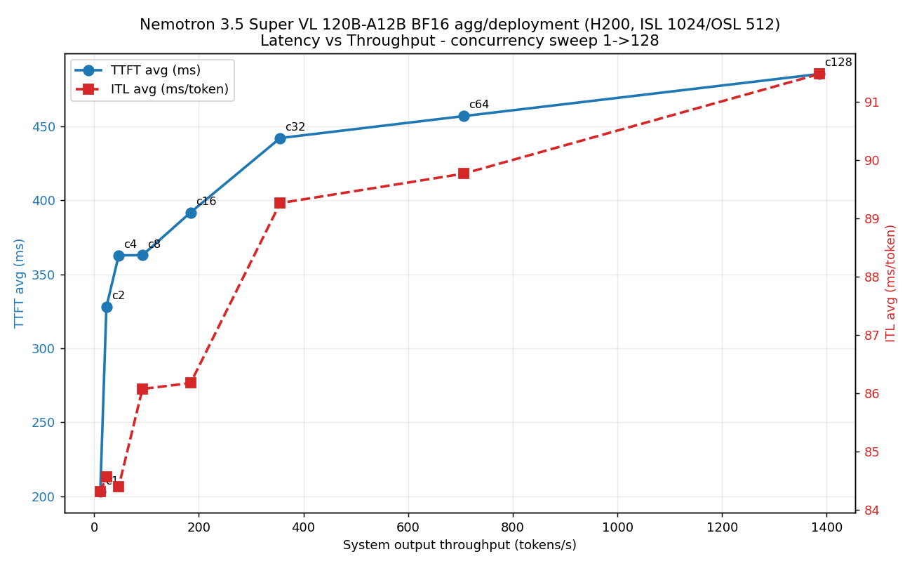
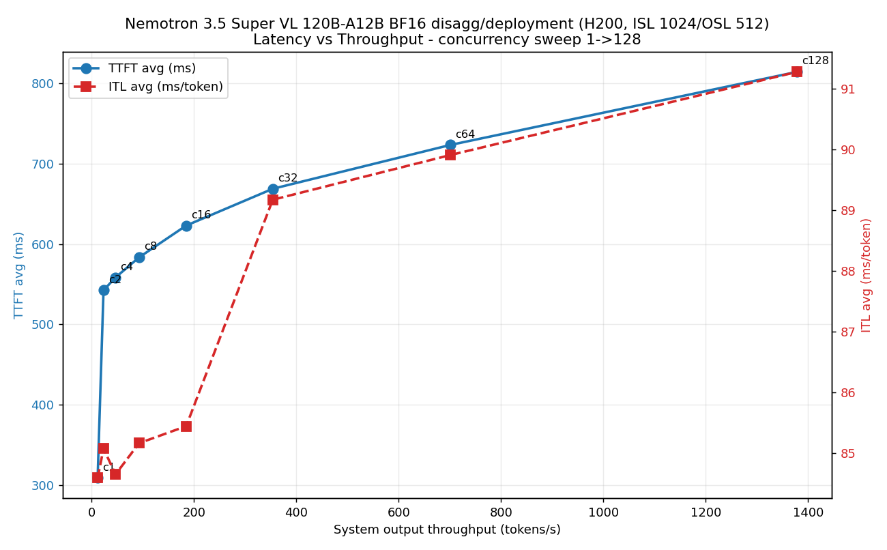
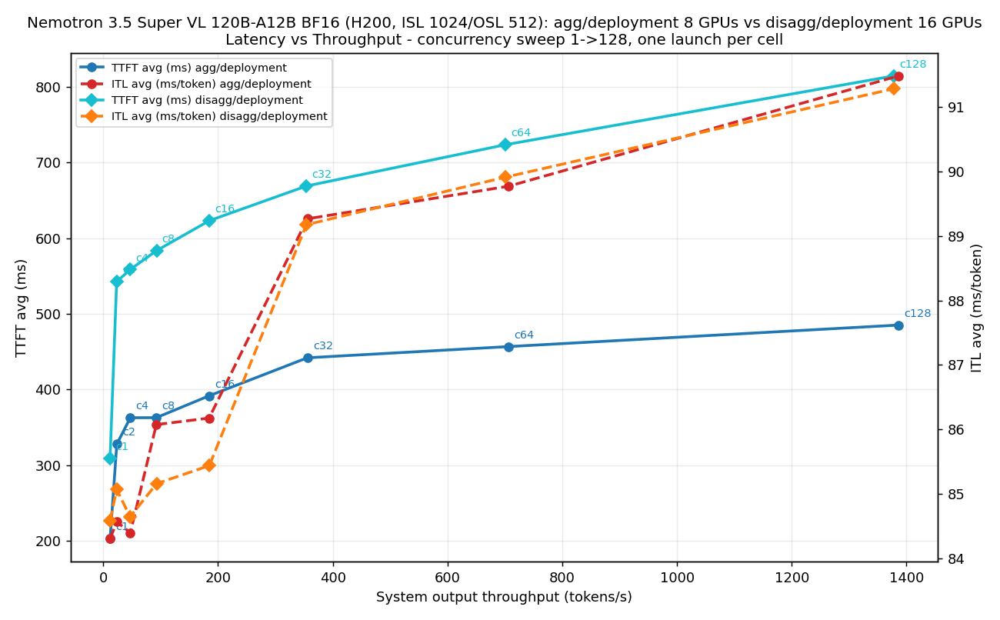
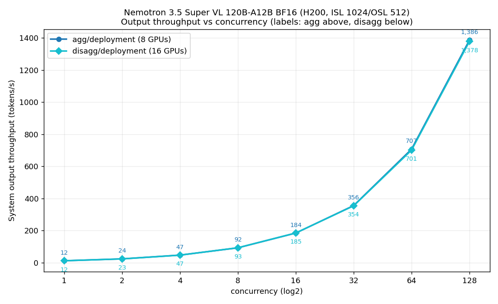

# Nemotron 3.5 Super VL 120B-A12B — AIPerf results

**Measured on H200 (p5en.48xlarge, Dynamo 1.4.0 platform, stock `vllm-runtime:1.5.0-efa` or the `dynamo-vllm-efa/Dockerfile.ray` golden image, shipped Hugging Face checkpoints): 26 of the 34 fixed-concurrency cells below (BF16: `agg/deployment`, `agg/lws`, `agg/lws-ep`, `agg/dgd`, `agg/dgd-v1beta1`, `agg/dgd-grove`, `agg/dgd-grove-ep`, `disagg/deployment`, `disagg/lws-ep`, `disagg/dgd`, `disagg/dgd-v1beta1`, `disagg/dgd-grove`, `disagg/dgd-grove-ep`; NVFP4: `agg/deployment`, `agg/lws`, `agg/lws-ep`, `agg/dgd`, `agg/dgd-v1beta1`, `agg/dgd-grove`, `agg/dgd-grove-ep`, `disagg/deployment`, `disagg/lws-ep`, `disagg/dgd`, `disagg/dgd-v1beta1`, `disagg/dgd-grove`, `disagg/dgd-grove-ep`), one launch each, footnotes 16-45. 8 cells are NOT SUPPORTED on this software stack with the exact upstream rejection recorded (BF16: `disagg/lws-2pp`, `disagg/lws-pp2`, `disagg/dgd-grove-pp2`, `disagg/epd`; NVFP4: `disagg/lws-2pp`, `disagg/lws-pp2`, `disagg/dgd-grove-pp2`, `disagg/epd`): `disagg/epd` because dynamo 1.5.0's encode worker only knows the LLaVA and Qwen-VL families (footnote 19), the PP>1 disaggregated shapes because vLLM's NIXL connector refuses pipeline_parallel_size > 1 with a hybrid-Mamba KV layout — still true upstream through v0.32.0 (footnotes 26, 42). No cell is PENDING. The four `deployment` rows measured on 2026-10-12/13 against the Early-Access GA-candidate checkpoint were re-measured on 2026-10-19 on the shipped checkpoint after the candidate was deprecated; their old footnotes (4, 5, 10, 11) stay, marked superseded. The two BF16 spec-decode cells remain NOT MEASURED (the engine rejects `--speculative-config` for this architecture; "Spec-decode cells" below), and the two concurrency sweeps below were measured on the deprecated candidate and not re-run.** **2026-10-20 update (Dynamo 1.5.1 platform, same cluster): 6 of the 8 NOT SUPPORTED cells are now MEASURED with opt-in `dynamo-vllm-efa/Dockerfile.ray` builds — `--build-arg NIXL_PP_PATCH=1` (vllm-project/vllm#53360 backport) for `disagg/lws-2pp`, `disagg/lws-pp2`; `--build-arg DYNAMO_EPD_NEMOTRON_PATCH=1` for `disagg/epd` — footnotes ¹⁰²–¹⁰⁶; the old footnotes (19, 26, 42) say which rows they still cover and which were superseded.** **2026-10-20, later the same day, with the platform's Grove and KAI feature gates switched on (`dynamo-platform` Helm revision 2, 04:47:45Z — the `eks/deployment/grove` flip): the two `disagg/dgd-grove-pp2` cells, NOT MEASURED ¹⁰⁷ while the operator had no multinode orchestrator, are MEASURED with the same `--build-arg NIXL_PP_PATCH=1` image and the unchanged manifest — footnotes BF16 ¹⁰⁸, NVFP4 ¹⁰⁹. All 34 fixed-concurrency cells are now MEASURED.**
A row leaves PENDING only when a run through `test-aiperf.sh` in its default LLM workload
(`AIPERF_WORKLOAD=llm`: the text profile identical to `../../ultra/test/test-aiperf.sh` —
ISL 1024 / OSL 512, `--concurrency 10`, `--request-count 100`, `--random-seed 42`, no image
flags — so a row here compares directly with the c=10 rows in `../../ultra/test/RESULTS.md`)
produces a `profile_export_aiperf.json` and a `run-meta.json` whose observed workloads match
the row's template and whose `workload` field reads `llm` — the same discipline as ultra's.
Vision rows are optional and separately labelled: a run with `AIPERF_WORKLOAD=vl` (the same
profile with synthetic 512×512 images added, `run-meta.json` `workload: vl`, artifacts under
a `vl-` run id) is recorded as its own row with a `(vl)` suffix in the template column, and
never moves an LLM row out of PENDING.

The GPU column stays empty until a measurement exists; fill it with what actually
served the run (e.g. H200 / B200), never with the intended target. Note for NVFP4 on
H200 (sm90): there is no native FP4 compute — vLLM serves the NVFP4 checkpoint through
its Marlin weight-only fallback (FP4-compressed weights, BF16 compute), so an H200
NVFP4 row measures a different kernel path than a B200 one.

## Fixed-concurrency grid (c=10)

| precision | template | GPU | GPUs | TTFT p50 (ms) | ITL p50 (ms) | tok/s/user p50 | tok/s total | status |
|---|---|---|---|---|---|---|---|---|
| BF16 | `agg/deployment` | NVIDIA H200 | 8 | 355.56 | 86.62 | 11.55 | 114.55 | MEASURED ³⁵ |
| BF16 | `agg/lws` | NVIDIA H200 | 16 | 212.50 | 46.54 | 21.49 | 213.04 | MEASURED ²⁰ |
| BF16 | `agg/lws-ep` | NVIDIA H200 | 16 | 461.75 | 103.08 | 9.70 | 96.23 | MEASURED ²⁵ |
| BF16 | `agg/dgd` | NVIDIA H200 | 8 | 307.77 | 86.77 | 11.52 | 114.46 | MEASURED ¹⁶ |
| BF16 | `agg/dgd-v1beta1` | NVIDIA H200 | 8 | 353.93 | 86.60 | 11.55 | 114.28 | MEASURED ¹⁸ |
| BF16 | `agg/dgd-grove` | NVIDIA H200 | 16 | 218.82 | 45.80 | 21.83 | 214.97 | MEASURED ²¹ |
| BF16 | `agg/dgd-grove-ep` | NVIDIA H200 | 16 | 464.77 | 103.14 | 9.70 | 96.28 | MEASURED ²⁸ |
| BF16 | `disagg/deployment` | NVIDIA H200 | 16 | 520.01 | 87.77 | 11.39 | 112.75 | MEASURED ³⁷ |
| BF16 | `disagg/lws-2pp` | NVIDIA H200 | 32 | 519.59 | 85.43 | 11.71 | 115.26 | MEASURED ¹⁰³ |
| BF16 | `disagg/lws-pp2` | NVIDIA H200 | 32 | 367.62 | 46.39 | 21.56 | 211.53 | MEASURED ¹⁰² |
| BF16 | `disagg/lws-ep` | NVIDIA H200 | 32 | 726.91 | 103.96 | 9.62 | 94.82 | MEASURED ³³ |
| BF16 | `disagg/dgd` | NVIDIA H200 | 16 | 519.41 | 87.13 | 11.48 | 113.54 | MEASURED ¹⁷ |
| BF16 | `disagg/dgd-v1beta1` | NVIDIA H200 | 16 | 516.39 | 86.25 | 11.59 | 114.59 | MEASURED ²² |
| BF16 | `disagg/dgd-grove` | NVIDIA H200 | 16 | 526.56 | 88.33 | 11.32 | 112.04 | MEASURED ²⁷ |
| BF16 | `disagg/dgd-grove-pp2` | NVIDIA H200 | 32 | 363.71 | 45.92 | 21.78 | 214.29 | MEASURED ¹⁰⁸ |
| BF16 | `disagg/dgd-grove-ep` | NVIDIA H200 | 32 | 757.44 | 104.21 | 9.60 | 94.40 | MEASURED ³⁶ |
| BF16 | `disagg/epd` | NVIDIA H200 | 8+enc | 352.61 | 86.54 | 11.56 | 114.68 | MEASURED ¹⁰¹ |
| NVFP4 | `agg/deployment` | NVIDIA H200 | 8 | 399.73 | 95.13 | 10.51 | 104.44 | MEASURED ³⁸ |
| NVFP4 | `agg/lws` | NVIDIA H200 | 16 | 290.24 | 52.34 | 19.11 | 189.18 | MEASURED ³¹ |
| NVFP4 | `agg/lws-ep` | NVIDIA H200 | 16 | 396.51 | 108.75 | 9.20 | 91.63 | MEASURED ⁴⁰ |
| NVFP4 | `agg/dgd` | NVIDIA H200 | 8 | 378.66 | 97.26 | 10.28 | 102.46 | MEASURED ²³ |
| NVFP4 | `agg/dgd-v1beta1` | NVIDIA H200 | 8 | 375.12 | 95.83 | 10.43 | 103.75 | MEASURED ²⁹ |
| NVFP4 | `agg/dgd-grove` | NVIDIA H200 | 16 | 269.08 | 51.31 | 19.49 | 192.77 | MEASURED ³² |
| NVFP4 | `agg/dgd-grove-ep` | NVIDIA H200 | 16 | 399.34 | 107.74 | 9.28 | 92.33 | MEASURED ⁴⁴ |
| NVFP4 | `disagg/deployment` | NVIDIA H200 | 16 | 643.80 | 102.14 | 9.81 | 94.89 | MEASURED ³⁹ |
| NVFP4 | `disagg/lws-2pp` | NVIDIA H200 | 32 | 580.24 | 96.57 | 10.36 | 102.29 | MEASURED ¹⁰⁶ |
| NVFP4 | `disagg/lws-pp2` | NVIDIA H200 | 32 | 427.09 | 54.08 | 18.49 | 182.17 | MEASURED ¹⁰⁴ |
| NVFP4 | `disagg/lws-ep` | NVIDIA H200 | 32 | 635.11 | 103.12 | 9.71 | 94.90 | MEASURED ⁴¹ |
| NVFP4 | `disagg/dgd` | NVIDIA H200 | 16 | 578.89 | 96.64 | 10.35 | 102.25 | MEASURED ³⁰ |
| NVFP4 | `disagg/dgd-v1beta1` | NVIDIA H200 | 16 | 590.33 | 97.48 | 10.26 | 101.19 | MEASURED ³⁴ |
| NVFP4 | `disagg/dgd-grove` | NVIDIA H200 | 16 | 579.41 | 96.67 | 10.34 | 102.28 | MEASURED ⁴⁵ |
| NVFP4 | `disagg/dgd-grove-pp2` | NVIDIA H200 | 32 | 362.03 | 51.46 | 19.43 | 191.13 | MEASURED ¹⁰⁹ |
| NVFP4 | `disagg/dgd-grove-ep` | NVIDIA H200 | 32 | 654.17 | 109.12 | 9.16 | 90.69 | MEASURED ⁴³ |
| NVFP4 | `disagg/epd` | NVIDIA H200 | 8+enc | 411.02 | 95.40 | 10.48 | 104.05 | MEASURED ¹⁰⁵ |

¹ `disagg/epd` carries a verified structural caveat before any run is attempted: at
dynamo v1.5.0 the encode worker's loader
(`components/src/dynamo/vllm/multimodal_utils/model.py`, `load_vision_model`) uses the
lightweight encoder-only path only for Qwen-VL families and full-loads every other VL
checkpoint via `AutoModel.from_pretrained` — the BF16 Super-VL checkpoint (~249 GB)
cannot fit the template's default 1-GPU encode worker. See the header of
`../disagg/epd.yaml-template`.

⁴ 2026-10-12, window 20261012T193453Z, one server launch on one p5en.48xlarge, TP8 agg worker, image `nvcr.io/nvidia/ai-dynamo/vllm-runtime:1.5.0-efa` (node-recorded digest `sha256:a1bc3d20ea2b…`), the same `--hf-overrides` alias and engine flags as ². Measured with this folder's `test-aiperf.sh` in its default LLM workload (ISL 1024 / OSL 512, `ignore_eos:true`, `--concurrency 10`, `--request-count 100`, `--random-seed 42`, no image flags) and `AIPERF_WARMUP_REQUESTS=0` (no `--warmup-request-count`), i.e. the `../../ultra/test/RESULTS.md` table methodology: a cold run right after the health gate (run id `cold`: TTFT p50 452.09, ITL p50 87.26, tok/s/user p50 11.46, tok/s total 113.09; `profile_export_aiperf.json` sha256 `cd88f74b7eafa756…`), then a warm run on the same launch (run id `warm`), and **the warm run is the row**; both runs completed 100/100 requests with no errors (aiperf 0.9.0). The weights are the Early-Access checkpoint `/shared/nemotron/super/bf16/nemotron_3_5_super_ga_candidate_mtp_boosted_20261001_vv0.1` (`MODEL_PATH` export, the .env's documented override) on a shared FSx this lane may only mount read-only, so the manifest ran with namespace, a private etcd/NATS in place of the platform services, a node pin, a read-only `fsx-pvc` mount, and a teardown label (the same five deployment-only changes as ²), and the aiperf client pod mounted `fsx-pvc` read-only with its artifact directory on an emptyDir (copied out before the pod was deleted) and was pinned to the worker's node; the `aiperf profile` command itself is byte-identical to this script's (only `--artifact-dir` differs). Row artifacts (sha256): `profile_export_aiperf.json` `da503c3049efcf95…`, `profile_export.jsonl` `8c2a9ad6a8dae258…`, `run-meta.json` `6350fbc3ce05abb6…` (`workload: llm`, `warmup_requests: 0`). n=1 launch: one server start, two client runs; reproducibility across launches, tail columns, throughput at saturation, MTP, NVFP4, dgd/epd manifests, B200 and long context are not established. An earlier launch of the same cell the same day (window 20261012T191525Z, on another node of the same node group) passed the health gate and had completed 40 of the cold run's 100 requests when that node received an owner-side instance reboot (19:28:47Z); the frontend logged `Engine was shut down during generation`, the remaining requests failed with 404/503, and the window tore the stack down. That launch is kept as provenance only and contributes nothing to the row. **Superseded:** this footnote's checkpoint (the Early-Access GA candidate under `/shared/nemotron/super`) was deprecated by the model owner on 2026-10-19 ("use the shipped HF path"); the row above now carries the 2026-10-19 measurement on the shipped checkpoint (³⁵). The superseded row read TTFT p50 348.46 ms, ITL p50 87.30 ms, 11.45 tok/s/user p50, 113.56 tok/s total.

⁵ 2026-10-12, window 20261012T210839Z, one server launch on two p5en.48xlarge, TP8 prefill on one and TP8 decode on the other (KV prefill→decode via vLLM `NixlConnector`, LIBFABRIC backend over EFA), image `nvcr.io/nvidia/ai-dynamo/vllm-runtime:1.5.0-efa` (node-recorded digest `sha256:a1bc3d20ea2b…`), the same `--hf-overrides` alias and engine flags as ³. Measured with this folder's `test-aiperf.sh` in its default LLM workload (ISL 1024 / OSL 512, `ignore_eos:true`, `--concurrency 10`, `--request-count 100`, `--random-seed 42`, no image flags) and `AIPERF_WARMUP_REQUESTS=0` (no `--warmup-request-count`), i.e. the `../../ultra/test/RESULTS.md` table methodology: a cold run right after the health gate (run id `cold`: TTFT p50 644.36, ITL p50 86.13, tok/s/user p50 11.61, tok/s total 113.37; `profile_export_aiperf.json` sha256 `184e7e64407cacbb…`), then a warm run on the same launch (run id `warm`), and **the warm run is the row**; both runs completed 100/100 requests with no errors (aiperf 0.9.0). The weights are the Early-Access checkpoint `/shared/nemotron/super/bf16/nemotron_3_5_super_ga_candidate_mtp_boosted_20261001_vv0.1` (`MODEL_PATH` export, the .env's documented override) on a shared FSx this lane may only mount read-only, so the manifest ran with namespace, a private etcd/NATS in place of the platform services, a node pin per worker, read-only `fsx-pvc` volumes and `/shared` mounts, a teardown label, and a header comment (the same six deployment-only changes as ³), and the aiperf client pod mounted `fsx-pvc` read-only with its artifact directory on an emptyDir (copied out before the pod was deleted) and was pinned to the decode worker's node; the `aiperf profile` command itself is byte-identical to this script's (only `--artifact-dir` differs). Row artifacts (sha256): `profile_export_aiperf.json` `dc2ec1333f6fa134…`, `profile_export.jsonl` `1b2c7e71f995d56a…`, `run-meta.json` `dd05f05c7a1f43c7…` (`workload: llm`, `warmup_requests: 0`). n=1 launch: one server start, two client runs; reproducibility across launches, an agg-vs-disagg verdict (the two n=1 rows only sit side by side), that every request took the remote-prefill path (KV transfer was verified in the health-gate window, not per request), tail columns, throughput at saturation, MTP, NVFP4, dgd/epd manifests, B200 and long context are not established. **Superseded:** this footnote's checkpoint (the Early-Access GA candidate under `/shared/nemotron/super`) was deprecated by the model owner on 2026-10-19 ("use the shipped HF path"); the row above now carries the 2026-10-19 measurement on the shipped checkpoint (³⁷). The superseded row read TTFT p50 509.73 ms, ITL p50 86.68 ms, 11.54 tok/s/user p50, 114.33 tok/s total.

## EKS Auto Mode p5e.48xlarge (us-west-2) — live results 2026-10-19/20

A second live campaign of the same grid, same method (one launch per cell through the folder's own `run.sh`, shipped chat + image
smokes, then `test-aiperf.sh` in the default LLM workload: `--concurrency 10`, `--request-count 100`, ISL 1024 / OSL 512,
`--random-seed 42`, aiperf 0.13.0, a cold run then a warm run on the same launch; the warm run is the row), on a different
cluster class: an **EKS Auto Mode** cluster (EKS 1.35) with four **p5e.48xlarge** (8x H200 141 GB, **32** EFA interfaces each)
Bottlerocket "EKS Auto, Nvidia" nodes on a capacity block, plus a utility node; Dynamo platform 1.4.0 operator, Grove + KAI,
LeaderWorkerSet v0.8.0, FSx for Lustre (`fsx-pvc`, 1.2 TiB). PP>1 shapes were run first, as asked. Every cell carries an EFA
proof (the four parts listed under "EFA proof" below); a multi-node row is MEASURED only with a non-zero EFA byte delta on the
cell's nodes during the aiperf runs, while a single-node (8-GPU) cell has no inter-node path and its footnote states what its
template requests and what the counters did. GPU counts are the `.env` defaults. Footnote numbering continues from the grid above.

| precision | template | GPU | GPUs | TTFT p50 (ms) | ITL p50 (ms) | tok/s/user p50 | tok/s total | status |
|---|---|---|---|---|---|---|---|---|
| BF16 | `agg/deployment` | NVIDIA H200 | 8 | 343.39 | 90.54 | 11.04 | 109.93 | MEASURED ⁵⁴ |
| BF16 | `agg/lws` | NVIDIA H200 | 16 | 207.35 | 48.48 | 20.63 | 203.01 | MEASURED ⁵¹ |
| BF16 | `agg/lws-ep` | NVIDIA H200 | 16 | 423.71 | 104.24 | 9.59 | 95.29 | MEASURED ⁶² |
| BF16 | `agg/dgd` | NVIDIA H200 | 8 | 350.90 | 90.33 | 11.07 | 109.84 | MEASURED ⁵⁵ |
| BF16 | `agg/dgd-v1beta1` | | 8 | | | | | PENDING |
| BF16 | `agg/dgd-grove` | NVIDIA H200 | 16 | 186.68 | 48.16 | 20.76 | 204.92 | MEASURED ⁵² |
| BF16 | `agg/dgd-grove-ep` | NVIDIA H200 | 16 | 452.64 | 105.68 | 9.46 | 93.93 | MEASURED ⁶⁴ |
| BF16 | `disagg/deployment` | NVIDIA H200 | 16 | 534.65 | 89.23 | 11.21 | 110.64 | MEASURED ⁵³ |
| BF16 | `disagg/lws-2pp` | NVIDIA H200 | 32 | 572.54 | 89.55 | 11.17 | 110.20 | MEASURED ⁵⁷ |
| BF16 | `disagg/lws-pp2` | NVIDIA H200 | 32 | 400.63 | 49.52 | 20.20 | 198.67 | MEASURED ⁵⁶ |
| BF16 | `disagg/lws-ep` | | 32 | | | | | PENDING |
| BF16 | `disagg/dgd` | NVIDIA H200 | 16 | 535.04 | 89.58 | 11.16 | 110.36 | MEASURED ⁶³ |
| BF16 | `disagg/dgd-v1beta1` | NVIDIA H200 | 16 | 537.82 | 90.14 | 11.09 | 109.58 | MEASURED ⁶⁵ |
| BF16 | `disagg/dgd-grove` | NVIDIA H200 | 16 | 544.95 | 90.31 | 11.07 | 108.97 | MEASURED ⁶⁶ |
| BF16 | `disagg/dgd-grove-pp2` | NVIDIA H200 | 32 | 381.84 | 48.44 | 20.64 | 202.64 | MEASURED ⁵⁸ |
| BF16 | `disagg/dgd-grove-ep` | | 32 | | | | | PENDING |
| BF16 | `disagg/epd` | | 8+enc | | | | | PENDING |
| NVFP4 | `agg/deployment` | | 8 | | | | | PENDING |
| NVFP4 | `agg/lws` | | 16 | | | | | PENDING |
| NVFP4 | `agg/lws-ep` | | 16 | | | | | PENDING |
| NVFP4 | `agg/dgd` | | 8 | | | | | PENDING |
| NVFP4 | `agg/dgd-v1beta1` | | 8 | | | | | PENDING |
| NVFP4 | `agg/dgd-grove` | | 16 | | | | | PENDING |
| NVFP4 | `agg/dgd-grove-ep` | | 16 | | | | | PENDING |
| NVFP4 | `disagg/deployment` | | 16 | | | | | PENDING |
| NVFP4 | `disagg/lws-2pp` | NVIDIA H200 | 32 | 593.49 | 98.74 | 10.13 | 99.67 | MEASURED ⁶⁰ |
| NVFP4 | `disagg/lws-pp2` | NVIDIA H200 | 32 | 455.20 | 55.62 | 17.98 | 176.31 | MEASURED ⁵⁹ |
| NVFP4 | `disagg/lws-ep` | | 32 | | | | | PENDING |
| NVFP4 | `disagg/dgd` | | 16 | | | | | PENDING |
| NVFP4 | `disagg/dgd-v1beta1` | | 16 | | | | | PENDING |
| NVFP4 | `disagg/dgd-grove` | | 16 | | | | | PENDING |
| NVFP4 | `disagg/dgd-grove-pp2` | NVIDIA H200 | 32 | 435.53 | 53.91 | 18.55 | 182.58 | MEASURED ⁶¹ |
| NVFP4 | `disagg/dgd-grove-ep` | | 32 | | | | | PENDING |
| NVFP4 | `disagg/epd` | | 8+enc | | | | | PENDING |

### p5e / EKS Auto Mode notes (what differed from the p5en cells above, and what was changed)

- **Launch overrides, no template edits:** `INSTANCE_TYPE_WORKER=p5e.48xlarge EFA_PER_WORKER=32` (p5e advertises 32
  `vpc.amazonaws.com/efa`; the `.env` default 16 is p5en's), `NAMESPACE=default` (where `fsx-pvc` lives), the golden image
  through `REGISTRY`/`IMAGE`/`TAG` (`RUNTIME_BOOTSTRAP=0`), `INSTANCE_TYPE_FRONTEND=m7i.xlarge` (see the Auto Mode note).
- **EKS Auto Mode specifics observed:** no EFA device-plugin DaemonSet is needed (Auto Mode exposes the resource; the
  kube-system plugin shows DESIRED=0); `/dev/gdrdrv` is provided by the `gdrcopy-installer` DaemonSet (the templates'
  `CharDevice` hostPath mounts are satisfied); GPU nodes carry the `nvidia.com/gpu:NoSchedule` taint, which every GPU
  container in the templates tolerates; a same-account private ECR pull needs no pull secret (node role).
- **Karpenter honours a *preferred* nodeAffinity as a provisioning hint:** the templates' `INSTANCE_TYPE_FRONTEND=m5.8xlarge`
  preference made the `general-purpose` NodePool launch a fresh m5.8xlarge for a dynamo frontend instead of falling back to
  an existing node. On Auto Mode set `INSTANCE_TYPE_FRONTEND` to an instance type that already exists in the cluster (or
  accept the extra node; it is consolidated away after the cell is deleted).
- **EFA hw_counters are hidden inside a pod's sysfs** on these Bottlerocket nodes (kernel 6.12.110, efa module 3.1.0g):
  `/sys/class/infiniband/<dev>/ports/1/` has no `hw_counters` directory in the container while the host has the full set.
  The byte proof below is read from the host sysfs through a per-node `hostPath: /sys` probe pod (what `efatop` does).
- **FSx throughput is the pacing item:** two cells loading the ~249 GB BF16 checkpoint at once halve each other's load rate
  (one engine Ready in ~26 min instead of ~14), and an HF download in flight slows both. Stagger launches on a 1.2 TiB volume.
- **Karpenter consolidation disrupts live pods on the utility nodes:** the `general-purpose` NodePool runs
  `consolidationPolicy: WhenEmptyOrUnderutilized` with `consolidateAfter: 30s`; at 21:12Z it drained an m7i.xlarge that carried a
  live frontend and two running aiperf client pods (`Evicted pod: Underutilized`), killing one warm run mid-flight (⁵⁴). Shipped
  fixes: `test/aiperf-pod-run.sh` annotates the do-aiperf pod `karpenter.sh/do-not-disrupt: "true"`, and every template with a
  frontend pod (all but `lws-ep`, which has none) now carries the same annotation on that pod (Deployment `template.metadata`,
  v1alpha1 DGD `extraPodMetadata`, v1beta1 DGD `podTemplate.metadata`; all 34 renders pass a server-side dry-run, and the 1.4.0 operator propagates the v1beta1 form
  to the rendered pod — verified on the `disagg/dgd-grove-pp2` cell's frontend). Worker pods
  need nothing: they fill a GPU node, and the GPU pools consolidate `Never`.
- **Single-node templates and EFA:** none of the three single-node agg templates (`agg/deployment`, `agg/dgd`, `agg/dgd-v1beta1`)
  requests `vpc.amazonaws.com/efa` (`agg/deployment` only tolerates the EFA taint; TP8 runs over NVLink), so their worker pods carry
  no EFA device and their nodes' counters do not move during a run. Their rows say so; the EFA proof is a multi-node matter.
- **The FSx for Lustre client also rides EFA on these nodes:** a node's `rdma_read_bytes` grows by tens of GB while a worker streams the
  checkpoint, before any request is served. The byte proof therefore reads the host counters only around the aiperf windows (after the
  engine is Ready) and pairs the delta with the NCCL / NIXL log lines, so weight loading is never counted as inference traffic.
- **Auto Mode node health events are worth reading alongside a failure:** one GPU node (`i-0eb475c73550e80c4`, the prefill node of every
  PP>1 cell) reported `Warning AcceleratedHardwareReady … NvidiaPCIeError: detected 141 PCIe replays` at 00:53Z; no cell on it failed, and
  the event is recorded here so a later failure on that node can be read against it.
- **Shipped-file fixes found by these runs** are listed in the footnotes of the rows that found them.

### EFA proof (per cell, under the cell's evidence)

1. `render.yaml`: `vpc.amazonaws.com/efa` requests on every GPU container (32 per p5e worker).
2. Worker logs: NCCL `Initialized NET plugin Libfabric` / `Using network Libfabric`, `GPU Direct RDMA Enabled` per HCA,
   the OFI tuner's `platform: p5e.48xlarge`, and no `NET/Socket` line (the templates already set `NCCL_DEBUG=INFO`,
   `NCCL_DEBUG_SUBSYS=INIT,NET`).
3. Disagg only: NIXL `Backend LIBFABRIC was instantiated` in the worker logs and `fi_info -p efa` from inside a worker
   (provider `efa`, 32 devices).
4. Host `hw_counters` (`rdma_read_bytes`, `rdma_write_bytes`, `tx_bytes`, `rx_bytes`, summed over the node's 32 devices) read
   before the cold run, after the cold run and after the warm run on every node of the cell; the per-cell table is cited in
   the row's footnote.

⁵¹ 2026-10-19, launch 19:33:10Z, `INSTANCE_TYPE_WORKER=p5e.48xlarge EFA_PER_WORKER=32 NAMESPACE=default INSTANCE_TYPE_FRONTEND=m7i.xlarge MANIFEST_TYPE=lws DEPLOYMENT_NAME=nsv-agg-lws-bf16 ./run.sh` (BF16, `.env` default `MODEL_PATH` = the shipped HF checkpoint, Hub-verified 88/88 files) on the EKS Auto Mode p5e cluster, image = the golden image built from `../dynamo-vllm-efa/Dockerfile.ray` (stock `vllm-runtime:1.5.0-efa` + ray 2.55.1 + the `NemotronH_Nano_VL_V2` SupportsPP patch; node-recorded digest `sha256:bb36e7449c2f…`, the same digest as ²⁰) pulled from a same-account private ECR mirror in us-west-2 through `REGISTRY`/`IMAGE`/`TAG` overrides (`RUNTIME_BOOTSTRAP` 0; Auto Mode nodes pulled it with no pull secret): one engine TP8 x PP2 across two p5e.48xlarge (leader `i-020e0d9e5aca15a85`, worker `i-0eb475c73550e80c4`; `[leader] ray nodes seen: 2`, `[leader] GLOO_SOCKET_IFNAME=eth0`), frontend a plain Deployment on an m7i.xlarge, etcd/NATS = the cluster's Dynamo platform (`DYN_NAMESPACE=dynamo`). Engine Ready and model listed 19:58:05Z (25 min after apply; a second cell was streaming the same 249 GB checkpoint from the same 1.2 TiB FSx for most of that time); 0 restarts on all three pods; shipped chat and image smokes returned 200 with text. Aiperf 0.13.0 c=10 ISL1024/OSL512, warmup 0: cold run 100/100 TTFT p50 271.52 ms, ITL p50 47.73 ms, 20.95 tok/s/user p50, 202.37 tok/s total; warm run 100/100 (the row) export sha256 `cc0bd32265735767`, run-meta `label_check: consistent` (`DYN_NAMESPACE=dynamo`). EFA proof: render requests `vpc.amazonaws.com/efa: "32"` on both GPU containers; NCCL on every rank `Initialized NET plugin Libfabric` / `Using network Libfabric`, `NET/OFI Tuner init: comm with 16 ranks and 2 nodes`, `NET/OFI Region base Tuner is chosen for platform: p5e.48xlarge`, `GPU Direct RDMA Enabled` on all 8 HCAs per rank, no `NET/Socket` line; `fi_info -p efa` inside the leader: provider `efa`, 32 devices; host hw_counters across the two aiperf runs (per-node sum over 32 rdmap devices): leader node `rdma_write_bytes` +4,221,006,336 / `tx_bytes` +4,222,516,904, worker node `rx_bytes` +4,222,516,904 (the PP activation traffic between the two nodes; ~25 MB per request cold, ~17 MB warm), both non-zero. A bring-up launch of the same cell at 18:51:49Z on the pre-GA GA-candidate checkpoint (deprecated for rows) served the same shape (warm TTFT p50 236.72 ms, ITL p50 49.07 ms, 20.38 tok/s/user, 200.09 tok/s total) and is not a row.

⁵² 2026-10-19, launch 19:37:55Z, `INSTANCE_TYPE_WORKER=p5e.48xlarge EFA_PER_WORKER=32 NAMESPACE=default INSTANCE_TYPE_FRONTEND=m7i.xlarge MANIFEST_TYPE=dgd-grove DEPLOYMENT_NAME=nsv-agg-dgdgrove-bf16 ./run.sh` (BF16, shipped HF checkpoint) on the same cluster and image as ⁵¹ (digest `sha256:bb36e7449c2f…`): the v1beta1 DGD with `multinode.nodeCount=2` rendered by the Dynamo 1.4.0 operator as a Grove PodCliqueSet (`nsv-agg-dgdgrove-bf16-0`, leader `i-06d3df5f5548ae33d`, worker `i-08e2eb641ce5bc930`), one engine TP8 x PP2 bootstrapped by the operator (all 16 ranks `Worker_PP0_TP0-7` / `Worker_PP1_TP0-7` in the two pods' logs), gang-scheduled by kai-scheduler (PodGang Pending -> both GPU pods placed within a minute of apply); `DYN_NAMESPACE=default-nsv-agg-dgdgrove-bf16` (the operator's namespaced value; run-meta `label_check` reads it as not discriminating, the `workloads` field identifies the run). Frontend: the operator's frontend Deployment on an m7i.xlarge (Karpenter launched a fresh one for it, see the Auto Mode notes). Engine Ready 20:05:57Z (28 min after apply, the whole load overlapping another cell's load on the same FSx); 0 restarts; shipped chat and image smokes returned 200 with text. Aiperf 0.13.0 c=10 ISL1024/OSL512, warmup 0: cold 100/100 TTFT p50 271.62 ms, ITL p50 48.56 ms, 20.59 tok/s/user p50, 198.10 tok/s total; warm 100/100 (the row) export sha256 `147a9d3cdce2b923`. EFA proof: render requests `vpc.amazonaws.com/efa: "32"` on both GPU containers; NCCL `Initialized NET plugin Libfabric` on all 8 ranks of each pod (16 lines in the leader log, 16 in the worker log, 0 `NET/Socket` lines), `NET/OFI Tuner init: comm with 16 ranks and 2 nodes`, tuner platform `p5e.48xlarge`, `GPU Direct RDMA Enabled` per HCA; `fi_info -p efa` in the leader: provider `efa`, 32 devices; host hw_counters across the two aiperf runs: leader node `rdma_write_bytes` +4,221,484,544 / `tx_bytes` +4,222,520,568, worker node `rx_bytes` +4,222,520,568 (within 0.1% of the Ray-bootstrapped ⁵¹ cell: the same PP activation traffic). A bring-up launch of this cell at 18:56:02Z on the pre-GA GA-candidate checkpoint served the same shape (warm TTFT p50 204.12 ms, ITL p50 47.75 ms, 20.94 tok/s/user, 206.07 tok/s total) and is not a row.

⁵³ 2026-10-19, launch 20:13:56Z, `INSTANCE_TYPE_WORKER=p5e.48xlarge EFA_PER_WORKER=32 NAMESPACE=default INSTANCE_TYPE_FRONTEND=m7i.xlarge MANIFEST_TYPE=deployment DEPLOYMENT_NAME=nsv-disagg-deployment-bf16 ./run.sh` in `../disagg` (BF16, shipped HF checkpoint at the `.env` default `MODEL_PATH`) on the same cluster as ⁵¹, image = the golden image of ⁵¹ (digest `sha256:bb36e7449c2f…`; PP1 on both sides, so none of its additions are exercised): plain Deployments, TP8 prefill on `i-020e0d9e5aca15a85`, TP8 decode on `i-0eb475c73550e80c4`, frontend on an m7i.xlarge (`i-061dc45d0eda3f711`), the cluster's Dynamo platform etcd/NATS with `DYN_NAMESPACE=dynamo-disagg` (run-meta `label_check: consistent`), KV prefill→decode through `NixlConnector` (`kv_role=kv_both`, pull path) on the LIBFABRIC backend (`Backend LIBFABRIC was instantiated` on all 8 ranks of each worker); 0 restarts. Model listed 20:42:52Z (29 min after apply, overlapping two other cells' loads from the same FSx). Shipped chat and image smokes returned 200 with text. Aiperf 0.13.0 c=10 ISL1024/OSL512, warmup 0: cold run 100/100 TTFT p50 710.53 ms, ITL p50 89.32 ms, 11.20 tok/s/user p50, 109.41 tok/s total; warm run 100/100 (the row) export sha256 `41aa2a9a51948ec6`. The cold leg's client was launched by a driver process that was killed at 20:47Z while the run was in flight; the aiperf processes inside the client pod ran on unattended to a complete 100/100 export (20:52:07Z, harness `run-meta.json` written), so only the after-cold counter read is late (21:01Z). EFA proof: render requests `vpc.amazonaws.com/efa: "32"` on both GPU containers; decode `KV Transfer metrics` lines every 50 s during the runs (`Num successful transfers=80` per window, `Avg MB per transfer=14.418` cold / `12.355` warm, `Avg xfer time (ms)` ≈ 86); host hw_counters over the two runs: decode node `rdma_read_bytes` +22,562,832,384 (12,198,313,984 over the cold run + 10,364,518,400 over the warm run — the decode's RDMA reads of the prefill's KV, ≈122 MB and ≈104 MB per request), prefill node `tx_bytes` +22,562,832,384, `rdma_write_bytes` 0 on both nodes (pull path). TP8 is intra-node on both workers, so no NCCL inter-node traffic is expected and none is claimed; `fi_info -p efa` inside the prefill worker: provider `efa` (its distinct-device count line in this capture is broken; the node advertises 32 devices).

⁵⁵ 2026-10-19, launch 20:20:00Z, `INSTANCE_TYPE_WORKER=p5e.48xlarge EFA_PER_WORKER=32 NAMESPACE=default INSTANCE_TYPE_FRONTEND=m7i.xlarge MANIFEST_TYPE=dgd DEPLOYMENT_NAME=nsv-agg-dgd-bf16 ./run.sh` (BF16, shipped HF checkpoint) on the same cluster and image as ⁵¹ (digest `sha256:bb36e7449c2f…`; single-node TP8, none of the image's additions are exercised): the v1alpha1 DGD (applied with the API's deprecation warning, as ¹⁶) rendered by the Dynamo 1.4.0 operator as a Grove PodCliqueSet, TP8 worker `nsv-agg-dgd-bf16-0-vllmworker-24wk7` on `i-08e2eb641ce5bc930`, frontend on an m7i.xlarge, `DYN_NAMESPACE=default-nsv-agg-dgd-bf16` (the operator's namespaced value; run-meta `label_check` not discriminating, the `dynamographdeployments` field identifies the run); 0 restarts on the worker. Model listed 20:54:29Z (34 min after apply; three other cells were loading from the same FSx). Shipped chat and image smokes returned 200 with text. Aiperf 0.13.0 c=10 ISL1024/OSL512, warmup 0: cold run 100/100 TTFT p50 437.16 ms, ITL p50 90.58 ms, 11.04 tok/s/user p50, 109.14 tok/s total; warm run 100/100 (the row) export sha256 `0812099a3e2b07d2`. EFA: this template (like `dgd-v1beta1`) requests **no** `vpc.amazonaws.com/efa` — the operator-rendered single-node shapes run TP8 over NVLink — so the worker pod has no EFA device (`fi_info -p efa` inside it: `fi_getinfo: -61 (No data available)`) and the node's host hw_counters did not move during the two runs (Δ 0 on all four counters). A single-node cell exercises no inter-node path; the EFA proof applies to the multi-node cells. Auto Mode observation from this cell: at 21:12Z Karpenter judged the m7i.xlarge carrying the cell's frontend and two aiperf client pods Underutilized (`general-purpose` NodePool: `consolidationPolicy: WhenEmptyOrUnderutilized`, `consolidateAfter: 30s`) and drained it; the frontend was rescheduled (`…-frontend-knwht`) after this cell's warm run had completed, so the row is unaffected, but the same drain killed the ⁵⁴ cell's warm client mid-run (see ⁵⁴ and the Auto Mode notes).

⁵⁴ 2026-10-19, launch 20:19:51Z, `INSTANCE_TYPE_WORKER=p5e.48xlarge EFA_PER_WORKER=32 NAMESPACE=default INSTANCE_TYPE_FRONTEND=m7i.xlarge MANIFEST_TYPE=deployment DEPLOYMENT_NAME=nsv-agg-deployment-bf16 ./run.sh` (BF16, shipped HF checkpoint) on the same cluster and image as ⁵¹ (digest `sha256:bb36e7449c2f…`; single-node TP8, none of the image's additions are exercised): plain Deployments, TP8 worker `nsv-agg-deployment-bf16-worker-77bf5d55d-b2kjl` on `i-06d3df5f5548ae33d`, frontend on `i-08e2eb641ce5bc930` (a p5e node: the m7i.xlarge *preference* could not be satisfied at the time and the preferred affinity fell back), the cluster's Dynamo platform etcd/NATS with `DYN_NAMESPACE=dynamo-agg` (run-meta `label_check: consistent`); 0 restarts. Model listed 20:54:30Z (34 min after apply; three other cells were loading from the same FSx). Shipped chat and image smokes returned 200 with text. Aiperf 0.13.0 c=10 ISL1024/OSL512, warmup 0: cold run 100/100 TTFT p50 443.07 ms, ITL p50 90.29 ms, 11.07 tok/s/user p50, 109.41 tok/s total; warm run 100/100 (the row) export sha256 `8bf15d1fb7632cdd`. The first warm leg (21:04:40Z) was killed at ~21:12:30Z when Karpenter drained the m7i.xlarge carrying its aiperf client pod (`Evicted pod: Underutilized`, aiperf exit 137, no export; see the Auto Mode notes); the warm leg was re-run alone at 21:17:50Z on the same engine, and that complete run is the row. EFA: this template requests **no** `vpc.amazonaws.com/efa` (it only tolerates the EFA taint; its header says a single node needs none), so the worker pod has no EFA device (`fi_info -p efa` inside it: no provider) and the node's host hw_counters did not move during the two runs (Δ 0 on all four counters) — a single-node cell exercises no inter-node path. Within 3% of the CGK row ³⁵ on every column (355.56 / 86.62 / 11.55 / 114.55 there).

⁵⁶ 2026-10-19, launch 21:27:49Z, `INSTANCE_TYPE_WORKER=p5e.48xlarge EFA_PER_WORKER=32 NAMESPACE=default INSTANCE_TYPE_FRONTEND=m7i.xlarge MANIFEST_TYPE=lws-pp2 DEPLOYMENT_NAME=nsv-disagg-lwspp2-bf16 ./run.sh` in `../disagg` (BF16, shipped HF checkpoint) on the same cluster as ⁵¹ with `REGISTRY`/`IMAGE`/`TAG` pointing BOTH roles at the **PP>1 image**: `../dynamo-vllm-efa/Dockerfile.ray` with `--build-arg NIXL_PP_PATCH=1` (step 3b: `patches/0002-nixl-pull-path-pipeline-parallel-0.28.0.vllm.diff`, sha256 `1f10f560…`, the backport of the open upstream PR vllm-project/vllm#53360 onto vLLM 0.28.0 — see the Dockerfile header; the cell ran the lane build of that exact step, node-recorded digest `sha256:947ff0caa1b0…`; the build from the committed Dockerfile is `sha256:43561d30cf85…`). **This is the shape that stock vLLM 0.28.0 rejects at worker init** (⁴² on the p5en grid: `NotImplementedError … pipeline_parallel_size > 1 with hybrid KV cache layouts (HMA)`); with the patch the gate is gone. Topology: prefill LWS TP8 x PP2 via Ray on `i-020e0d9e5aca15a85` (leader) + `i-0eb475c73550e80c4`, decode LWS TP8 x PP2 via Ray on `i-06d3df5f5548ae33d` (leader) + `i-08e2eb641ce5bc930`, frontend on an m7i.xlarge, `DYN_NAMESPACE=dynamo-disagg` (run-meta `label_check: consistent`), KV prefill→decode through `NixlConnector` (pull path, `kv_role=kv_both`) on LIBFABRIC; 0 restarts on all five pods. Each role logs the per-stage registration the patch adds — `Registering KV_Caches. pp_rank=1/2, layers=[44, 88), num_regions=4` from the stage-1 worker through the leader (the stage-0 line had rotated out of the collected logs; the serving-time capture is `evidence/…/pp/`). Model listed 21:59:57Z (32 min after apply; 1686 s weight load with four nodes streaming the 249 GB checkpoint from one FSx); shipped chat and image smokes returned 200 with text. **Output parity:** one greedy request (temperature 0, seed 42, 96 tokens, fixed prompt) returned content byte-identical to the same request against the PP1 `disagg/deployment` cell ⁵³ (339 chars, same `finish_reason`) — the fluent-but-wrong KV-routing failure mode (vllm-project/vllm#46407) did not occur for that prompt. Aiperf 0.13.0 c=10 ISL1024/OSL512, warmup 0: cold run 100/100 TTFT p50 488.74 ms, ITL p50 49.73 ms, 20.11 tok/s/user p50, 192.54 tok/s total (265.9 s); warm run 100/100 (the row) export sha256 `a4b8f5a5be96e0cb` (257.7 s) — PP2 decode latency (ITL ≈ 49.5 ms, as the agg PP2 cells ⁵¹ ⁵²) with disaggregation's TTFT. EFA proof: render requests `vpc.amazonaws.com/efa: "32"` on all four GPU containers; NIXL `Backend LIBFABRIC was instantiated` on the ranks of both roles; decode `KV Transfer metrics` during the runs: `Num successful transfers=160` per 30-s window (twice the PP1 cell's 80) at `Avg MB per transfer` 6.178 / 7.209 (the PP1 cell: 12.355 — each decode stage reads only its own 44-layer slice); host hw_counters over the two runs: decode stage-0 node `rdma_read_bytes` +11,281,416,192 and decode stage-1 node +11,287,844,864 (together 22,569,261,056 — within 0.03% of the PP1 cell's 22,562,832,384 for the same 200 requests: the same KV, now pulled per stage from the matching prefill stage), prefill stage-0 node `tx_bytes` +13,778,893,312 and stage-1 node +11,230,556,160; `rdma_write_bytes` +2,539,582,976 on the prefill leader node and +1,678,263,296 on the decode leader node = the PP activation traffic between the two stages of each role (the agg PP2 cells move the same ≈4.2 GB over two runs). `fi_info -p efa` inside the prefill leader: provider `efa` (32 devices per node, 64 domain entries across the `efa` and `efa-direct` fabrics). Not established: whether the `skipping producer shard` INFO line of the upstream PR is emitted at this log level (not seen); longer prompts, other seeds, NVFP4 (row below), reproducibility across launches (n=1).

⁵⁷ 2026-10-19, launch 22:13:14Z, `INSTANCE_TYPE_WORKER=p5e.48xlarge EFA_PER_WORKER=32 NAMESPACE=default INSTANCE_TYPE_FRONTEND=m7i.xlarge MANIFEST_TYPE=lws-2pp DEPLOYMENT_NAME=nsv-disagg-lws2pp-bf16 ./run.sh` in `../disagg` (BF16, shipped HF checkpoint) on the same cluster and PP>1 image as ⁵⁶ (both roles; node-recorded digest `sha256:947ff0caa1b0…`). **The asymmetric PP>1 shape** — prefill LWS TP8 x PP2 via Ray on `i-020e0d9e5aca15a85` (leader) + `i-0eb475c73550e80c4`, two single-node TP8 x PP1 decodes (native multiprocessing, no Ray) on `i-06d3df5f5548ae33d` and `i-08e2eb641ce5bc930`, frontend on an m7i.xlarge, `DYN_NAMESPACE=dynamo-disagg` (run-meta `label_check: consistent`), KV through `NixlConnector` (pull path) on LIBFABRIC; 0 restarts on all five pods. This is the shape ²⁶ on the p5en grid rejected at worker init on stock vLLM 0.28.0; with the patch the prefill registers `pp_rank=0/2, layers=[0, 44)` and `pp_rank=1/2, layers=[44, 88)`, and each PP1 decode rank handshakes with **both** producer stages (`NIXL compatibility check passed` 16 times per decode = 8 ranks x 2 stages, 16 `Transfer plan` lines) — the per-member descriptor-slot path the backport adds for a pooling mismatch was not needed (no `pools members into different local regions` line: 0.28.0's per-stage pooling matched the PP1 consumer's). Model listed 22:45:36Z (32 min after apply; 4-node weight stream from one FSx). **Output parity:** the greedy control request (temperature 0, seed 42, 96 tokens) returned content byte-identical to the PP1 `disagg/deployment` cell ⁵³ (339 chars). Shipped chat and image smokes returned 200 with text. Aiperf 0.13.0 c=10 ISL1024/OSL512, warmup 0: cold run 100/100 TTFT p50 631.50 ms, ITL p50 89.57 ms, 11.16 tok/s/user p50, 109.19 tok/s total (468.8 s); warm run 100/100 (the row) export sha256 `b23572a577547d5c` (464.6 s) — PP1 decode latency (ITL ≈ 89.5 ms, as ⁵³ ⁵⁴ ⁵⁵) with the PP2 prefill's TTFT. EFA proof: render requests `vpc.amazonaws.com/efa: "32"` on all four GPU containers; NIXL `Backend LIBFABRIC was instantiated` on all 8 ranks of each decode (and the prefill ranks; its log had rotated by collection); decode `KV Transfer metrics` during the runs: `Num successful transfers=80` per 30-s window per decode at `Avg MB per transfer` 6.178 / 7.209 (each transfer is one producer stage's slice: 16 transfers per request = 98.8 MB, the same KV per request as the PP1 cell's 8 x 12.355 MB); host hw_counters over the two runs: decode nodes `rdma_read_bytes` +11,385,307,136 each (the router split the 200 requests evenly; together 22,770,614,272, within 1% of the PP1 cell's 22,562,832,384 and the PP2->PP2 cell's 22,569,261,056), prefill stage-0 node `tx_bytes` +13,924,911,616 and stage-1 node +11,386,428,416 (each decode reads from both), `rdma_write_bytes` +2,539,604,480 on the prefill leader node only (its PP activation traffic to stage 1; the PP1 decodes write nothing). `fi_info -p efa` inside the prefill leader: provider `efa` (32 devices per node, 64 domain entries across the `efa`/`efa-direct` fabrics). n=1 launch.

⁵⁸ 2026-10-19, launch 23:05:04Z, `INSTANCE_TYPE_WORKER=p5e.48xlarge EFA_PER_WORKER=32 NAMESPACE=default INSTANCE_TYPE_FRONTEND=m7i.xlarge MANIFEST_TYPE=dgd-grove-pp2 DEPLOYMENT_NAME=nsv-disagg-dgdgrovepp2-bf16 ./run.sh` in `../disagg` (BF16, shipped HF checkpoint) on the same cluster as ⁵¹, both roles on the PP>1 image **built from the committed `../dynamo-vllm-efa/Dockerfile.ray` with `--build-arg NIXL_PP_PATCH=1`** (node-recorded digest `sha256:43561d30cf85…`; the Dockerfile's step 3b applied `patches/0002-nixl-pull-path-pipeline-parallel-0.28.0.vllm.diff` and its verifier passed at build). The v1beta1 DGD with `multinode.nodeCount=2` on both worker components rendered by the Dynamo 1.4.0 operator as one Grove PodCliqueSet / PodGang (frontend + prefill leader/worker + decode leader/worker), gang-scheduled by kai-scheduler (all four GPU pods placed within a minute of apply), each role TP8 x PP2 under the operator's **multiprocessing bootstrap** (`--distributed-executor-backend mp --nnodes 2`, no Ray): prefill on `i-08e2eb641ce5bc930` (stage 0) + `i-0eb475c73550e80c4` (stage 1), decode on `i-020e0d9e5aca15a85` (stage 0) + `i-06d3df5f5548ae33d` (stage 1), frontend on an m7i.xlarge (its pod carries the template's `karpenter.sh/do-not-disrupt` annotation — the operator propagated `podTemplate.metadata.annotations`), `DYN_NAMESPACE=default-nsv-disagg-dgdgrovepp2-bf16` (run-meta `label_check` not discriminating; the `dynamographdeployments` field identifies the run); 0 restarts on all five pods. This is the shape ⁴² on the p5en grid rejected at worker init on stock vLLM 0.28.0 under this same bootstrap. Because each PP stage runs in its own pod here, the per-stage logs are complete: every pod logs `Registering KV_Caches. pp_rank=0/2, layers=[0, 44)` or `pp_rank=1/2, layers=[44, 88), num_regions=4` on its 8 ranks and `Backend LIBFABRIC was instantiated` x8; each decode pod logs `NIXL compatibility check passed` 16 times (8 ranks x 2 producer stages) and the backport's designed mirror-image skip `NIXL handshake: skipping producer shard … registers no layer of this consumer stage's slice` 8 times (one per rank for the non-matching stage), 8 `Transfer plan` lines, and no forbidden line. Model listed 23:38:40Z (34 min after apply; 4-node weight stream from one FSx). **Output parity:** two greedy control requests (temperature 0, seed 42, 96 tokens): the first, sent while the shipped smokes were in flight, differed from the PP1 `disagg/deployment` cell ⁵³ in one word at the tail (char 333 of 339, `can`/`should`); the second, with no other traffic, was byte-identical — batch-composition nondeterminism in BF16, not a routing error; a factual prompt (17×23, 144/12, the capital of France) answered 391 / 12 / Paris with coherent reasoning. Shipped chat and image smokes returned 200 with text. Aiperf 0.13.0 c=10 ISL1024/OSL512, warmup 0: cold run 100/100 TTFT p50 537.38 ms, ITL p50 48.56 ms, 20.59 tok/s/user p50, 196.57 tok/s total (260.4 s); warm run 100/100 (the row) export sha256 `c4e6d5ad086613cf` (252.6 s) — within 5% of the Ray-bootstrapped ⁵⁶ on every column. EFA proof: render requests `vpc.amazonaws.com/efa: "32"` on all four GPU pods; decode-leader `KV Transfer metrics` `Num successful transfers=160` per 30-s window at 6.178 / 7.209 MB per transfer; host hw_counters over the two runs: decode stage-0 node `rdma_read_bytes` +11,333,238,784, decode stage-1 node +11,337,464,832 (together 22,670,703,616, within 0.5% of the PP1 cell's 22,562,832,384 and of ⁵⁶), prefill stage-0 node `tx_bytes` +13,874,238,976 and stage-1 node +11,334,157,056, PP activation traffic `rdma_write_bytes` +2,541,000,192 (prefill leader node) and +1,685,965,184 (decode leader node). `fi_info -p efa` inside the prefill leader: provider `efa` (32 devices per node, 64 domain entries across the `efa`/`efa-direct` fabrics). With ⁵⁶ and ⁵⁷ this completes the three BF16 disagg PP>1 shapes on the backport; n=1 launch each.

⁵⁹ 2026-10-19, launch 23:52:27Z, `INSTANCE_TYPE_WORKER=p5e.48xlarge EFA_PER_WORKER=32 NAMESPACE=default INSTANCE_TYPE_FRONTEND=m7i.xlarge MANIFEST_TYPE=lws-pp2 MODEL_VARIANT=NVFP4 DEPLOYMENT_NAME=nsv-disagg-lwspp2-nvfp4 ./run.sh` in `../disagg` (the shipped NVFP4 HF checkpoint, Hub-verified 114/114 files; on H200 vLLM serves it through the Marlin weight-only FP4 path, as the p5en NVFP4 rows) on the same cluster as ⁵¹, both roles on the PP>1 image built from the committed `Dockerfile.ray` with `--build-arg NIXL_PP_PATCH=1` (node-recorded digest `sha256:43561d30cf85…`, as ⁵⁸). Same topology as ⁵⁶ (prefill TP8 x PP2 via Ray on `i-020e0d9e5aca15a85` + `i-06d3df5f5548ae33d`, decode TP8 x PP2 via Ray on `i-0eb475c73550e80c4` + `i-08e2eb641ce5bc930`, frontend on an m7i.xlarge, `DYN_NAMESPACE=dynamo-disagg`); 0 restarts on all five pods; both stages registered (`pp_rank=1/2, layers=[44, 88), num_regions=4` through each leader). Model listed 00:04:20Z (12 min after apply — the NVFP4 checkpoint streams in a third of the BF16 time). A greedy factual prompt (temperature 0, seed 42: 17×23, 144/12, the capital of France) answered 391 / 12 / Paris with coherent reasoning; the cell's greedy control output is kept as the NVFP4 reference for the NVFP4 cells that follow (no NVFP4 PP1 cell had run yet). Shipped chat and image smokes returned 200 with text. Aiperf 0.13.0 c=10 ISL1024/OSL512, warmup 0: cold run 100/100 TTFT p50 479.59 ms, ITL p50 55.56 ms, 18.00 tok/s/user p50, 176.35 tok/s total (290.3 s); warm run 100/100 (the row) export sha256 `5677ce8607f7ffcb` — the Marlin FP4 decode step is ≈12% slower than the BF16 PP2 cells' (ITL 55.6 vs 49.5 ms), as on the p5en grid. EFA proof: render requests `vpc.amazonaws.com/efa: "32"` on all four GPU containers; NIXL `Backend LIBFABRIC was instantiated` on the ranks of both roles; decode `KV Transfer metrics` `Num successful transfers=160` per 30-s window at 6.178 MB per transfer; host hw_counters over the two runs: decode stage-0 node `rdma_read_bytes` +10,416,340,992, decode stage-1 node +10,425,431,040 (20,841,772,032 together — 8% below the BF16 cells' ≈22.6 GB for the same requests), prefill stage-0 node `tx_bytes` +13,769,169,408 and stage-1 node +10,365,610,240, PP activation traffic `rdma_write_bytes` +3,404,651,008 (prefill leader node) and +1,677,618,176 (decode leader node). `fi_info -p efa` inside the prefill leader: provider `efa` (32 devices per node). n=1 launch.

⁶⁰ 2026-10-20, launch 00:18:25Z, `INSTANCE_TYPE_WORKER=p5e.48xlarge EFA_PER_WORKER=32 NAMESPACE=default INSTANCE_TYPE_FRONTEND=m7i.xlarge MANIFEST_TYPE=lws-2pp MODEL_VARIANT=NVFP4 DEPLOYMENT_NAME=nsv-disagg-lws2pp-nvfp4 ./run.sh` in `../disagg` (shipped NVFP4 checkpoint as ⁵⁹) on the same cluster as ⁵¹, both roles on the committed-Dockerfile PP>1 image (digest `sha256:43561d30cf85…`). Same asymmetric topology as ⁵⁷ (prefill TP8 x PP2 via Ray on `i-020e0d9e5aca15a85` + `i-0eb475c73550e80c4`, two single-node TP8 PP1 decodes on `i-06d3df5f5548ae33d` / `i-08e2eb641ce5bc930`, frontend on an m7i.xlarge, `DYN_NAMESPACE=dynamo-disagg`); 0 restarts on all five pods; prefill registers both stages, each PP1 decode rank handshakes with both producer stages (`NIXL compatibility check passed` 16x and `Transfer plan` 16x per decode), no forbidden line. Model listed 00:30:28Z (12 min after apply). **Output parity:** the greedy control request returned content byte-identical to the NVFP4 PP2 cell ⁵⁹ (339 chars). Shipped chat and image smokes returned 200 with text. Aiperf 0.13.0 c=10 ISL1024/OSL512, warmup 0: cold run 100/100 TTFT p50 610.17 ms, ITL p50 100.91 ms, 9.91 tok/s/user p50, 97.43 tok/s total (525.5 s); warm run 100/100 (the row) export sha256 `c300c47c472fd5e9` (513.7 s) — the Marlin FP4 PP1 decode step (ITL ≈ 99 ms) against the BF16 PP1 cells' ≈ 89.5 ms, with the PP2 prefill's TTFT. EFA proof: render requests `vpc.amazonaws.com/efa: "32"` on all four GPU containers; NIXL `Backend LIBFABRIC was instantiated` on all 8 ranks of each decode; decode `KV Transfer metrics` `Num successful transfers=80` per 30-s window per decode at 6.178 MB per transfer (16 transfers per request: one per producer stage per rank); host hw_counters over the two runs: decode nodes `rdma_read_bytes` +10,364,518,400 each (20,729,036,800 together, within 0.6% of the NVFP4 PP2 cell ⁵⁹), prefill stage-0 node `tx_bytes` +13,769,201,152 and stage-1 node +10,366,020,224, PP activation traffic `rdma_write_bytes` +3,404,682,752 on the prefill leader node only. `fi_info -p efa` inside the prefill leader: provider `efa` (32 devices per node). n=1 launch.

⁶¹ 2026-10-20, launch 00:51:47Z, `INSTANCE_TYPE_WORKER=p5e.48xlarge EFA_PER_WORKER=32 NAMESPACE=default INSTANCE_TYPE_FRONTEND=m7i.xlarge MANIFEST_TYPE=dgd-grove-pp2 MODEL_VARIANT=NVFP4 DEPLOYMENT_NAME=nsv-disagg-dgdgrovepp2-nvfp4 ./run.sh` in `../disagg` (shipped NVFP4 checkpoint as ⁵⁹) on the same cluster as ⁵¹, both roles on the committed-Dockerfile PP>1 image (digest `sha256:43561d30cf85…`). Same operator/Grove topology and multiprocessing bootstrap as ⁵⁸; the 28-character DGD name made Grove hash the PodCliqueSet to `nsv-disagg-dgdgrovepp2-9434` (the pods are `…-9434-0-{prefill,decode}-0-…-{ldr,wkr}-…`; the frontend Service kept the full name, and the frontend pod carries the template's `karpenter.sh/do-not-disrupt` annotation): prefill on `i-08e2eb641ce5bc930` + `i-0eb475c73550e80c4`, decode on `i-020e0d9e5aca15a85` + `i-06d3df5f5548ae33d`, `DYN_NAMESPACE=default-nsv-disagg-dgdgrovepp2-nvfp4`; 0 restarts on all five pods; per-stage pods log their stage registration, `Backend LIBFABRIC was instantiated` x8, and on each decode pod `NIXL compatibility check passed` x16, the mirror-image `skipping producer shard` x8 and `Transfer plan` x8, no forbidden line. Model listed 01:04:18Z (12 min after apply). **Output parity:** the first greedy control request, sent while the shipped smokes ran, differed from the NVFP4 PP2 reference ⁵⁹ by one tail word (char 333 of 339 — the same `can`/`should` flip as ⁵⁸); a second request in the idle window after the warm run was byte-identical (339 chars); a factual prompt (17×23, 144/12, the capital of France) answered 391 / 12 / Paris. Shipped chat and image smokes returned 200 with text. Aiperf 0.13.0 c=10 ISL1024/OSL512, warmup 0: cold run 100/100 TTFT p50 432.02 ms, ITL p50 53.61 ms, 18.65 tok/s/user p50, 182.36 tok/s total (280.7 s); warm run 100/100 (the row) export sha256 `87a4bf63ab4bdb70` (280.4 s) — within 4% of the Ray-bootstrapped NVFP4 PP2 cell ⁵⁹. EFA proof: render requests `vpc.amazonaws.com/efa: "32"` on all four GPU pods; decode-leader `KV Transfer metrics` `Num successful transfers=160` per 30-s window at 6.178 MB per transfer; host hw_counters over the two runs: decode stage-0 node `rdma_read_bytes` +10,416,340,992, decode stage-1 node +10,422,775,808 (20,839,116,800 together, within 0.1% of ⁵⁹), prefill stage-0 node `tx_bytes` +13,874,240,512 and stage-1 node +10,469,244,672, PP activation traffic `rdma_write_bytes` +3,406,076,928 (prefill leader node) and +1,679,934,464 (decode leader node). `fi_info -p efa` inside the prefill leader: provider `efa` (32 devices per node). With ⁵⁹ and ⁶⁰ this completes the NVFP4 disagg PP>1 shapes: all six PP>1 disagg cells of the grid are MEASURED on the backport image. n=1 launch each.

⁶³ 2026-10-20, launch 01:19:01Z, `INSTANCE_TYPE_WORKER=p5e.48xlarge EFA_PER_WORKER=32 NAMESPACE=default INSTANCE_TYPE_FRONTEND=m7i.xlarge MANIFEST_TYPE=dgd DEPLOYMENT_NAME=nsv-disagg-dgd-bf16 ./run.sh` in `../disagg` (BF16, shipped HF checkpoint) on the same cluster and image as ⁵¹ (digest `sha256:bb36e7449c2f…`; PP1 both sides): the v1alpha1 P/D DGD (applied with the API's deprecation warning) rendered by the Dynamo 1.4.0 operator as a Grove PodCliqueSet, TP8 prefill `…-vllmprefillworker-lhzzh` on `i-08e2eb641ce5bc930`, TP8 decode `…-vllmdecodeworker-4zxmj` on `i-06d3df5f5548ae33d`, frontend on an m7i.xlarge (the operator-rendered frontend pod carries the template's `extraPodMetadata` `karpenter.sh/do-not-disrupt` annotation — the third template family verified live), `DYN_NAMESPACE=default-nsv-disagg-dgd-bf16`, KV prefill→decode through `NixlConnector` (pull path) on LIBFABRIC (`Backend LIBFABRIC was instantiated` on all 8 ranks of each worker); 0 restarts. Model listed 01:46:54Z (28 min after apply; a second BF16 cell was loading from the same FSx). Shipped chat and image smokes returned 200 with text. Aiperf 0.13.0 c=10 ISL1024/OSL512, warmup 0: cold run 100/100 TTFT p50 721.27 ms, ITL p50 89.93 ms, 11.12 tok/s/user p50, 108.50 tok/s total (471.9 s); warm run 100/100 (the row) export sha256 `35f151c5d5999fd4` (463.9 s) — within 1% of the plain-Deployment PP1 disagg cell ⁵³ on every column. EFA proof: render requests `vpc.amazonaws.com/efa: "32"` on both GPU pods (the DGD resources carry `custom: vpc.amazonaws.com/efa`); decode `KV Transfer metrics` `Num successful transfers=80` per 50-s window at 14.418 (cold) / 12.355 (warm) MB per transfer; host hw_counters over the two runs: decode node `rdma_read_bytes` +22,459,187,200 (the decode's RDMA reads of the prefill's KV, ≈112 MB per request), prefill node `tx_bytes` +22,459,187,200, `rdma_write_bytes` 0 on both. `fi_info -p efa` inside the prefill worker: provider `efa` (32 devices per node). n=1 launch.

⁶² 2026-10-20, launch 01:41:51Z, `INSTANCE_TYPE_WORKER=p5e.48xlarge EFA_PER_WORKER=32 NAMESPACE=default INSTANCE_TYPE_FRONTEND=m7i.xlarge MANIFEST_TYPE=lws-ep DEPLOYMENT_NAME=nsv-agg-lwsep-bf16 ./run.sh` (BF16, shipped HF checkpoint, `EP_DP_SIZE=2`) on the same cluster and image as ⁵¹ (digest `sha256:bb36e7449c2f…`; this shape runs native `vllm serve`, no Dynamo runtime, PP1 — none of the image's additions are exercised): one engine DP2 x TP8 with `--enable-expert-parallel` (EP degree 16) across two p5e.48xlarge — DP rank 0 + the OpenAI server on `i-020e0d9e5aca15a85`, DP rank 1 (`--headless`) on `i-0eb475c73550e80c4`; 0 restarts. **Template fix found by this cell:** `agg/lws-ep` passed no `--load-format` (as `agg/dgd-grove-ep` still does, by design — see ⁶⁴), so a first launch at 01:18Z used vLLM's default safetensors loader and read 2 of 64 shards in 16 min with the 16 EP ranks mmap-reading from the FSx (ETA > 7 h; aborted 01:39Z); the template now passes `--load-format ${LOAD_FORMAT}` on both ranks (default `runai_streamer`) and the relaunch streamed the checkpoint in ≈ 10 min — model listed 02:00:32Z (19 min after apply). On the p5en grid the same template loaded in 8 min (²⁵), so the gap only shows on a slower FSx. Shipped chat and image smokes returned 200 with text. Aiperf 0.13.0 c=10 ISL1024/OSL512, warmup 0: cold run 100/100 TTFT p50 538.99 ms, ITL p50 106.09 ms, 9.43 tok/s/user p50, 93.40 tok/s total (548.2 s); warm run 100/100 (the row) export sha256 `0a0f4e28bd54070e` (537.3 s). EFA proof — here the EFA traffic is the expert-parallel all-to-all itself: render requests `vpc.amazonaws.com/efa: "32"` on both GPU containers; NCCL `NET/OFI Tuner init: comm with 16 ranks and 2 nodes` in the DP-1 log (the init lines of the leader had rotated out of the collected log; `Initialized NET plugin Libfabric` was read live at 01:29Z on the first launch); host hw_counters over the two aiperf runs: DP-0 node `rdma_write_bytes` +85,365,024,336 / `tx_bytes` +86,448,087,976 / `rx_bytes` +87,056,832,200, DP-1 node `rdma_write_bytes` +75,634,067,392 / `tx_bytes` +87,056,832,200 / `rx_bytes` +86,448,087,976 — 173.5 GB exchanged between the two nodes for 200 requests (≈ 0.87 GB per request of expert dispatch/combine traffic, 40x the PP activation traffic of the PP2 cells). `fi_info -p efa` inside the leader: provider `efa` (32 devices per node). n=1 launch.

⁶⁴ 2026-10-20, launch 02:07:17Z, `INSTANCE_TYPE_WORKER=p5e.48xlarge EFA_PER_WORKER=32 NAMESPACE=default INSTANCE_TYPE_FRONTEND=m7i.xlarge MANIFEST_TYPE=dgd-grove-ep DEPLOYMENT_NAME=nsv-agg-dgdgroveep-bf16 ./run.sh` (BF16, shipped HF checkpoint, `EP_DP_SIZE=2`) on the same cluster and image as ⁵¹ (digest `sha256:bb36e7449c2f…`; operator-run `dynamo.vllm` worker, DP/EP, PP1 — none of the image's additions are exercised): the v1beta1 DGD with `multinode.nodeCount: 2` rendered by the Dynamo 1.4.0 operator as a Grove PodCliqueSet with leader/worker cliques (`…-worker-ldr-8cvpq` on `i-06d3df5f5548ae33d`, `…-worker-wkr-qb4kr` on `i-08e2eb641ce5bc930`, frontend on an m7i.xlarge carrying the template's `karpenter.sh/do-not-disrupt` annotation); the operator injected vLLM's DP coordination (`--data-parallel-hybrid-lb --data-parallel-size-local 1 --data-parallel-start-rank <rank> --data-parallel-address <leader clique hostname> --data-parallel-rpc-port 13445`) next to the template's `--data-parallel-size 2 --tensor-parallel-size 8 --enable-expert-parallel` (EP degree 16; `world_size=16`, ranks 0-7 on the leader, 8-15 on the worker); `DYN_NAMESPACE=default-nsv-agg-dgdgroveep-bf16`; 0 restarts. Loader: this template passes no `--load-format` by design (its header), so vLLM's default loader ran (`load_format=auto`): the first of the 64 shards took 5 min 54 s and the remaining 63 about 6-7 min (`Model loading took … 759.8 seconds` on the leader, `719.8` on the worker); model listed 02:24:00Z (16 min after apply; 7 min on the p5en grid ²⁸). The 2-shards-in-16-min stall of ⁶²'s first launch did not recur, so the template's loader is unchanged (its stale header comment was refreshed and ⁶²'s "only template" wording corrected in this cell's commit). Shipped chat and image smokes PASS (both returned a completion). Aiperf 0.13.0 c=10 ISL1024/OSL512, warmup 0: cold run 100/100 TTFT p50 541.82 ms, ITL p50 105.71 ms, 9.46 tok/s/user p50, 93.48 tok/s total (547.7 s); warm run 100/100 (the row) export sha256 `07199cd6f027a33a` (545.0 s) — within 1.5% of ⁶² (the same DP2 x TP8 EP16 engine under lws-ep's external-lb wiring) on ITL and both throughputs, TTFT p50 +7% (452.64 vs 423.71 ms), and within 2.6% of the p5en cell ²⁸ on every column. EFA proof — the EFA traffic is the expert-parallel all-to-all: render requests `vpc.amazonaws.com/efa: "32"` on the multinode worker's GPU container; NCCL `Initialized NET plugin Libfabric` (24 lines in each pod log), 0 `NET/Socket` lines, `GPU Direct RDMA Enabled` for every HCA, `NET/OFI … Tuner … platform: p5e.48xlarge`, tuner comm `16 ranks and 2 nodes`; `fi_info -p efa` inside a worker: provider `efa`, fabric `efa-direct` (32 devices per node); host hw_counters over the two aiperf runs: leader node `rdma_write_bytes` +81,282,967,232 / `tx_bytes` +86,586,874,696 / `rx_bytes` +87,174,474,656, worker node `rdma_write_bytes` +81,323,568,224 / `tx_bytes` +87,174,474,656 / `rx_bytes` +86,586,874,696 — 173.8 GB exchanged between the two nodes for 200 requests (⁶²: 173.5 GB). n=1 launch.

⁶⁵ 2026-10-20, launch 02:22:22Z, `INSTANCE_TYPE_WORKER=p5e.48xlarge EFA_PER_WORKER=32 NAMESPACE=default INSTANCE_TYPE_FRONTEND=m7i.xlarge MANIFEST_TYPE=dgd-v1beta1 DEPLOYMENT_NAME=nsv-disagg-dgdv1beta1-bf16 ./run.sh` in `../disagg` (BF16, shipped HF checkpoint) on the same cluster and image as ⁵¹ (digest `sha256:bb36e7449c2f…`; PP1 both sides): the v1beta1 P/D DGD (`created` with no API deprecation warning, unlike the v1alpha1 cell ⁶³) rendered by the Dynamo 1.4.0 operator as a Grove PodCliqueSet, TP8 prefill `…-vllmprefillworker-gmd6l` on `i-0eb475c73550e80c4`, TP8 decode `…-vllmdecodeworker-7xprh` on `i-020e0d9e5aca15a85`, frontend on an m7i.xlarge carrying the template's `podTemplate.metadata` `karpenter.sh/do-not-disrupt` annotation (the v1beta1 path verified live), `DYN_NAMESPACE=default-nsv-disagg-dgdv1beta1-bf16`, KV prefill→decode through `NixlConnector` (`kv_role` `kv_both`, `backends` `["LIBFABRIC"]`; `Backend LIBFABRIC was instantiated` on all 8 ranks of each worker), `--load-format runai_streamer` (`Model loading took … 883.7 / 889.2 seconds`); 0 restarts. Model listed 02:41:55Z (19 min after apply, a second BF16 cell loading from the same FSx; 12 min on the p5en grid ²²). Shipped chat and image smokes PASS (both returned a completion). Aiperf 0.13.0 c=10 ISL1024/OSL512, warmup 0: cold run 100/100 TTFT p50 686.44 ms, ITL p50 90.49 ms, 11.05 tok/s/user p50, 108.16 tok/s total (473.3 s); warm run 100/100 (the row) export sha256 `244cb80b133e3ec2` (467.2 s) — within 0.7% of the v1alpha1 cell ⁶³ on every column, 4-5% behind the p5en cell ²² on ITL and throughput. EFA proof: render requests `vpc.amazonaws.com/efa: "32"` on both GPU pods (the v1beta1 `podTemplate` resources); decode `KV Transfer metrics` `Num successful transfers=80` per 50-s window at 14.418 (cold) / 12.355 (warm) MB per transfer; host hw_counters over the two runs: decode node `rdma_read_bytes` +22,459,187,200 — byte-identical to ⁶³'s decode node (the same 200 requests pull the same KV volume, ≈112 MB per request), prefill node `tx_bytes` +22,459,187,200, `rdma_write_bytes` 0 on both. `fi_info -p efa` inside the prefill worker: provider `efa` (32 devices per node). n=1 launch.

⁶⁶ 2026-10-20, launch 02:49:19Z, `INSTANCE_TYPE_WORKER=p5e.48xlarge EFA_PER_WORKER=32 NAMESPACE=default INSTANCE_TYPE_FRONTEND=m7i.xlarge MANIFEST_TYPE=dgd-grove DEPLOYMENT_NAME=nsv-disagg-dgdgrove-bf16 ./run.sh` in `../disagg` (BF16, shipped HF checkpoint) on the same cluster and image as ⁵¹ (digest `sha256:bb36e7449c2f…`; PP1 both sides): the v1beta1 P/D DGD (`created`, no deprecation warning) rendered by the Dynamo 1.4.0 operator as one Grove PodCliqueSet / PodGang `nsv-disagg-dgdgrove-bf16-0` with `kai.scheduler/queue=dynamo` and per-role subgroup labels on the pods — TP8 prefill `…-vllmprefillworker-cm9kl` on `i-08e2eb641ce5bc930`, TP8 decode `…-vllmdecodeworker-7bthx` on `i-06d3df5f5548ae33d`, frontend on an m7i.xlarge carrying the `karpenter.sh/do-not-disrupt` annotation; `DYN_NAMESPACE=default-nsv-disagg-dgdgrove-bf16`; KV prefill→decode through `NixlConnector` (`kv_both`, `backends` `["LIBFABRIC"]`; `Backend LIBFABRIC was instantiated` on all 8 ranks of each worker); `--load-format runai_streamer` (`Model loading took … 797.8 seconds` on both workers, loading beside two other cells); 0 restarts. Model listed 03:07:05Z (18 min after apply; 7 min on the p5en grid ²⁷). Shipped chat and image smokes PASS (both returned a completion). Aiperf 0.13.0 c=10 ISL1024/OSL512, warmup 0: cold run 100/100 TTFT p50 753.95 ms, ITL p50 91.05 ms, 10.98 tok/s/user p50, 107.22 tok/s total (477.5 s); warm run 100/100 (the row) export sha256 `7e5915f5a1032a4f` (469.9 s) — the three PP1 DGD disagg cells of this grid (⁶³ v1alpha1, ⁶⁵ v1beta1, this Grove one) agree within 2% on every column; 2-4% behind the p5en cell ²⁷. EFA proof: render requests `vpc.amazonaws.com/efa: "32"` on both GPU pods; decode `KV Transfer metrics` `Num successful transfers=80` per 50-s window at 14.418 (cold) / 12.355 (warm) MB per transfer; host hw_counters over the two runs: decode node `rdma_read_bytes` +22,459,187,200 (the same figure as ⁶³ and ⁶⁵ — the same 200 requests pull the same KV volume, ≈112 MB per request), prefill node `tx_bytes` +22,459,187,200, `rdma_write_bytes` 0 on both. `fi_info -p efa` inside the prefill worker: provider `efa` (32 devices per node). n=1 launch.

## Concurrency sweeps: aggregated vs disaggregated (H200, c = 1 → 128)

Both sweeps are the same LLM text workload as the table above (ISL 1024 / OSL 512, `ignore_eos:true`, seed 42, aiperf 0.9.0) run through this folder's own `aiperf-sweep.yaml-template` (`aiperf-sweep-run.sh`) with only concurrency varying — c = 1 / 2 / 4 / 8 / 16 / 32 / 64 / 128, 20 waves per phase (`--request-count` = 20 × c), and a per-phase excluded warm-up of 2 waves + 1 request (`--warmup-request-count` = 2 × c + 1). Because the warm-up is excluded, sweep rows are not directly comparable to the warmup=0 c=10 rows above; compare sweep to sweep (the six shipped phases c = 1/4/8/16/32/64 are the same ladder as `../../ultra/test/RESULTS.md`'s sweeps; c = 2 and c = 128 were added so the curve spans 1 → 128). The two cells ran on the same day on the same image, one server launch each; they differ in GPU count (8 vs 16), so the pair is not an equal-GPU comparison.

**Checkpoint of both sweeps:** the Early-Access GA-candidate `/shared/nemotron/super/bf16/nemotron_3_5_super_ga_candidate_mtp_boosted_20261001_vv0.1` (the `MODEL_PATH` override footnotes 6 and 7 record), **not** the public Hugging Face checkpoint `../download` lands and the `.env` files default to. That candidate was deprecated by the model owner on 2026-10-19 ("use the shipped HF path"); the two sweeps were not re-run on the shipped checkpoint in the 2026-10-19 campaign (a re-run was offered and not requested), so read them as a curve shape measured on a superseded checkpoint, not as numbers for the shipped one.

The charts plot, per phase, `time_to_first_token.avg` (left axis) and `inter_token_latency.avg` (right axis) against `output_token_throughput.avg` (x), read from each phase's `profile_export_aiperf.json`; a phase that failed validation is a GAP row below and is not plotted.

### BF16 `agg/deployment` — aggregated TP8, 8 GPUs (one p5en.48xlarge) ⁶

| c | requests | TTFT avg (ms) | TTFT p50 | TTFT p90 | TTFT p99 | ITL avg (ms) | ITL p50 | ITL p90 | ITL p99 | request latency p50 (ms) | request latency p99 (ms) | output tok/s | requests/s |
|---|---|---|---|---|---|---|---|---|---|---|---|---|---|
| 1 | 20 | 203.06 | 218.54 | 221.01 | 224.32 | 84.31 | 84.32 | 84.49 | 84.60 | 43,300.99 | 43,450.28 | 11.83 | 0.023 |
| 2 | 40 | 327.95 | 345.07 | 417.70 | 419.65 | 84.57 | 84.59 | 84.78 | 84.90 | 43,534.43 | 43,730.92 | 23.51 | 0.046 |
| 4 | 80 | 362.75 | 362.89 | 440.07 | 460.80 | 84.40 | 84.39 | 84.58 | 84.86 | 43,489.51 | 43,646.70 | 47.08 | 0.092 |
| 8 | 160 | 362.84 | 338.68 | 442.41 | 453.58 | 86.08 | 86.07 | 86.64 | 86.76 | 44,405.76 | 44,590.49 | 92.34 | 0.180 |
| 16 | 320 | 391.70 | 375.03 | 453.80 | 473.37 | 86.18 | 86.20 | 86.53 | 86.67 | 44,414.79 | 44,696.07 | 184.36 | 0.360 |
| 32 | 640 | 441.93 | 453.90 | 515.83 | 622.18 | 89.26 | 89.23 | 89.91 | 90.19 | 46,045.16 | 46,704.72 | 355.62 | 0.695 |
| 64 | 1280 | 456.78 | 462.87 | 516.44 | 900.99 | 89.77 | 89.63 | 90.58 | 91.18 | 46,170.36 | 47,075.65 | 706.81 | 1.381 |
| 128 | 2560 | 485.20 | 491.78 | 522.29 | 1,361.48 | 91.48 | 91.47 | 92.27 | 92.61 | 47,139.39 | 48,277.27 | 1,386.12 | 2.707 |

### BF16 `disagg/deployment` — prefill TP8 + decode TP8, 16 GPUs (two p5en.48xlarge) ⁷

| c | requests | TTFT avg (ms) | TTFT p50 | TTFT p90 | TTFT p99 | ITL avg (ms) | ITL p50 | ITL p90 | ITL p99 | request latency p50 (ms) | request latency p99 (ms) | output tok/s | requests/s |
|---|---|---|---|---|---|---|---|---|---|---|---|---|---|
| 1 | 20 | 308.86 | 325.76 | 327.64 | 331.14 | 84.59 | 84.72 | 85.06 | 85.12 | 43,575.33 | 43,822.51 | 11.76 | 0.023 |
| 2 | 40 | 542.57 | 584.36 | 589.47 | 626.46 | 85.07 | 85.08 | 85.45 | 85.77 | 44,036.89 | 44,412.23 | 23.26 | 0.045 |
| 4 | 80 | 558.55 | 584.68 | 594.81 | 762.24 | 84.65 | 84.62 | 85.13 | 85.46 | 43,816.04 | 44,176.23 | 46.72 | 0.091 |
| 8 | 160 | 583.56 | 587.11 | 720.17 | 837.21 | 85.16 | 85.14 | 85.55 | 85.78 | 44,088.06 | 44,521.49 | 92.77 | 0.181 |
| 16 | 320 | 623.12 | 596.86 | 839.38 | 859.87 | 85.44 | 85.38 | 85.92 | 86.30 | 44,175.12 | 44,873.67 | 184.78 | 0.361 |
| 32 | 640 | 668.91 | 685.60 | 785.09 | 939.09 | 89.17 | 88.89 | 90.08 | 90.17 | 46,131.04 | 46,896.65 | 353.96 | 0.691 |
| 64 | 1280 | 723.52 | 720.91 | 898.61 | 1,118.77 | 89.91 | 89.94 | 90.13 | 90.23 | 46,653.31 | 47,008.65 | 701.22 | 1.370 |
| 128 | 2560 | 814.46 | 767.56 | 1,026.09 | 1,600.50 | 91.28 | 91.29 | 91.79 | 91.86 | 47,430.55 | 48,222.36 | 1,378.30 | 2.692 |

### What the two curves show

* **BF16 `agg/deployment`** (8 validated phases): ITL avg stays within 10% of its c=1 value (84.31 ms) through c=128 (91.48 ms); output throughput stays within 80% of linear scaling through c=128 (1,386.12 tok/s vs 1,513.86 linear); at c=128 the cell served 1,386.12 tok/s with TTFT avg 485.20 ms and ITL avg 91.48 ms/token.
* **BF16 `disagg/deployment`** (8 validated phases): ITL avg stays within 10% of its c=1 value (84.59 ms) through c=128 (91.28 ms); output throughput stays within 80% of linear scaling through c=128 (1,378.30 tok/s vs 1,505.22 linear); at c=128 the cell served 1,378.30 tok/s with TTFT avg 814.46 ms and ITL avg 91.28 ms/token.

These are readings of the two n=1 curves with fixed thresholds (10% ITL, 80% of linear), not a model of the engine; the cells differ in GPU count (8 vs 16), so neither reading is an agg-vs-disagg verdict.

⁶ 2026-10-13, window 20261013T043719Z, one server launch on one p5en.48xlarge (TP8 agg worker, one node), image `nvcr.io/nvidia/ai-dynamo/vllm-runtime:1.5.0-efa` (node-recorded digest `sha256:a1bc3d20ea2b…`), the same Early-Access BF16 checkpoint, engine flags and deployment-only changes as the c=10 row above (namespace, private etcd/NATS, node pin, read-only `fsx-pvc` on the serving pods, teardown label). Sweep pod: this folder's `aiperf-sweep.yaml-template` rendered by `source .env; envsubst` (NAMESPACE=antonai, DEPLOYMENT_TYPE=agg, MANIFEST_TYPE=deployment, MODEL_VARIANT=BF16, the EA `MODEL_PATH`), run with four recorded deviations: DS1 the ladder adds c=2 (n=40, w=5) and c=128 (n=2560, w=257) to the shipped six phases and the in-pod `run-metadata.json` lists the same eight; DS2 a `nodeSelector` pinning the sweep pod to the serving node; DS3 the template's own publish to `${MODEL_PATH}/aiperf/agg/deployment/sweep-20261013T044819Z` on the FSx kept as shipped (`fsx-pvc` read-write only on this pod; published: /shared/nemotron/super/bf16/nemotron_3_5_super_ga_candidate_mtp_boosted_20261001_vv0.1/aiperf/agg/deployment/sweep-20261013T044819Z); DS4 the harness waited for the template's `=== BENCH DONE` line, then copied `/tmp/run-bundle` and the pod log out before deleting the pod. aiperf 0.9.0 in `python:3.12-slim`; 8 of 8 phases validated (request_count = 20c, no errors, warm-up 2c+1 excluded, ISL 1024/OSL 512/seed 42, chat/streaming/ignore_eos, n jsonl records). Per-phase `profile_export_aiperf.json` sha256: c1 `a55431e35360026e…`; c2 `901cb3b0ad12df90…`; c4 `35a4c198592ceced…`; c8 `d6eda1e45c2b7894…`; c16 `7ce285f4b12d67fa…`; c32 `0df73a8def32988d…`; c64 `a7167a3b3b43232f…`; c128 `8a12954f0b49024f…`. n=1 launch per cell: one server start, one sweep pod; reproducibility across launches, tails at low concurrency (c=1 is 20 requests), throughput beyond c=128, an agg-vs-disagg verdict beyond the two curves (different GPU counts), B200, NVFP4, MTP, dgd/epd manifests and long context are not established. One harvest note: the window copied the bundle out of the pod with `kubectl cp`, which ended `error: unexpected EOF` after the 21 MB c=128 per-request jsonl, so the harvested copy lacked `c128/profile_export_aiperf.json` and the window's own validator recorded c=128 as GAP (the window verdict stays FAIL at e-sweep in the run record). The sweep pod had already published the complete bundle to `/shared/nemotron/super/bf16/nemotron_3_5_super_ga_candidate_mtp_boosted_20261001_vv0.1/aiperf/agg/deployment/sweep-20261013T044819Z` (DS3, the template's own step) after aiperf logged `Phase profiling complete | completed=2,560, cancelled=0, errors=0` for c=128; the c=128 export was read back from that FSx copy with a CPU-only read-only pod, every one of the 68 other harvested files hashed identical to the FSx copy (the only difference is the cp-truncated, unused `c128/inputs.json`), and the merged bundle re-validated 8 of 8 phases (`RECOVERY.md`, `validation-recovered.json`). The c=128 row therefore comes from the same launch and the same aiperf run as the other seven; its export file came from the FSx publish instead of the pod copy.
⁷ 2026-10-13, window 20261013T043724Z, one server launch on two p5en.48xlarge (TP8 prefill on one node, TP8 decode on the other), image `nvcr.io/nvidia/ai-dynamo/vllm-runtime:1.5.0-efa` (node-recorded digest `sha256:a1bc3d20ea2b…`), the same Early-Access BF16 checkpoint, engine flags and deployment-only changes as the c=10 row above (namespace, private etcd/NATS, node pin, read-only `fsx-pvc` on the serving pods, teardown label). Sweep pod: this folder's `aiperf-sweep.yaml-template` rendered by `source .env; envsubst` (NAMESPACE=antonai, DEPLOYMENT_TYPE=disagg, MANIFEST_TYPE=deployment, MODEL_VARIANT=BF16, the EA `MODEL_PATH`), run with four recorded deviations: DS1 the ladder adds c=2 (n=40, w=5) and c=128 (n=2560, w=257) to the shipped six phases and the in-pod `run-metadata.json` lists the same eight; DS2 a `nodeSelector` pinning the sweep pod to the decode node; DS3 the template's own publish to `${MODEL_PATH}/aiperf/disagg/deployment/sweep-20261013T045417Z` on the FSx kept as shipped (`fsx-pvc` read-write only on this pod; published: /shared/nemotron/super/bf16/nemotron_3_5_super_ga_candidate_mtp_boosted_20261001_vv0.1/aiperf/disagg/deployment/sweep-20261013T045417Z); DS4 the harness waited for the template's `=== BENCH DONE` line, then copied `/tmp/run-bundle` and the pod log out before deleting the pod. aiperf 0.9.0 in `python:3.12-slim`; 8 of 8 phases validated (request_count = 20c, no errors, warm-up 2c+1 excluded, ISL 1024/OSL 512/seed 42, chat/streaming/ignore_eos, n jsonl records). Per-phase `profile_export_aiperf.json` sha256: c1 `f07d1a26a06fdfd0…`; c2 `198c725137ed2069…`; c4 `f5724f5054fa5e36…`; c8 `b773a0945197d256…`; c16 `336cbc86a6ff86d6…`; c32 `470c859b6d4fcde4…`; c64 `1c300a5703e47c87…`; c128 `2b0fe069443de02e…`. n=1 launch per cell: one server start, one sweep pod; reproducibility across launches, tails at low concurrency (c=1 is 20 requests), throughput beyond c=128, an agg-vs-disagg verdict beyond the two curves (different GPU counts), B200, NVFP4, MTP, dgd/epd manifests and long context are not established. One harvest note: the window copied the bundle out of the pod with `kubectl cp`, which ended `error: unexpected EOF` after the 21 MB c=128 per-request jsonl, so the harvested copy lacked `c128/profile_export_aiperf.json` and the window's own validator recorded c=128 as GAP (the window verdict stays FAIL at e-sweep in the run record). The sweep pod had already published the complete bundle to `/shared/nemotron/super/bf16/nemotron_3_5_super_ga_candidate_mtp_boosted_20261001_vv0.1/aiperf/disagg/deployment/sweep-20261013T045417Z` (DS3, the template's own step) after aiperf logged `Phase profiling complete | completed=2,560, cancelled=0, errors=0` for c=128; the c=128 export was read back from that FSx copy with a CPU-only read-only pod, every one of the 68 other harvested files hashed identical to the FSx copy (the only difference is the cp-truncated, unused `c128/inputs.json`), and the merged bundle re-validated 8 of 8 phases (`RECOVERY.md`, `validation-recovered.json`). The c=128 row therefore comes from the same launch and the same aiperf run as the other seven; its export file came from the FSx publish instead of the pod copy.

## Dynamo platform 1.5.1 spot-check (2026-10-20, same image, same harness)

On 2026-10-20 the CGK cluster's Dynamo platform moved from 1.4.0 to **1.5.1** with the `eks/deployment/nvidia-dynamo` + `eks/deployment/grove` recipe of aws-samples/aws-do-eks#116 (`kubernetes-operator:1.5.1`, Grove `v0.1.0-alpha.13`, KAI `v0.17.0`; S1), while the worker image (`vllm-runtime:1.5.0-efa`, node-recorded digest `sha256:a1bc3d20ea2b…` on every pod — the digest of every 1.4.0 row), the shipped checkpoints and this folder's harness stayed as they were, so the platform is the only variable. Each cell below is one fresh launch of the shipped template under its own `DEPLOYMENT_NAME`, measured exactly like the grid (`test-aiperf.sh` default LLM workload, `AIPERF_WARMUP_REQUESTS=0`, aiperf 0.13.0): a cold run (`cold-p151`) then a warm run (`warm-p151`) on the same launch, **the warm run is compared** with the grid's 1.4.0 warm row; the 1.4.0 artifacts on the FSx were left untouched. Verdict rule: DISCREPANCY when |Δ| > 10 % on ITL p50, tok/s/user p50 or tok/s total, or > 20 % on TTFT p50 (TTFT is the noisiest metric of a 100-request run: the 1.4.0 launches' own cold-vs-warm spread reached +47 % on TTFT and stayed within ±3.5 % on the other three), and a flagged cell would be re-run once (`warm2-p151`) before being reported; no cell was flagged. The platform itself showed one discrepancy before any number: its Grove and KAI gates are off, so the `multinode` templates are refused and the single-node DGDs render as plain Deployments — S1.

| precision | template | 1.4.0: TTFT p50 / ITL p50 / tok/s/user / tok/s total | 1.5.1: same | Δ % | verdict |
|---|---|---|---|---|---|
| BF16 | `agg/dgd` | 307.77 / 86.77 / 11.52 / 114.46 | 327.02 / 87.75 / 11.4 / 113.33 | +6.3% / +1.1% / -1.0% / -1.0% | MATCH S2 |
| NVFP4 | `agg/dgd-v1beta1` | 375.12 / 95.83 / 10.43 / 103.75 | 408.61 / 94.95 / 10.53 / 104.05 | +8.9% / -0.9% / +1.0% / +0.3% | MATCH S3 |
| NVFP4 | `agg/dgd` | 378.66 / 97.26 / 10.28 / 102.46 | 391.08 / 99.32 / 10.07 / 100.41 | +3.3% / +2.1% / -2.0% / -2.0% | MATCH S4 |
| BF16 | `agg/dgd-grove` | 218.82 / 45.80 / 21.83 / 214.97 | — | — | NOT RENDERED — DGD `state: failed`, `no multinode orchestrator available` S5 |
| BF16 | `agg/deployment` | 355.56 / 86.62 / 11.55 / 114.55 | 361.29 / 87.6 / 11.42 / 113.39 | +1.6% / +1.1% / -1.1% / -1.0% | MATCH S6 |
| BF16 | `disagg/dgd` | 519.41 / 87.13 / 11.48 / 113.54 | 519.24 / 87.11 / 11.48 / 113.51 | -0.0% / -0.0% / +0.0% / -0.0% | MATCH S7 |
| NVFP4 | `disagg/dgd-v1beta1` | 590.33 / 97.48 / 10.26 / 101.19 | 578.55 / 96.85 / 10.33 / 102.21 | -2.0% / -0.6% / +0.7% / +1.0% | MATCH S8 |
| BF16 | `disagg/dgd-grove-ep` | 757.44 / 104.21 / 9.60 / 94.40 | — | — | NOT RENDERED — DGD `state: failed`, `no multinode orchestrator available` S9 |
| NVFP4 | `disagg/dgd-grove` | 579.41 / 96.67 / 10.34 / 102.28 | 584.83 / 96.94 / 10.32 / 101.84 | +0.9% / +0.3% / -0.2% / -0.4% | MATCH S10 |
| NVFP4 | `disagg/deployment` | 643.8 / 102.14 / 9.81 / 94.89 | 590.29 / 98.95 / 10.11 / 99.92 | -8.3% / -3.1% / +3.1% / +5.3% | MATCH S11 |

### Spot-check notes

S1 — PLATFORM (applies to every DGD row of this section). At G63's start (01:30Z) `dynamo-system` ran `nvcr.io/nvidia/ai-dynamo/kubernetes-operator:1.5.1` (Deployment created 01:10:57Z; etcd `bitnamilegacy/etcd:3.5.18-debian-12-r5` and NATS `2.10.21-alpine` StatefulSets created 01:10:57Z, so the platform etcd/NATS were empty and fresh), `grove-system` ran `grove-operator:v0.1.0-alpha.13` (01:09:56Z) and `kai-scheduler` v0.17.0 (01:09:22Z); the `nvidia.com` CRDs were re-created 01:11:05Z. The 1.4.0 rows ran on `kubernetes-operator:1.4.0`, Grove `v0.1.0-alpha.12-rc1`, KAI `v0.13.4` (footnote 16). **Gate finding:** the 1.5.1 operator logged at start `API availability detected {"group": "grove.io", "available": true}` and then `Resolved operator feature gates {"checkpoint": false, "grove": false, "lws": false, "kaiScheduler": false, "volcanoScheduler": false, "dra": true, "istio": false, "gpuDiscovery": true}`; its ConfigMap `dynamo-platform-dynamo-operator-config` carries `orchestrators.grove.enabled: false` and `orchestrators.kaiScheduler.enabled: false`, and the `dynamo-platform` helm release has a single revision (deployed 01:10:39Z) whose user-supplied values hold `global.grove.enabled: false` + `global.kai-scheduler.enabled: false` — the chart defaults that `eks/deployment/nvidia-dynamo/values.yaml` ships. `eks/deployment/grove/deploy.sh` sets both to true with `helm upgrade --reuse-values`, but only on an already-existing `dynamo-platform` release ("No dynamo-platform release ... skipping integration flip"); Grove/KAI were (re)installed 01:08-01:10Z, before the 1.5.1 platform, so the flip never landed on this release (the 1.4.0 release had it: its pods carried `grove.io/*` and `kai.scheduler/queue=dynamo` labels under `PodClique` owners). Consequence 1: every `multinode` template is refused by the operator — `agg/dgd-grove` BF16 (`DEPLOYMENT_NAME=nsv63-agg-dgdgrove-bf16`, applied 01:35:27Z) went to DGD `state: failed`, condition `Ready=False`, reason `no_multinode_orchestrator_available`, message `no multinode orchestrator available` at 01:35:34Z with zero pods created (operator: `"hasMultinode": true, "lwsEnabled": false` → `ERROR no multinode orchestrator available`); `disagg/dgd-grove-ep` BF16 (`nsv63-disagg-dgdgroveep-bf16`, both of its workers carry `multinode.nodeCount`) was applied once and refused the same way (its note below). `disagg/dgd-grove` has NO `multinode` component (prefill and decode are single-node TP8 workers; its Grove-ness in 1.4.0 was the operator rendering the graph as one PodCliqueSet), so the closed gate does not refuse it — it renders as plain Deployments and was measured (its note below). The v1beta1 objects were admitted by the 1.5.1 webhooks (`validate create` ok, operator origin version 1.5.1 stamped): this is a platform configuration, not a CRD validation of the templates, and the fix is one `helm upgrade dynamo-platform ... --reuse-values --set global.grove.enabled=true --set global.kai-scheduler.enabled=true` (or a re-run of `grove/deploy.sh` after `nvidia-dynamo/deploy.sh`) on the release — not applied by this spot-check, which changed nothing in `dynamo-system`. Consequence 2 (rendered-spec differences, identical for every DGD cell measured below — `agg/dgd`, `agg/dgd-v1beta1`, `disagg/dgd`, `disagg/dgd-v1beta1`, `disagg/dgd-grove`; from `kubectl describe pod` of the live 1.5.1 pods against the 1.4.0 describes, volatile fields normalized): the operator renders the single-node DGDs as `Deployment`/`ReplicaSet` pods on the default scheduler (names `<name>-vllmworker-<8-hex>-<rs>-<pod>`, owner `ReplicaSet/...`) where 1.4.0 rendered Grove `PodClique`s gang-scheduled by kai-scheduler (names `<name>-0-vllmworker-<pod>`, labels `grove.io/*`, `kai.scheduler/queue=dynamo`, env `GROVE_PCS_NAME`/`GROVE_PCLQ_NAME`/`GROVE_HEADLESS_SERVICE`, `Runtime Class Name: nvidia`); the pods carry no `app.kubernetes.io/part-of` label (only the DGD object does — the shipped `stop.sh` sweep still removes everything through the DGD's ownership, but its `kubectl wait --for=delete pods -l app.kubernetes.io/part-of` returns at once); worker liveness probe `failureThreshold` 1 → 3; worker env `DYN_HEALTH_CHECK_ENABLED` false → true; new worker env `DYN_NAMESPACE_WORKER_SUFFIX=<8-hex>` with label `nvidia.com/dynamo-worker-hash=<8-hex>` and selector `nvidia.com/selector=<name>-vllmworker-<8-hex>`. Image, command, engine arguments, resources (8 GPU / 16 EFA / 48 CPU / 800Gi), mounts, the operator-injected `DYN_NAMESPACE=antonai-<name>`, `DYN_DISCOVERY_BACKEND=kubernetes`, readiness/startup probes and the frontend spec are otherwise unchanged. The two plain-`deployment` control cells render identically to their 1.4.0 pods (only ReplicaSet hashes differ), so these deltas are specific to the operator's 1.5.1 DGD path. Not re-measurable on this platform as deployed: every template whose component carries `multinode.nodeCount` — `agg/dgd-grove`, `agg/dgd-grove-ep`, `disagg/dgd-grove-ep` (both precisions; `agg/dgd-grove` BF16 and `disagg/dgd-grove-ep` BF16 were applied and refused, the other four were not applied: same gate, same component) and `disagg/dgd-grove-pp2` (already NOT SUPPORTED, footnote 42). The remaining grid templates (`agg/lws`, `agg/lws-ep`, `disagg/lws-*`, `disagg/epd`, the BF16 `disagg/deployment`, the NVFP4 `agg/deployment`) were outside this spot-check.

S2 — BF16 `agg/dgd`: 2026-10-20, launch 01:32:50Z, `MANIFEST_TYPE=dgd MODEL_VARIANT=BF16 DEPLOYMENT_NAME=nsv63-agg-dgd-bf16 ./run.sh` in `../agg` as shipped (`NAMESPACE=antonai`, default `MODEL_PATH`, the shared platform etcd/NATS in `dynamo-system`) on the Dynamo **1.5.1** platform of S1; worker `ip-10-240-89-156`; image `vllm-runtime:1.5.0-efa`, node-recorded digest `sha256:a1bc3d20ea2b…` (one digest on every pod), restarts 0/0; `DYN_NAMESPACE=antonai-nsv63-agg-dgd-bf16`, frontend owner `ReplicaSet/nsv63-agg-dgd-bf16-frontend-798555f6fd`. Model listed 01:39:43Z; shipped chat and image smokes returned 200 with text (chat `finish_reason=stop`, image `finish_reason=length`). Measured as the grid rows (`test-aiperf.sh` default LLM workload, `AIPERF_WARMUP_REQUESTS=0`, aiperf 0.13.0, client pod on `ip-10-240-72-117`): cold run `cold-p151` 01:40:21Z — TTFT p50 457.63, ITL p50 88.22, tok/s/user p50 11.34, tok/s total 112.47 (`profile_export_aiperf.json` sha256 `d0dc5531efc8ca60…`), then `warm-p151` ending 01:57:57Z, **the compared run**; both 100/100 requests, errors none/none, OSL avg 512.00. Compared-run artifacts (sha256): `profile_export_aiperf.json` `ad5a15f281b36c42…`, `profile_export.jsonl` `fe85d3af7659185f…`, `run-meta.json` `5b1ae0483d234557…` (`workload: llm`, `warmup_requests: 0`). Artifacts on the FSx under `${MODEL_PATH}/aiperf/agg/dgd/{cold-p151,warm-p151}` beside the untouched 1.4.0 `cold`/`warm`. Rendered-spec differences vs the 1.4.0 pods of footnote 16: the S1 set, nothing else.

S3 — NVFP4 `agg/dgd-v1beta1`: 2026-10-20, launch 01:34:14Z, `MANIFEST_TYPE=dgd-v1beta1 MODEL_VARIANT=NVFP4 DEPLOYMENT_NAME=nsv63-agg-dgdb1-nvfp4 ./run.sh` in `../agg` as shipped (`NAMESPACE=antonai`, default `MODEL_PATH`, the shared platform etcd/NATS in `dynamo-system`) on the Dynamo **1.5.1** platform of S1; worker `ip-10-240-110-94`; image `vllm-runtime:1.5.0-efa`, node-recorded digest `sha256:a1bc3d20ea2b…` (one digest on every pod), restarts 0/0; `DYN_NAMESPACE=antonai-nsv63-agg-dgdb1-nvfp4`, frontend owner `ReplicaSet/nsv63-agg-dgdb1-nvfp4-frontend-6974d4458f`. Model listed 01:40:07Z; shipped chat and image smokes returned 200 with text (chat `finish_reason=length`, image `finish_reason=length`). Measured as the grid rows (`test-aiperf.sh` default LLM workload, `AIPERF_WARMUP_REQUESTS=0`, aiperf 0.13.0, client pod on `ip-10-240-72-117`): cold run `cold-p151` 01:41:38Z — TTFT p50 381.23, ITL p50 95.48, tok/s/user p50 10.47, tok/s total 104.09 (`profile_export_aiperf.json` sha256 `34ee4cbcef85c06d…`), then `warm-p151` ending 02:00:37Z, **the compared run**; both 100/100 requests, errors none/none, OSL avg 511.98. Compared-run artifacts (sha256): `profile_export_aiperf.json` `62c629080d14e707…`, `profile_export.jsonl` `98579e10231646ce…`, `run-meta.json` `bf131371db43aeea…` (`workload: llm`, `warmup_requests: 0`). Artifacts on the FSx under `${MODEL_PATH}/aiperf/agg/dgd-v1beta1/{cold-p151,warm-p151}` beside the untouched 1.4.0 `cold`/`warm`. Rendered-spec differences vs the 1.4.0 pods of footnote 29: the S1 set (the v1beta1 and v1alpha1 workers differ only in their ReplicaSet hash), nothing else.

S4 — NVFP4 `agg/dgd`: 2026-10-20, launch 02:02:57Z, `MANIFEST_TYPE=dgd MODEL_VARIANT=NVFP4 DEPLOYMENT_NAME=nsv63-agg-dgd-nvfp4 ./run.sh` in `../agg` as shipped (`NAMESPACE=antonai`, default `MODEL_PATH`, the shared platform etcd/NATS in `dynamo-system`) on the Dynamo **1.5.1** platform of S1; worker `ip-10-240-117-18`; image `vllm-runtime:1.5.0-efa`, node-recorded digest `sha256:a1bc3d20ea2b…` (one digest on every pod), restarts 0/0; `DYN_NAMESPACE=antonai-nsv63-agg-dgd-nvfp4`, frontend owner `ReplicaSet/nsv63-agg-dgd-nvfp4-frontend-d749d6fd6`. Model listed 02:08:46Z; shipped chat and image smokes returned 200 with text (chat `finish_reason=length`, image `finish_reason=length`). Measured as the grid rows (`test-aiperf.sh` default LLM workload, `AIPERF_WARMUP_REQUESTS=0`, aiperf 0.13.0, client pod on `ip-10-240-72-117`): cold run `cold-p151` 02:09:26Z — TTFT p50 354.61, ITL p50 98.35, tok/s/user p50 10.17, tok/s total 101.00 (`profile_export_aiperf.json` sha256 `17f20add153f2cdd…`), then `warm-p151` ending 02:29:00Z, **the compared run**; both 100/100 requests, errors none/none, OSL avg 511.89. Compared-run artifacts (sha256): `profile_export_aiperf.json` `05be2d777168b780…`, `profile_export.jsonl` `c243889dba33d8ed…`, `run-meta.json` `ad244c90e6f84505…` (`workload: llm`, `warmup_requests: 0`). Artifacts on the FSx under `${MODEL_PATH}/aiperf/agg/dgd/{cold-p151,warm-p151}` beside the untouched 1.4.0 `cold`/`warm`. Additional cell (run because the multinode cells were blocked and nodes were idle). Rendered-spec differences vs the 1.4.0 pods of footnote 23: the S1 set, nothing else.

S5 — BF16 `agg/dgd-grove`: 2026-10-20, applied 01:35:27Z (`MANIFEST_TYPE=dgd-grove MODEL_VARIANT=BF16 DEPLOYMENT_NAME=nsv63-agg-dgdgrove-bf16 ./run.sh` in `../agg` as shipped; the v1beta1 object was admitted by the 1.5.1 webhooks and the operator stamped origin version 1.5.1). The template's worker carries `multinode.nodeCount`, so with the gates of S1 off the operator set the DGD to `state: failed`, condition `Ready=False`, reason `no_multinode_orchestrator_available`, message `no multinode orchestrator available` at 01:35:34Z and created no PodCliqueSet, PodGang, LWS, component deployment or pod (operator log: `"hasMultinode": true, "lwsEnabled": false` → `ERROR no multinode orchestrator available`, repeated on every requeue). Not a template fault: the same render served and was measured on the 1.4.0 platform (footnote 21). Torn down; nothing to compare.

S6 — BF16 `agg/deployment`: 2026-10-20, launch 01:59:51Z, `MANIFEST_TYPE=deployment MODEL_VARIANT=BF16 DEPLOYMENT_NAME=nsv63-agg-deployment-bf16 ./run.sh` in `../agg` as shipped (`NAMESPACE=antonai`, default `MODEL_PATH`, the shared platform etcd/NATS in `dynamo-system`) on the Dynamo **1.5.1** platform of S1; worker `ip-10-240-89-156`; image `vllm-runtime:1.5.0-efa`, node-recorded digest `sha256:a1bc3d20ea2b…` (one digest on every pod), restarts 0/0; `DYN_NAMESPACE=dynamo-agg`, frontend owner `ReplicaSet/nsv63-agg-deployment-bf16-frontend-6f49c86b8b`. Model listed 02:05:42Z; shipped chat and image smokes returned 200 with text (chat `finish_reason=length`, image `finish_reason=length`). Measured as the grid rows (`test-aiperf.sh` default LLM workload, `AIPERF_WARMUP_REQUESTS=0`, aiperf 0.13.0, client pod on `ip-10-240-72-117`): cold run `cold-p151` 02:06:23Z — TTFT p50 453.62, ITL p50 88.11, tok/s/user p50 11.35, tok/s total 111.93 (`profile_export_aiperf.json` sha256 `305900fc0b1e0064…`), then `warm-p151` ending 02:24:10Z, **the compared run**; both 100/100 requests, errors none/none, OSL avg 511.99. Compared-run artifacts (sha256): `profile_export_aiperf.json` `12de42dfc4aa6cd8…`, `profile_export.jsonl` `2493e48fa9bfc71c…`, `run-meta.json` `c4569c678812eed6…` (`workload: llm`, `warmup_requests: 0`). Artifacts on the FSx under `${MODEL_PATH}/aiperf/agg/deployment/{cold-p151,warm-p151}` beside the untouched 1.4.0 `cold`/`warm`. Control cell (plain Deployments, no operator involved): its pods render identically to the 1.4.0 pods of footnote 35 after normalization (only the ReplicaSet hashes differ).

S7 — BF16 `disagg/dgd`: 2026-10-20, launch 01:33:23Z, `MANIFEST_TYPE=dgd MODEL_VARIANT=BF16 DEPLOYMENT_NAME=nsv63-disagg-dgd-bf16 ./run.sh` in `../disagg` as shipped (`NAMESPACE=antonai`, default `MODEL_PATH`, the shared platform etcd/NATS in `dynamo-system`) on the Dynamo **1.5.1** platform of S1; decode `ip-10-240-82-52`, prefill `ip-10-240-117-18`; image `vllm-runtime:1.5.0-efa`, node-recorded digest `sha256:a1bc3d20ea2b…` (one digest on every pod), restarts 0/0/0; `DYN_NAMESPACE=antonai-nsv63-disagg-dgd-bf16`, frontend owner `ReplicaSet/nsv63-disagg-dgd-bf16-frontend-78c5f74c9b`. Model listed 01:40:07Z; shipped chat and image smokes returned 200 with text (chat `finish_reason=stop`, image `finish_reason=length`). Measured as the grid rows (`test-aiperf.sh` default LLM workload, `AIPERF_WARMUP_REQUESTS=0`, aiperf 0.13.0, client pod on `ip-10-240-72-117`): cold run `cold-p151` 01:40:59Z — TTFT p50 682.29, ITL p50 86.66, tok/s/user p50 11.54, tok/s total 113.01 (`profile_export_aiperf.json` sha256 `286c044bd2885546…`), then `warm-p151` ending 01:58:33Z, **the compared run**; both 100/100 requests, errors none/none, OSL avg 511.96. Compared-run artifacts (sha256): `profile_export_aiperf.json` `dc4f3746ce74c7c2…`, `profile_export.jsonl` `bef4f10062e3b076…`, `run-meta.json` `6c902405677224a7…` (`workload: llm`, `warmup_requests: 0`). Artifacts on the FSx under `${MODEL_PATH}/aiperf/disagg/dgd/{cold-p151,warm-p151}` beside the untouched 1.4.0 `cold`/`warm`. The 1.4.0 evidence of footnote 17 holds no pod describes (its Grove-hashed pod names escaped that lane's label selection), so the rendered-spec diff of this cell was taken against the 1.4.0 pods of footnote 30 (same template, NVFP4): the S1 set, nothing else.

S8 — NVFP4 `disagg/dgd-v1beta1`: 2026-10-20, launch 02:03:23Z, `MANIFEST_TYPE=dgd-v1beta1 MODEL_VARIANT=NVFP4 DEPLOYMENT_NAME=nsv63-disagg-dgdb1-nvfp4 ./run.sh` in `../disagg` as shipped (`NAMESPACE=antonai`, default `MODEL_PATH`, the shared platform etcd/NATS in `dynamo-system`) on the Dynamo **1.5.1** platform of S1; decode `ip-10-240-82-52`, prefill `ip-10-240-110-94`; image `vllm-runtime:1.5.0-efa`, node-recorded digest `sha256:a1bc3d20ea2b…` (one digest on every pod), restarts 0/0/0; `DYN_NAMESPACE=antonai-nsv63-disagg-dgdb1-nvfp4`, frontend owner `ReplicaSet/nsv63-disagg-dgdb1-nvfp4-frontend-5cb8fdb8`. Model listed 02:09:12Z; shipped chat and image smokes returned 200 with text (chat `finish_reason=length`, image `finish_reason=length`). Measured as the grid rows (`test-aiperf.sh` default LLM workload, `AIPERF_WARMUP_REQUESTS=0`, aiperf 0.13.0, client pod on `ip-10-240-72-117`): cold run `cold-p151` 02:10:06Z — TTFT p50 580.11, ITL p50 97.01, tok/s/user p50 10.31, tok/s total 101.97 (`profile_export_aiperf.json` sha256 `c2923e5ab3bdfb25…`), then `warm-p151` ending 02:29:21Z, **the compared run**; both 100/100 requests, errors none/none, OSL avg 511.99. Compared-run artifacts (sha256): `profile_export_aiperf.json` `1715fbdd5ab277a5…`, `profile_export.jsonl` `f5d1792c6cd7860c…`, `run-meta.json` `4c029ff29cc88941…` (`workload: llm`, `warmup_requests: 0`). Artifacts on the FSx under `${MODEL_PATH}/aiperf/disagg/dgd-v1beta1/{cold-p151,warm-p151}` beside the untouched 1.4.0 `cold`/`warm`. Additional cell (run because the multinode cells were blocked and nodes were idle). Rendered-spec differences vs the 1.4.0 pods of footnote 34: the S1 set, nothing else.

S9 — BF16 `disagg/dgd-grove-ep`: 2026-10-20, applied 02:14:17Z (`MANIFEST_TYPE=dgd-grove-ep MODEL_VARIANT=BF16 DEPLOYMENT_NAME=nsv63-disagg-dgdgroveep-bf16 ./run.sh` in `../disagg` as shipped; the v1beta1 object was admitted by the 1.5.1 webhooks and the operator stamped origin version 1.5.1). The template's workers carry `multinode.nodeCount`, so with the gates of S1 off the operator set the DGD to `state: failed`, condition `Ready=False`, reason `no_multinode_orchestrator_available`, message `no multinode orchestrator available` at 02:14:24Z and created no PodCliqueSet, PodGang, LWS, component deployment or pod (operator log: `"hasMultinode": true, "lwsEnabled": false` → `ERROR no multinode orchestrator available`, repeated on every requeue). Not a template fault: the same render served and was measured on the 1.4.0 platform (footnote 36). Torn down; nothing to compare.

S10 — NVFP4 `disagg/dgd-grove`: 2026-10-20, launch 02:10:22Z, `MANIFEST_TYPE=dgd-grove MODEL_VARIANT=NVFP4 DEPLOYMENT_NAME=nsv63-disagg-dgdgrove-nvfp4 ./run.sh` in `../disagg` as shipped (`NAMESPACE=antonai`, default `MODEL_PATH`, the shared platform etcd/NATS in `dynamo-system`) on the Dynamo **1.5.1** platform of S1; decode `ip-10-240-117-144`, prefill `ip-10-240-68-100`; image `vllm-runtime:1.5.0-efa`, node-recorded digest `sha256:a1bc3d20ea2b…` (one digest on every pod), restarts 0/0/0; `DYN_NAMESPACE=antonai-nsv63-disagg-dgdgrove-nvfp4`, frontend owner `ReplicaSet/nsv63-disagg-dgdgrove-nvfp4-frontend-7984984bd8`. Model listed 02:17:58Z; shipped chat and image smokes returned 200 with text (chat `finish_reason=length`, image `finish_reason=length`). Measured as the grid rows (`test-aiperf.sh` default LLM workload, `AIPERF_WARMUP_REQUESTS=0`, aiperf 0.13.0, client pod on `ip-10-240-72-117`): cold run `cold-p151` 02:18:38Z — TTFT p50 587.58, ITL p50 97.25, tok/s/user p50 10.28, tok/s total 101.53 (`profile_export_aiperf.json` sha256 `0c5846ae3ae23005…`), then `warm-p151` ending 02:37:57Z, **the compared run**; both 100/100 requests, errors none/none, OSL avg 511.93. Compared-run artifacts (sha256): `profile_export_aiperf.json` `6e3cbb55cb5428b2…`, `profile_export.jsonl` `21beda56edd0045a…`, `run-meta.json` `30fe37ca40e17bc0…` (`workload: llm`, `warmup_requests: 0`). Artifacts on the FSx under `${MODEL_PATH}/aiperf/disagg/dgd-grove/{cold-p151,warm-p151}` beside the untouched 1.4.0 `cold`/`warm`. This template has no `multinode` component (prefill and decode are single-node TP8 workers), so the closed gate does not refuse it: the 1.5.1 operator rendered it as plain Deployments on the default scheduler — NOT as the Grove PodCliqueSet/PodGang of footnote 45 — and that is what this row measures. A first apply of this cell at 02:10Z was torn down by this spot-check's wrong expectation that it would be refused; the row is from the second apply.

S11 — NVFP4 `disagg/deployment`: 2026-10-20, launch 01:39:31Z, `MANIFEST_TYPE=deployment MODEL_VARIANT=NVFP4 DEPLOYMENT_NAME=nsv63-disagg-deployment-nvfp4 ./run.sh` in `../disagg` as shipped (`NAMESPACE=antonai`, default `MODEL_PATH`, the shared platform etcd/NATS in `dynamo-system`) on the Dynamo **1.5.1** platform of S1; decode `ip-10-240-117-144`, prefill `ip-10-240-68-100`; image `vllm-runtime:1.5.0-efa`, node-recorded digest `sha256:a1bc3d20ea2b…` (one digest on every pod), restarts 0/0/0; `DYN_NAMESPACE=dynamo-disagg`, frontend owner `ReplicaSet/nsv63-disagg-deployment-nvfp4-frontend-8bd8d784c`. Model listed 01:46:51Z; shipped chat and image smokes returned 200 with text (chat `finish_reason=length`, image `finish_reason=length`). Measured as the grid rows (`test-aiperf.sh` default LLM workload, `AIPERF_WARMUP_REQUESTS=0`, aiperf 0.13.0, client pod on `ip-10-240-72-117`): cold run `cold-p151` 01:47:32Z — TTFT p50 593.41, ITL p50 98.91, tok/s/user p50 10.11, tok/s total 99.99 (`profile_export_aiperf.json` sha256 `d1648670faf7dbdf…`), then `warm-p151` ending 02:07:14Z, **the compared run**; both 100/100 requests, errors none/none, OSL avg 511.87. Compared-run artifacts (sha256): `profile_export_aiperf.json` `5138df670d0654fd…`, `profile_export.jsonl` `25fed69d3c216be8…`, `run-meta.json` `ac25ca23d7a6667c…` (`workload: llm`, `warmup_requests: 0`). Artifacts on the FSx under `${MODEL_PATH}/aiperf/disagg/deployment/{cold-p151,warm-p151}` beside the untouched 1.4.0 `cold`/`warm`. Control cell (plain Deployments, no operator involved): its three pods render identically to the 1.4.0 pods of footnote 39 after normalization (only the ReplicaSet hashes differ).

## Spec-decode cells

The `SPEC_DECODE=1` toggle (MTP, `num_speculative_tokens=1`) is OFF in every row above.
When a cell is measured with it on, record it as a SEPARATE row — never fold a
spec-decode number into a non-spec row.

| precision | template | GPU | GPUs | TTFT p50 (ms) | ITL p50 (ms) | tok/s/user p50 | tok/s total | status |
|---|---|---|---|---|---|---|---|---|
| BF16 | `agg/deployment` | | 8 | | | | | NOT MEASURED ⁸ |
| BF16 | `disagg/deployment` | | 16 | | | | | NOT MEASURED ⁹ |

⁸ 2026-10-13, window 20261013T072830Z: the BF16 `agg/deployment` cell with `SPEC_DECODE=1` (the scaffold's own toggle: `--speculative-config '{"method":"mtp","num_speculative_tokens":1}'` on the worker) was attempted on one p5en.48xlarge, TP8 worker and did **not** reach the measurement: window verdict FAIL at `c-worker-healthy` (worker CRASHED: nemotron35-super-vl-120b-agg-worker-6644df759f-xchqg: restarts=1 terminated=[{'exitCode': 1, 'finishedAt': '2026-10-13T07:30:02Z', 'reason': 'Error', 'startedAt': '2026-10-13T07:29:24Z'}] waiting=[]). The worker's crashed container logged: `ValidationError: 1 validation error for SpeculativeConfig   Value error, Model architectures ['NemotronH_Omni_Reasoning_V3'] are not supported for now. Supported architectures: dict_keys(['AfmoeForCausalLM', 'ApertusForCausalLM', 'ArceeForCausalLM', 'ArcticForCausalLM', 'AXK1ForCausalLM', 'BailingMoeForCausalLM', 'BailingMoeV2ForCausalLM', 'BailingMoeV2_5ForCausalLM', 'BailingMoeV3ForCausalLM', 'B`. The scaffold's `.env` already marks the MTP path UNVERIFIED on this architecture; at vLLM 0.28.0 (the engine in `vllm-runtime:1.5.0-efa`) `SpeculativeConfig` rejects the checkpoint's architecture, so no spec-decode number exists for this cell and the engine was torn down (0 GPU idle). The row stays PENDING.

⁹ 2026-10-13, window 20261013T073103Z: the BF16 `disagg/deployment` cell with `SPEC_DECODE=1` (the scaffold's own toggle: `--speculative-config '{"method":"mtp","num_speculative_tokens":1}'` on prefill and decode) was attempted on two p5en.48xlarge, TP8 prefill on one node and TP8 decode on the other (KV prefill→decode via vLLM `NixlConnector`, LIBFABRIC backend over EFA) and did **not** reach the measurement: window verdict FAIL at `c-worker-healthy` (prefill CRASHED: nemotron35-super-vl-120b-disagg-prefill-7547bb8589-vzx6w: restarts=1 terminated=[{'exitCode': 1, 'finishedAt': '2026-10-13T07:33:03Z', 'reason': 'Error', 'startedAt': '2026-10-13T07:32:26Z'}] waiting=[]). The worker's crashed container logged: `ValidationError: 1 validation error for SpeculativeConfig   Value error, Model architectures ['NemotronH_Omni_Reasoning_V3'] are not supported for now. Supported architectures: dict_keys(['AfmoeForCausalLM', 'ApertusForCausalLM', 'ArceeForCausalLM', 'ArcticForCausalLM', 'AXK1ForCausalLM', 'BailingMoeForCausalLM', 'BailingMoeV2ForCausalLM', 'BailingMoeV2_5ForCausalLM', 'BailingMoeV3ForCausalLM', 'B`. The scaffold's `.env` already marks the MTP path UNVERIFIED on this architecture; at vLLM 0.28.0 (the engine in `vllm-runtime:1.5.0-efa`) `SpeculativeConfig` rejects the checkpoint's architecture, so no spec-decode number exists for this cell and the engine was torn down (0 GPU idle). The row stays PENDING.

¹⁰ 2026-10-13, window 20261013T073500Z, one server launch on one p5en.48xlarge, TP8 worker, image `nvcr.io/nvidia/ai-dynamo/vllm-runtime:1.5.0-efa` (node-recorded digest `sha256:a1bc3d20ea2b…`), with `MODEL_VARIANT=NVFP4` and `MODEL_PATH=/shared/nemotron/super/nvfp4/nemotron_3_5_super_ga_candidate_mtp_boosted_nvfp4_20261001_vv0.1` (the Early-Access NVFP4 checkpoint; served name `nvidia/NVIDIA-Nemotron-3.5-Super-VL-120B-A12B-NVFP4`; on H200 vLLM serves it through the Marlin weight-only FP4 fallback, BF16 compute, and `WARMUP_ENABLED=auto` turns the frontend warmer on); every other engine flag and deployment-only change as the BF16 row of the same template (namespace, private etcd/NATS, node pin, read-only `fsx-pvc`, teardown label). Measured with this folder's `test-aiperf.sh` default LLM workload (ISL 1024 / OSL 512, `ignore_eos:true`, `--concurrency 10`, `--request-count 100`, `--random-seed 42`) and `AIPERF_WARMUP_REQUESTS=0`: cold run right after the health gate (run id `cold`: TTFT p50 411.81, ITL p50 96.46, tok/s/user p50 10.37, tok/s total 103.24), then a warm run on the same launch (run id `warm`), **the warm run is the row**; both runs 100/100 requests, no errors (aiperf 0.9.0). Row artifacts (sha256): `profile_export_aiperf.json` `125915aaa5c18c35…`, `profile_export.jsonl` `717bb679b87e8547…`, `run-meta.json` `8c0a06c243a310e0…`. n=1 launch; reproducibility across launches, tails, saturation and the other precisions/manifests are not established. **Superseded:** this footnote's checkpoint (the Early-Access GA candidate under `/shared/nemotron/super`) was deprecated by the model owner on 2026-10-19 ("use the shipped HF path"); the row above now carries the 2026-10-19 measurement on the shipped checkpoint (³⁸). The superseded row read TTFT p50 387.85 ms, ITL p50 97.93 ms, 10.21 tok/s/user p50, 101.51 tok/s total.

¹¹ 2026-10-13, window 20261013T080334Z, one server launch on two p5en.48xlarge, TP8 prefill on one node and TP8 decode on the other (KV prefill→decode via vLLM `NixlConnector`, LIBFABRIC backend over EFA), image `nvcr.io/nvidia/ai-dynamo/vllm-runtime:1.5.0-efa` (node-recorded digest `sha256:a1bc3d20ea2b…`), with `MODEL_VARIANT=NVFP4` and `MODEL_PATH=/shared/nemotron/super/nvfp4/nemotron_3_5_super_ga_candidate_mtp_boosted_nvfp4_20261001_vv0.1` (the Early-Access NVFP4 checkpoint; served name `nvidia/NVIDIA-Nemotron-3.5-Super-VL-120B-A12B-NVFP4`; on H200 vLLM serves it through the Marlin weight-only FP4 fallback, BF16 compute, and `WARMUP_ENABLED=auto` turns the frontend warmer on); every other engine flag and deployment-only change as the BF16 row of the same template (namespace, private etcd/NATS, node pin, read-only `fsx-pvc`, teardown label). Measured with this folder's `test-aiperf.sh` default LLM workload (ISL 1024 / OSL 512, `ignore_eos:true`, `--concurrency 10`, `--request-count 100`, `--random-seed 42`) and `AIPERF_WARMUP_REQUESTS=0`: cold run right after the health gate (run id `cold`: TTFT p50 587.69, ITL p50 97.89, tok/s/user p50 10.22, tok/s total 101.14), then a warm run on the same launch (run id `warm`), **the warm run is the row**; both runs 100/100 requests, no errors (aiperf 0.9.0). Row artifacts (sha256): `profile_export_aiperf.json` `576862e49931d528…`, `profile_export.jsonl` `cff1b37d5478cb3a…`, `run-meta.json` `f47feb6406ef8ae1…`. n=1 launch; reproducibility across launches, tails, saturation and the other precisions/manifests are not established. **Superseded:** this footnote's checkpoint (the Early-Access GA candidate under `/shared/nemotron/super`) was deprecated by the model owner on 2026-10-19 ("use the shipped HF path"); the row above now carries the 2026-10-19 measurement on the shipped checkpoint (³⁹). The superseded row read TTFT p50 576.36 ms, ITL p50 96.77 ms, 10.33 tok/s/user p50, 102.16 tok/s total.

¹² 2026-10-13: the `agg/dgd`, `agg/dgd-v1beta1`, `disagg/dgd` and `disagg/dgd-v1beta1` cells were **not run** in this campaign. Read-only facts gathered first: the cluster's Dynamo operator (`dynamo-system/dynamo-platform-dynamo-operator-controller-manager`, image `kubernetes-operator:1.4.0`) is cluster-scoped (manager ClusterRoleBinding, no namespace restriction in its `OperatorConfiguration`) and the `dynamographdeployments.nvidia.com` CRD serves `v1alpha1` (storage) and `v1beta1`, so a DGD in this namespace would be reconciled without any platform change. The cells were still not attempted because (1) these templates target a Dynamo **1.5.0** platform (`dgd-v1beta1` is storage-native only there) while the installed operator is 1.4.0, an untested version skew for the 1.5.0 `vllm-runtime` image; (2) operator-managed pods use the platform's shared etcd/NATS, which every measured cell above avoided by design with a private control plane; and (3) the campaign's time budget went to the sweeps and the spec-decode/NVFP4 cells. No DGD object was created. The rows stay PENDING.

¹³ 2026-10-13: `disagg/epd` (BF16 and NVFP4) stays **not run**, per the verified structural caveat in footnote 1 (the encode worker full-loads the VL checkpoint on one GPU at dynamo v1.5.0); nothing was attempted. The rows stay PENDING.

¹⁴ 2026-10-13: the optional vision row (`AIPERF_WORKLOAD=vl`, synthetic 512×512 images on the c=10 profile) was **not run** for any cell in this campaign; the LLM rows and sweeps above exercise the text path only. No `(vl)` row is added.

¹⁵ 2026-10-17: the ten multinode and Grove templates (`agg/lws`, `agg/lws-ep`, `agg/dgd-grove`, `agg/dgd-grove-ep`, `disagg/lws-2pp`, `disagg/lws-pp2`, `disagg/lws-ep`, `disagg/dgd-grove`, `disagg/dgd-grove-pp2`, `disagg/dgd-grove-ep`) were added for `MANIFEST_TYPE` parity with `../../ultra` and were **not run** in this change: no cluster was available to it, so the templates are render-validated only (`run.sh` driven with a stubbed `kubectl` for every type × BF16/NVFP4, YAML parse, landed-value asserts, `kubectl apply --dry-run=client`; server-side validation was not possible). GPU counts are the `.env` defaults (`EP_DP_SIZE=2`, `NODE_COUNT_PER_WORKER=2`). Each template is ultra's with only the Super delta applied; the PP>1 disagg cells (`lws-2pp`, `lws-pp2`, `dgd-grove-pp2`) additionally carry the stock-vLLM-0.28 caveat from their template headers (on ultra those shapes required the `:1.4.0-patched` image). The rows stay PENDING. **Superseded 2026-10-19:** every one of these ten templates was then applied and served on the H200 cluster described in ¹⁶ — seven measured per precision (footnotes 20, 21, 25, 27, 28, 33, 36 for BF16; 31, 32, 40, 41, 43, 44, 45 for NVFP4) and the three PP>1 disaggregated shapes rejected by vLLM's NIXL connector (footnotes 26, 42); none is PENDING any more.

¹⁶ 2026-10-19, launch 15:49:12Z, one `MANIFEST_TYPE=dgd ./run.sh` as shipped (default `DEPLOYMENT_NAME`, `NAMESPACE=antonai`, `MODEL_VARIANT=BF16`, weights from `../download` at the `.env` default `MODEL_PATH`) on a shared 8-node p5en.48xlarge cluster with the Dynamo **1.4.0** platform (`kubernetes-operator:1.4.0`, Grove `v0.1.0-alpha.12-rc1`, KAI `v0.13.4`, shared platform etcd/NATS in `dynamo-system`): the operator rendered the v1alpha1 DGD as a Grove PodCliqueSet gang-scheduled by kai-scheduler and injected `DYN_DISCOVERY_BACKEND=kubernetes` + `DYN_NAMESPACE=antonai-nemotron35-super-vl-120b-agg`; worker TP8 on one node (`ip-10-240-110-94`), image `nvcr.io/nvidia/ai-dynamo/vllm-runtime:1.5.0-efa` (node-recorded digest `sha256:a1bc3d20ea2b…`), 0 restarts. Engine ready 9 min after apply (frontend committed the model group 15:58:33Z; EndpointSlices ready=true, `KubeDiscoveryClient::list returning 3 instances`). Shipped `test-chat-completions.sh` and `test-chat-image.sh` both returned 200 with text (the image reply describes the inline red test image as "a solid, flat red color"). Measured with this folder's `test-aiperf.sh` default LLM workload (ISL 1024 / OSL 512, `ignore_eos:true`, `--concurrency 10`, `--request-count 100`, `--random-seed 42`) and `AIPERF_WARMUP_REQUESTS=0`, aiperf **0.13.0** (the `AIPERF_VERSION` pin, upgraded in the do-aiperf pod): a cold run right after the smoke (run id `cold`: TTFT p50 452.64, ITL p50 87.40, tok/s/user p50 11.44, tok/s total 112.83; `profile_export_aiperf.json` sha256 `386ae85eec277da7…`), then a warm run on the same launch (run id `warm`), **the warm run is the row**; both runs 100/100 requests, no errors, OSL avg 511.99. Row artifacts (sha256): `profile_export_aiperf.json` `f1cd4ae416bc8607…`, `profile_export.jsonl` `923c9262e11d0ba8…`, `run-meta.json` `da1af5b09d612f45…` (`workload: llm`, `warmup_requests: 0`, `aiperf_version: 0.13.0`). n=1 launch; reproducibility across launches, tails, saturation and NVFP4 are not established.

¹⁷ 2026-10-19, launch 15:49:21Z, one `MANIFEST_TYPE=dgd ./run.sh` as shipped in `../disagg` (default `DEPLOYMENT_NAME`, `NAMESPACE=antonai`, BF16, `.env` default `MODEL_PATH`) on the same cluster and platform as ¹⁶: the operator rendered the v1alpha1 P/D DGD as one Grove PodCliqueSet (name hashed to `nemotron35-super-vl-120-ce9e` because the DGD name is long; the frontend Service kept the full `…-disagg-frontend` name), `DYN_NAMESPACE=antonai-nemotron35-super-vl-120b-disagg`; TP8 prefill on `ip-10-240-117-18` and TP8 decode on `ip-10-240-117-144`, image `vllm-runtime:1.5.0-efa` (same digest as ¹⁶), 0 restarts, DGD Ready 16:03Z. KV moves prefill→decode through vLLM `NixlConnector` with the LIBFABRIC backend as the template configures; each TP rank of the prefill worker logged `NIXL INFO _api.py:390 Backend LIBFABRIC was instantiated` (read live at 15:58:35Z — this cell's worker logs were not archived: the first version of the evidence collector selected pods by `app.kubernetes.io/part-of`, which Grove rewrites to the PodCliqueSet name; fixed for every later cell). Shipped chat and image smokes returned 200 with text (image reply "a solid, flat red color"). Measured exactly as ¹⁶ (`test-aiperf.sh`, warmup 0, aiperf 0.13.0): cold run TTFT p50 697.64, ITL p50 87.55, tok/s/user p50 11.42, tok/s total 111.77 (`profile_export_aiperf.json` sha256 `fd2a5dff2284610a…`), then the warm run that is the row; both 100/100, no errors, OSL avg 511.98. Row artifacts (sha256): `profile_export_aiperf.json` `e3fbf5d574ef5be5…`, `profile_export.jsonl` `c7d2c8c3abec329e…`, `run-meta.json` `a25b9202fa0da439…`. Per-request remote-prefill attribution and EFA counters were not read for this cell; n=1 launch.

¹⁸ 2026-10-19, launch 16:03:21Z, `MANIFEST_TYPE=dgd-v1beta1 DEPLOYMENT_NAME=nsv-agg-dgdb1-bf16 ./run.sh` (the name override so it could run beside ¹⁶; everything else as shipped, BF16, `.env` default `MODEL_PATH`) on the same cluster and platform as ¹⁶: the v1beta1 DGD applied without a deprecation warning and was rendered the same way (Grove PodCliqueSet, kubernetes discovery, `DYN_NAMESPACE=antonai-nsv-agg-dgdb1-bf16`); worker TP8 on `ip-10-240-68-100`, image `vllm-runtime:1.5.0-efa` (same digest as ¹⁶), 0 restarts; DGD Ready ~9 min after apply. One operator fact the template comments did not know: the 1.4.0 operator mounts its own `shared-memory` emptyDir (8Gi) at `/dev/shm` and leaves the template's 64Gi `dshm` volume unmounted (the `sharedMemorySize` CRD field is the knob) — TP8 ran fine on 8Gi here. Shipped chat and image smokes returned 200 with text (image reply "a solid, flat red color"). Measured exactly as ¹⁶ (`test-aiperf.sh`, warmup 0, aiperf 0.13.0): cold run TTFT p50 444.51, ITL p50 86.43, tok/s/user p50 11.57, tok/s total 114.07 (`profile_export_aiperf.json` sha256 `423c4c60ddef41b5…`), then the warm run that is the row; both 100/100, no errors, OSL avg 511.99. Row artifacts (sha256): `profile_export_aiperf.json` `4f28ea4bdfe47571…`, `profile_export.jsonl` `8ceda9bcebea38ef…`, `run-meta.json` `837250037fd76857…`. n=1 launch.

¹⁹ 2026-10-19, launch 16:10:00Z, `MANIFEST_TYPE=epd DEPLOYMENT_NAME=nsv-disagg-epd-bf16 ./run.sh` as shipped (BF16, 1-GPU encode worker, `MEM_PER_ENCODE=128Gi`, 8-GPU PD worker, image `vllm-runtime:1.5.0-efa`) on the same cluster as ¹⁶: the PD worker came up (`init engine ... took 75.98 s`, then `Waiting for Encoder Worker Instances`), but the encode worker cannot serve this model at dynamo v1.5.0. Its loader full-loads the checkpoint (`AutoModel.from_pretrained(..., device_map="auto")`, 18 min, `big_modeling.dispatch_model: Some parameters are on the meta device because they were offloaded to the cpu`) and then `multimodal_handlers/encode_worker_handler.py:175 __init__ -> multimodal_utils/encode_utils.py:161 get_encoder_components` raises **`NotImplementedError: Model not supported: /shared/models/hf/nvidia/NVIDIA-Nemotron-3.5-Super-VL-120B-A12B-BF16`** (container exit 1, then the same load again). In v1.5.0 `get_encoder_components` returns encoder components only for `ModelFamily.LLAVA` and `ModelFamily.QWEN_VL` and raises for every other family, so this is not a memory or GPU-count problem (the header of `../disagg/epd.yaml-template` anticipated the load path; the family check is the actual gate) and `GPU_PER_ENCODE=8` would not change it. The cell was torn down after the first rejection; no request was served, no number exists. The row stays unfillable until dynamo's encode worker supports the NemotronH Omni/VL family; the NVFP4 row takes the same code path. **Superseded for `disagg/epd` BF16 by ¹⁰¹** (made supported on the Dynamo 1.5.1 platform with the `../dynamo-vllm-efa/Dockerfile.ray --build-arg NIXL_PP_PATCH=1 --build-arg DYNAMO_EPD_NEMOTRON_PATCH=1` (the vllm#53360 backport plus the dynamo encode-worker NemotronH Omni patch, `patches/0003-*`) build, image digest `sha256:8f66005fa237…`, measured 2026-10-20).

²⁰ 2026-10-19, launch 16:37:03Z, `MANIFEST_TYPE=lws DEPLOYMENT_NAME=nsv-agg-lws-bf16 ./run.sh` (BF16, `.env` default `MODEL_PATH`) on the same cluster as ¹⁶, image = the golden image built from `../dynamo-vllm-efa/Dockerfile.ray` (stock `vllm-runtime:1.5.0-efa` + ray 2.55.1 + the `NemotronH_Nano_VL_V2` SupportsPP patch; node-recorded digest `sha256:bb36e7449c2f…`), pulled from a same-account private ECR mirror through `REGISTRY`/`IMAGE`/`TAG` overrides at launch (`RUNTIME_BOOTSTRAP` stayed 0): one engine TP8 x PP2 across two p5en.48xlarge, Ray bootstrapped exactly as the template does (leader `ip-10-240-93-169`, worker `ip-10-240-82-52`; `[leader] ray nodes seen: 2`), frontend a plain Deployment on an m5 node, etcd/NATS = the shared Dynamo platform (`DYN_NAMESPACE=dynamo`, etcd discovery — the runtime default). Two facts the reconciliation needed, both read from the leader log: `[leader] GLOO_SOCKET_IFNAME=eth0` (the iface that carries the pod IP; the previous `ip route get <own IP>` form resolves to `lo` on the leader) and NCCL `Initialized NET plugin Libfabric` / `Using network Libfabric` / `NET/OFI Tuner init: comm with 16 ranks and 2 nodes` with `GPU Direct RDMA Enabled` on every HCA — the explicit `NCCL_NET_PLUGIN=ofi` resolves in this image; no `NET/Socket` line (evidence file `nccl-net-evidence.txt`). Leader Ready and model listed by the frontend 7 min after apply; 0 restarts on all three pods. Shipped chat and image smokes returned 200 with text (image reply "a solid, flat red color"). A first launch at 16:26Z of the same cell had placed the leader on a node whose CUDA stack was down after a reboot (`cudaGetDeviceCount ... Error 802: system not yet initialized`, gpu-operator cuda-validator crash-looping) and was torn down before serving; it contributes nothing to the row. Measured exactly as ¹⁶ (`test-aiperf.sh`, warmup 0, aiperf 0.13.0): cold run TTFT p50 290.27, ITL p50 46.83, tok/s/user p50 21.35, tok/s total 206.58 (`profile_export_aiperf.json` sha256 `8632b69325428ccf…`), then the warm run that is the row; both 100/100, no errors, OSL avg 511.99. Row artifacts (sha256): `profile_export_aiperf.json` `dffdb43731599c6b…`, `profile_export.jsonl` `874d3526329dfe4c…`, `run-meta.json` `3d069a50b838f306…` (`label_check: consistent`). The PP2 cells (²⁰, ²¹) run at roughly half the ITL of the TP8/PP1 cells on 16 GPUs instead of 8; this is the same shape ultra measured, not an efficiency claim. n=1 launch.

²¹ 2026-10-19, launch 16:37:16Z, `MANIFEST_TYPE=dgd-grove DEPLOYMENT_NAME=nsv-agg-dgdgrove-bf16 ./run.sh` (BF16, `NODE_COUNT_PER_WORKER=2`) on the same cluster and 1.4.0 platform as ¹⁶, image = the golden image built from `../dynamo-vllm-efa/Dockerfile.ray` (stock `vllm-runtime:1.5.0-efa` + ray 2.55.1 + the `NemotronH_Nano_VL_V2` SupportsPP patch; node-recorded digest `sha256:bb36e7449c2f…`), pulled from a same-account private ECR mirror through `REGISTRY`/`IMAGE`/`TAG` overrides at launch (`RUNTIME_BOOTSTRAP` stayed 0): the v1beta1 DGD with `multinode.nodeCount: 2` was rendered by the operator as a Grove PodCliqueSet with a leader/worker clique pair (`…-vllmworker-ldr-…` on `ip-10-240-117-18`, `…-vllmworker-wkr-…` on `ip-10-240-68-100`) gang-scheduled by kai-scheduler, with the operator's own multinode bootstrap (vLLM multiprocessing, no Ray) and multinode-aware probes; `DYN_DISCOVERY_BACKEND=kubernetes`, `DYN_NAMESPACE=antonai-nsv-agg-dgdgrove-bf16`. The leader log shows `Initialized NET plugin Libfabric` / `Using network Libfabric` for every rank (evidence file `nccl-net-evidence.txt`). DGD Ready 8 min after apply, 0 restarts. Shipped chat and image smokes returned 200 with text (image reply "a solid, flat red recta…"). Measured exactly as ¹⁶ (`test-aiperf.sh`, warmup 0, aiperf 0.13.0): cold run TTFT p50 291.11, ITL p50 45.78, tok/s/user p50 21.84, tok/s total 211.71 (`profile_export_aiperf.json` sha256 `510f9e37cd7e527d…`), then the warm run that is the row; both 100/100, no errors, OSL avg 512.01. Row artifacts (sha256): `profile_export_aiperf.json` `33800b65b1a7b59d…`, `profile_export.jsonl` `8386e762623cfab5…`, `run-meta.json` `0ca9d68eec554996…`. n=1 launch.

²² 2026-10-19, launch 16:26:00Z (a first launch at 16:03:30Z put the decode worker on the CUDA-down node described in ²⁰ and was torn down unserved), `MANIFEST_TYPE=dgd-v1beta1 DEPLOYMENT_NAME=nsv-disagg-dgdb1-bf16 ./run.sh` in `../disagg` (BF16) on the same cluster and platform as ¹⁶, image `vllm-runtime:1.5.0-efa` (digest as ¹⁶): the v1beta1 P/D DGD rendered as one Grove PodCliqueSet, TP8 prefill on `ip-10-240-117-144` and TP8 decode on `ip-10-240-110-94`, KV through vLLM `NixlConnector` with the LIBFABRIC backend as the template configures, `DYN_NAMESPACE=antonai-nsv-disagg-dgdb1-bf16`; DGD Ready 12 min after apply, 0 restarts. As in ¹⁸ the operator's 8Gi `shared-memory` emptyDir is what sits at `/dev/shm`. Shipped chat and image smokes returned 200 with text (image reply "a solid, flat red recta…"). Measured exactly as ¹⁶ (`test-aiperf.sh`, warmup 0, aiperf 0.13.0): cold run TTFT p50 693.41, ITL p50 86.98, tok/s/user p50 11.50, tok/s total 112.44 (`profile_export_aiperf.json` sha256 `7ebd1edcd27c6cfa…`), then the warm run that is the row; both 100/100, no errors, OSL avg 511.98. Row artifacts (sha256): `profile_export_aiperf.json` `24a0fad1bf4338eb…`, `profile_export.jsonl` `7f58fb457408ebff…`, `run-meta.json` `e810cdb5731cf251…`. Per-request remote-prefill attribution and EFA counters were not read; n=1 launch.

²⁶ 2026-10-19, launch 16:59:49Z, `MANIFEST_TYPE=lws-2pp DEPLOYMENT_NAME=nsv-disagg-lws2pp-bf16 ./run.sh` (BF16) on the same cluster as ¹⁶, image = the golden image of ²⁰ (ray + SupportsPP patch): both PP1 decode pods (`ip-10-240-82-52`, `ip-10-240-93-169`) loaded and registered (`dynamo-disagg.backend.generate`), the Ray PP2 prefill pair (`ip-10-240-68-100` leader, `ip-10-240-117-18`) loaded its weights and initialized NIXL (`Backend LIBFABRIC was instantiated`), and then every prefill rank raised at KV-connector init — `gpu_worker.py ensure_kv_transfer_initialized → NixlPullConnectorWorker.__init__ →` **`NotImplementedError: NixlPushConnector does not support pipeline_parallel_size > 1 with hybrid KV cache layouts (HMA) yet.`** (vLLM 0.28.0 `kv_connector/v1/nixl/base_worker.py:447`; evidence `k8s/log-prefill-0-attempt1-previous.txt:355-400`), container exit 1, restart loop. This is the gate the template header anticipated (on ultra it required the `:1.4.0-patched` image); it is **still present upstream**: v0.29.0 and v0.30.0 carry the same check, v0.31.0, v0.32.0 (2026-10-18) and `main` reword it (`… with Mamba/SSM hybrid KV cache layouts yet.`) and additionally reject decode-side PP (`NixlPushConnector consumer (decode) does not support pipeline_parallel_size > 1.`); open upstream PRs vllm-project/vllm#53360, #43366, #43368, #56187. ultra's downstream patch (`../../ultra/dynamo-vllm-efa/patches/0001-nixl-pull-path-pipeline-parallel.vllm.diff`, cut against vLLM 0.26) does not apply to 0.28.0 (14 of 61 hunks fail), so no Super golden image carries it yet. No request was served; no number exists. The row stays unfillable until a 0.28-compatible port of that patch (or upstream support) lands in `../dynamo-vllm-efa/Dockerfile.ray`. `disagg/lws-pp2` and `disagg/dgd-grove-pp2` hit the same gate (the check reads `pp_size` and the KV layout, not the bootstrap or the precision); the aggregated PP2 shapes carry no KV connector and are unaffected (²⁰, ²¹). **Superseded for `disagg/lws-2pp` BF16 by ¹⁰³** (made supported on the Dynamo 1.5.1 platform with the `../dynamo-vllm-efa/Dockerfile.ray --build-arg NIXL_PP_PATCH=1` (the vllm-project/vllm#53360 backport, `patches/0002-*`) build, image digest `sha256:43561d30cf85…`, measured 2026-10-20).

²³ 2026-10-19, launch 16:46:04Z, `MANIFEST_TYPE=dgd MODEL_VARIANT=NVFP4 DEPLOYMENT_NAME=nsv-agg-dgd-nvfp4 ./run.sh` (the NVFP4 checkpoint downloaded by `../download`, served name `nvidia/NVIDIA-Nemotron-3.5-Super-VL-120B-A12B-NVFP4`; on H200 vLLM serves it through the Marlin weight-only FP4 fallback, BF16 compute) on the same cluster and platform as ¹⁶, image `vllm-runtime:1.5.0-efa` (digest as ¹⁶); worker TP8 on `ip-10-240-89-156`, `DYN_NAMESPACE=antonai-nsv-agg-dgd-nvfp4`, 0 restarts; model listed by the frontend 8 min after apply. `WARMUP_ENABLED=auto` turned the template's warmer on for the NVFP4 name and it ran before the benchmark (`[warmup] engine ready … priming batch=1 Mamba decode kernel`, `concurrent batch buckets warm` at 16:51:59Z). Shipped chat and image smokes returned 200 with text (image reply "a solid block…" of red). Measured exactly as ¹⁶ (`test-aiperf.sh`, warmup 0, aiperf 0.13.0): cold run TTFT p50 412.61, ITL p50 95.79, tok/s/user p50 10.44, tok/s total 103.51 (`profile_export_aiperf.json` sha256 `7c9f95cad792efb0…`), then the warm run that is the row; both 100/100, no errors, OSL avg 511.98. Row artifacts (sha256): `profile_export_aiperf.json` `d7ad9281f78e6afe…`, `profile_export.jsonl` `4cc2af92c5781e4e…`, `run-meta.json` `61860cb4767c7856…`. n=1 launch.

²⁵ 2026-10-19, launch 17:00:04Z, `MANIFEST_TYPE=lws-ep DEPLOYMENT_NAME=nsv-agg-lwsep-bf16 ./run.sh` (BF16, `EP_DP_SIZE=2`) on the same cluster as ¹⁶, image `vllm-runtime:1.5.0-efa` (digest as ¹⁶; this shape runs native `vllm serve`, no Dynamo runtime, so the stock image suffices): one engine DP2 x TP8 with `--enable-expert-parallel` (EP degree 16) across two p5en.48xlarge (`ip-10-240-110-94` leader/DP rank 0, `ip-10-240-117-144`), `parallel_state: rank 0 in world size 16 is assigned as DP rank 0, PP rank 0, … TP rank 0, EP rank 0`, NCCL `Initialized NET plugin Libfabric` / `Using network Libfabric` on every rank; the template's own `…-frontend` Service fronts the vLLM API server, so `test/` works unchanged. Model listed 8 min after apply, 0 restarts. Shipped chat and image smokes returned 200 with text (vLLM serves the image_url content natively; image reply describes the red test image). Measured exactly as ¹⁶ (`test-aiperf.sh`, warmup 0, aiperf 0.13.0): cold run TTFT p50 530.68, ITL p50 103.12, tok/s/user p50 9.70, tok/s total 95.69 (`profile_export_aiperf.json` sha256 `26f3f167dcba33bb…`), then the warm run that is the row; both 100/100, no errors, OSL avg 512.00. Row artifacts (sha256): `profile_export_aiperf.json` `6c28d97732cad6f7…`, `profile_export.jsonl` `715a854bd0730564…`, `run-meta.json` `84ad3019b180be30…` (`dyn_namespace` empty: no Dynamo frontend; `label_check: not discriminating`). AGGREGATED wide-EP on 16 GPUs — compare with `../disagg/lws-ep` only at equal GPU count. n=1 launch.

²⁷ 2026-10-19, launch 17:17:20Z, `MANIFEST_TYPE=dgd-grove DEPLOYMENT_NAME=nsv-disagg-dgdgrove-bf16 ./run.sh` in `../disagg` (BF16) on the same cluster and 1.4.0 platform as ¹⁶, image `vllm-runtime:1.5.0-efa` (digest as ¹⁶): the v1beta1 P/D DGD rendered as one Grove PodCliqueSet / PodGang (frontend + TP8 prefill + TP8 decode, one GPU node each: `ip-10-240-68-100`, `ip-10-240-117-18`) gang-scheduled by kai-scheduler, `DYN_NAMESPACE=antonai-nsv-disagg-dgdgrove-bf16`; KV prefill→decode through vLLM `NixlConnector` with the LIBFABRIC backend (`Backend LIBFABRIC was instantiated` on all 16 ranks; the decode worker's `KV Transfer metrics` lines count 80 successful transfers per reporting window during the runs). Model listed 7 min after apply, 0 restarts. Shipped chat and image smokes returned 200 with text (chat `finish_reason=stop`). Measured exactly as ¹⁶ (`test-aiperf.sh`, warmup 0, aiperf 0.13.0): cold run TTFT p50 696.41, ITL p50 87.53, tok/s/user p50 11.42, tok/s total 111.54 (`profile_export_aiperf.json` sha256 `d4ecd8896ccc5e40…`), then the warm run that is the row; both 100/100, no errors, OSL avg 511.99. Row artifacts (sha256): `profile_export_aiperf.json` `149604642f65368a…`, `profile_export.jsonl` `7cb4f24119dbd0cc…`, `run-meta.json` `e8e1279440cd5d2f…`. Per-request remote-prefill attribution and EFA counters were not read; n=1 launch.

²⁸ 2026-10-19, launch 17:17:31Z, `MANIFEST_TYPE=dgd-grove-ep DEPLOYMENT_NAME=nsv-agg-dgdgroveep-bf16 ./run.sh` (BF16, `EP_DP_SIZE=2`) on the same cluster and 1.4.0 platform as ¹⁶, image `vllm-runtime:1.5.0-efa` (digest as ¹⁶; DP/EP, PP1 — no Ray, no PP patch needed): the v1beta1 DGD with `multinode.nodeCount: 2` rendered as a Grove PodCliqueSet with leader/worker cliques (`…-worker-ldr-…` on `ip-10-240-82-52`, `…-worker-wkr-…` on `ip-10-240-89-156`), gang-scheduled by kai-scheduler; the operator injected vLLM's DP coordination (`--data-parallel-size 2 --data-parallel-size-local … --data-parallel-hybrid-lb --data-parallel-address <leader clique hostname> --data-parallel-rpc-port 13445 --data-parallel-start-rank 0`) next to the template's `--enable-expert-parallel` (EP degree 16); `parallel_state: rank 0 in world size 16 is assigned as DP rank 0, …, EP rank 0`, NCCL `Using network Libfabric` on every rank; `DYN_NAMESPACE=antonai-nsv-agg-dgdgroveep-bf16`. Model listed 7 min after apply, 0 restarts. Shipped chat and image smokes returned 200 with text. Measured exactly as ¹⁶ (`test-aiperf.sh`, warmup 0, aiperf 0.13.0): cold run TTFT p50 494.12, ITL p50 102.77, tok/s/user p50 9.73, tok/s total 96.28 (`profile_export_aiperf.json` sha256 `1a486fa115379eee…`), then the warm run that is the row; both 100/100, no errors, OSL avg 511.91. Row artifacts (sha256): `profile_export_aiperf.json` `788d2a9c3fc87581…`, `profile_export.jsonl` `f8ba0e4aa9df4b4d…`, `run-meta.json` `258447f83fbe5b08…`. AGGREGATED wide-EP on 16 GPUs (the operator's hybrid-lb coordination; ²⁵ is the same engine shape under lws-ep's external-lb wiring and lands within 1% on every column). n=1 launch.

²⁹ 2026-10-19, launch 17:18:59Z, `MANIFEST_TYPE=dgd-v1beta1 MODEL_VARIANT=NVFP4 DEPLOYMENT_NAME=nsv-agg-dgdb1-nvfp4 ./run.sh` (NVFP4 checkpoint as ²³) on the same cluster and platform as ¹⁶, image `vllm-runtime:1.5.0-efa` (digest as ¹⁶); worker TP8 on `ip-10-240-93-169`, `DYN_NAMESPACE=antonai-nsv-agg-dgdb1-nvfp4`, 0 restarts; model listed 6 min after apply; the template's warmer ran for the NVFP4 name (`[warmup] … concurrent batch buckets warm` 17:24:59Z). Shipped chat and image smokes returned 200 with text. Measured exactly as ¹⁶ (`test-aiperf.sh`, warmup 0, aiperf 0.13.0): cold run TTFT p50 393.06, ITL p50 95.81, tok/s/user p50 10.44, tok/s total 103.62 (`profile_export_aiperf.json` sha256 `7b6011857a85ab4b…`), then the warm run that is the row; both 100/100, no errors, OSL avg 511.97. Row artifacts (sha256): `profile_export_aiperf.json` `ee60d406849521a1…`, `profile_export.jsonl` `42d6302740586caa…`, `run-meta.json` `0e06cef9f4020bcf…`. n=1 launch.

³⁰ 2026-10-19, launch 17:31:04Z, `MANIFEST_TYPE=dgd MODEL_VARIANT=NVFP4 DEPLOYMENT_NAME=nsv-disagg-dgd-nvfp4 ./run.sh` in `../disagg` (NVFP4 checkpoint as ²³) on the same cluster and platform as ¹⁶, image `vllm-runtime:1.5.0-efa` (digest as ¹⁶): Grove-rendered v1alpha1 P/D DGD, TP8 prefill and TP8 decode on `ip-10-240-110-94` / `ip-10-240-117-144`, KV through `NixlConnector` LIBFABRIC (`Backend LIBFABRIC was instantiated` on all 16 ranks; decode `KV Transfer metrics … 80 successful transfers` per window during the runs), `DYN_NAMESPACE=antonai-nsv-disagg-dgd-nvfp4`, 0 restarts; model listed 6 min after apply; the template's warmer ran for the NVFP4 name on the decode worker (`[warmup] batch=1 warm` 17:36:59Z). Shipped chat and image smokes returned 200 with text. Measured exactly as ¹⁶ (`test-aiperf.sh`, warmup 0, aiperf 0.13.0): cold run TTFT p50 579.05, ITL p50 96.29, tok/s/user p50 10.38, tok/s total 102.31 (`profile_export_aiperf.json` sha256 `ccbd76ef964595a2…`), then the warm run that is the row; both 100/100, no errors, OSL avg 511.88. Row artifacts (sha256): `profile_export_aiperf.json` `73223df3636fcda1…`, `profile_export.jsonl` `010e13a97ad5b040…`, `run-meta.json` `e2bc0184aa4a30cc…`. n=1 launch.

³¹ 2026-10-19, launch 17:45:46Z, `MANIFEST_TYPE=lws MODEL_VARIANT=NVFP4 DEPLOYMENT_NAME=nsv-agg-lws-nvfp4 ./run.sh` (NVFP4 checkpoint as ²³) on the same cluster as ¹⁶, image = the golden image of ²⁰ (node-recorded digest `sha256:bb36e7449c2f…`): TP8 x PP2 via Ray across `ip-10-240-117-18` (leader) and `ip-10-240-68-100`; NCCL `Initialized NET plugin Libfabric` on every rank, `NET/OFI Tuner init: comm with 16 ranks and 2 nodes`; the template's warmer ran for the NVFP4 name on the leader (`[warmup] batch=1 warm` 17:50:41Z). Model listed 5 min after apply, 0 restarts. Shipped chat and image smokes returned 200 with text. Measured exactly as ¹⁶ (`test-aiperf.sh`, warmup 0, aiperf 0.13.0): cold run TTFT p50 282.29, ITL p50 52.52, tok/s/user p50 19.04, tok/s total 188.68 (`profile_export_aiperf.json` sha256 `0a70c886b72d0b50…`), then the warm run that is the row; both 100/100, no errors, OSL avg 511.92. Row artifacts (sha256): `profile_export_aiperf.json` `89b98645645fcb3f…`, `profile_export.jsonl` `1cfac08ae7baa0b0…`, `run-meta.json` `884412b9b52bc450…` (`label_check: consistent`). n=1 launch.

³² 2026-10-19, launch 17:47:17Z, `MANIFEST_TYPE=dgd-grove MODEL_VARIANT=NVFP4 DEPLOYMENT_NAME=nsv-agg-dgdgrove-nvfp4 ./run.sh` (NVFP4 checkpoint as ²³, `NODE_COUNT_PER_WORKER=2`) on the same cluster and 1.4.0 platform as ¹⁶, image = the golden image of ²⁰ (digest `sha256:bb36e7449c2f…`): Grove PodCliqueSet (name hashed to `nsv-agg-dgdgrove-efe2`) with leader/worker cliques on `ip-10-240-82-52` / `ip-10-240-89-156`, the operator's multinode bootstrap (`--distributed-executor-backend mp --nnodes 2`, `--pipeline-parallel-size 2`), NCCL `Initialized NET plugin Libfabric` / `Using network Libfabric`; `DYN_NAMESPACE=antonai-nsv-agg-dgdgrove-nvfp4`, 0 restarts; model listed 6 min after apply. Shipped chat and image smokes returned 200 with text. Measured exactly as ¹⁶ (`test-aiperf.sh`, warmup 0, aiperf 0.13.0): cold run TTFT p50 289.33, ITL p50 51.90, tok/s/user p50 19.27, tok/s total 190.07 (`profile_export_aiperf.json` sha256 `8f1bfc16beb92b3b…`), then the warm run that is the row; both 100/100, no errors, OSL avg 511.98. Row artifacts (sha256): `profile_export_aiperf.json` `1126f0381d9f6e94…`, `profile_export.jsonl` `d777677a03bdfb07…`, `run-meta.json` `c38e0d195adc37ab…`. n=1 launch.

³⁵ 2026-10-19, launch 18:08:59Z, `MANIFEST_TYPE=deployment DEPLOYMENT_NAME=nsv-agg-deployment-bf16 ./run.sh` as shipped (BF16, the `.env` default `MODEL_PATH` = the public Hugging Face checkpoint `../download` landed — the re-measurement of ⁴ after the Early-Access GA candidate was deprecated) on the same cluster as ¹⁶: plain Deployments, TP8 worker on `ip-10-240-89-156`, frontend on an m5 node, the shared Dynamo platform etcd/NATS with `DYN_NAMESPACE=dynamo-agg` (etcd discovery), image `vllm-runtime:1.5.0-efa` (digest as ¹⁶), 0 restarts; model listed 6 min after apply. Shipped chat and image smokes returned 200 with text. Measured exactly as ¹⁶ (`test-aiperf.sh`, warmup 0, aiperf 0.13.0): cold run TTFT p50 455.66, ITL p50 87.78, tok/s/user p50 11.39, tok/s total 112.33 (`profile_export_aiperf.json` sha256 `2438371552f93e09…`), then the warm run that is the row; both 100/100, no errors, OSL avg 511.99. Row artifacts (sha256): `profile_export_aiperf.json` `dd68f77894ecc856…`, `profile_export.jsonl` `a368fc8d125e99b1…`, `run-meta.json` `8216cb04ad3b8ad5…` (`label_check: consistent`). The superseded ⁴ row (deprecated checkpoint, 2026-10-12) read 348.46 / 87.30 / 11.45 / 113.56 — within 2% on every column. n=1 launch.

³³ 2026-10-19, launch 18:03:54Z, `MANIFEST_TYPE=lws-ep DEPLOYMENT_NAME=nsv-disagg-lwsep-bf16 ./run.sh` in `../disagg` (BF16, `EP_DP_SIZE=2`) on the same cluster as ¹⁶, image `vllm-runtime:1.5.0-efa` (digest as ¹⁶; DP/EP, PP1 — stock image suffices): two LeaderWorkerSets, prefill DP2 x TP8 with `--enable-expert-parallel` on `ip-10-240-110-94` / `ip-10-240-93-169` and decode DP2 x TP8 EP on `ip-10-240-117-144` / `ip-10-240-68-100` (four p5en.48xlarge, 32 GPUs), the Dynamo frontend on an m5 node, shared platform etcd/NATS with `DYN_NAMESPACE=dynamo-disagg`; KV prefill→decode through `NixlConnector` LIBFABRIC (`Backend LIBFABRIC was instantiated` on every rank; decode `KV Transfer metrics … 40 successful transfers` per DP rank per window during the runs). Model listed 8 min after apply, 0 restarts on all five pods. Shipped chat and image smokes returned 200 with text. Measured exactly as ¹⁶ (`test-aiperf.sh`, warmup 0, aiperf 0.13.0): cold run TTFT p50 931.53, ITL p50 103.87, tok/s/user p50 9.63, tok/s total 94.52 (`profile_export_aiperf.json` sha256 `b1ff3a204c0b0b5a…`), then the warm run that is the row; both 100/100, no errors, OSL avg 511.91. Row artifacts (sha256): `profile_export_aiperf.json` `88d86ca4efddaa1c…`, `profile_export.jsonl` `d328f878aaba0f27…`, `run-meta.json` `b94d153be9d2b9a4…` (`label_check: consistent`). EP16 DISAGGREGATED on 32 GPUs; compare with `../agg/lws-ep` (²⁵, 16 GPUs) only at equal GPU count. n=1 launch.

³⁴ 2026-10-19, launch 18:06:36Z, `MANIFEST_TYPE=dgd-v1beta1 MODEL_VARIANT=NVFP4 DEPLOYMENT_NAME=nsv-disagg-dgdb1-nvfp4 ./run.sh` in `../disagg` (NVFP4 checkpoint as ²³) on the same cluster and platform as ¹⁶, image `vllm-runtime:1.5.0-efa` (digest as ¹⁶): Grove-rendered v1beta1 P/D DGD, TP8 prefill and TP8 decode on `ip-10-240-117-18` / `ip-10-240-82-52`, KV through `NixlConnector` LIBFABRIC (`Backend LIBFABRIC was instantiated` on all 16 ranks; decode `KV Transfer metrics … 80 successful transfers` per window during the runs), `DYN_NAMESPACE=antonai-nsv-disagg-dgdb1-nvfp4`, 0 restarts; model listed 6 min after apply. Shipped chat and image smokes returned 200 with text. Measured exactly as ¹⁶ (`test-aiperf.sh`, warmup 0, aiperf 0.13.0): cold run TTFT p50 590.45, ITL p50 98.98, tok/s/user p50 10.10, tok/s total 99.75 (`profile_export_aiperf.json` sha256 `37579c238f8fb0e7…`), then the warm run that is the row; both 100/100, no errors, OSL avg 511.95. Row artifacts (sha256): `profile_export_aiperf.json` `9bd4ac15fd463240…`, `profile_export.jsonl` `81d55f3e40e65d2f…`, `run-meta.json` `e297c566f88a33c0…`. n=1 launch.

³⁷ 2026-10-19, launch 18:35:42Z, `MANIFEST_TYPE=deployment DEPLOYMENT_NAME=nsv-disagg-deployment-bf16 ./run.sh` in `../disagg` as shipped (BF16, the `.env` default `MODEL_PATH` = the public Hugging Face checkpoint — the re-measurement of ⁵ after the Early-Access GA candidate was deprecated) on the same cluster as ¹⁶: plain Deployments, TP8 prefill on `ip-10-240-82-52` and TP8 decode on `ip-10-240-89-156`, frontend on an m5 node, shared platform etcd/NATS with `DYN_NAMESPACE=dynamo-disagg` (etcd discovery), KV through `NixlConnector` LIBFABRIC (`Backend LIBFABRIC was instantiated` on all 16 ranks; decode `KV Transfer metrics … 80 successful transfers` per window during the runs), image `vllm-runtime:1.5.0-efa` (digest as ¹⁶), 0 restarts; model listed 8 min after apply. Shipped chat and image smokes returned 200 with text (chat `finish_reason=stop`). Measured exactly as ¹⁶ (`test-aiperf.sh`, warmup 0, aiperf 0.13.0): cold run TTFT p50 692.45, ITL p50 86.99, tok/s/user p50 11.50, tok/s total 112.02 (`profile_export_aiperf.json` sha256 `4e72c35d94ce5a5e…`), then the warm run that is the row; both 100/100, no errors, OSL avg 511.99. Row artifacts (sha256): `profile_export_aiperf.json` `c25534ff6f416888…`, `profile_export.jsonl` `ce31e29798b8a324…`, `run-meta.json` `0a83a9068fd6763c…` (`label_check: consistent`). The superseded ⁵ row (deprecated checkpoint, 2026-10-12) read 509.73 / 86.68 / 11.54 / 114.33 — within 2% on every column. n=1 launch.

³⁸ 2026-10-19, launch 18:36:11Z, `MANIFEST_TYPE=deployment MODEL_VARIANT=NVFP4 DEPLOYMENT_NAME=nsv-agg-deployment-nvfp4 ./run.sh` as shipped (the NVFP4 checkpoint `../download` landed — the re-measurement of ¹⁰ after the GA candidate was deprecated) on the same cluster as ¹⁶: plain Deployments, TP8 worker on `ip-10-240-93-169`, `DYN_NAMESPACE=dynamo-agg`, image `vllm-runtime:1.5.0-efa` (digest as ¹⁶), 0 restarts; model listed 6 min after apply; the template's warmer ran for the NVFP4 name (`[warmup] batch=1 warm` 18:41:46Z). Shipped chat and image smokes returned 200 with text. Measured exactly as ¹⁶ (`test-aiperf.sh`, warmup 0, aiperf 0.13.0): cold run TTFT p50 331.80, ITL p50 95.69, tok/s/user p50 10.45, tok/s total 103.68 (`profile_export_aiperf.json` sha256 `65d3098e6fe97b12…`), then the warm run that is the row; both 100/100, no errors, OSL avg 511.96. Row artifacts (sha256): `profile_export_aiperf.json` `45637bfd9cec8175…`, `profile_export.jsonl` `a6ba0ecaadc93d75…`, `run-meta.json` `05429fd0b03cebf2…` (`label_check: consistent`). The superseded ¹⁰ row (deprecated checkpoint, 2026-10-13) read 387.85 / 97.93 / 10.21 / 101.51 — within 3% on every column. n=1 launch.

³⁶ 2026-10-19, launch 18:35:12Z, `MANIFEST_TYPE=dgd-grove-ep DEPLOYMENT_NAME=nsv-disagg-dgdgroveep-bf16 ./run.sh` in `../disagg` (BF16, `EP_DP_SIZE=2`) on the same cluster and 1.4.0 platform as ¹⁶, image `vllm-runtime:1.5.0-efa` (digest as ¹⁶): the v1beta1 P/D DGD with `multinode.nodeCount: 2` on both roles rendered as one Grove PodCliqueSet / PodGang — prefill leader/worker cliques and decode leader/worker cliques on four p5en.48xlarge (`ip-10-240-110-94`, `ip-10-240-117-144`, `ip-10-240-117-18`, `ip-10-240-68-100`; 32 GPUs), gang-scheduled by kai-scheduler, the operator injecting vLLM's DP coordination per role (`--data-parallel-size 2 --data-parallel-hybrid-lb …`) next to the template's `--enable-expert-parallel` (EP degree 16 per role); KV prefill→decode through `NixlConnector` LIBFABRIC (`Backend LIBFABRIC was instantiated` on all 32 ranks; decode `KV Transfer metrics … 40 successful transfers` per DP rank per window during the runs); `DYN_NAMESPACE=antonai-nsv-disagg-dgdgroveep-bf16`, 0 restarts; model listed 8.5 min after apply. Shipped chat and image smokes returned 200 with text (chat `finish_reason=stop`). Measured exactly as ¹⁶ (`test-aiperf.sh`, warmup 0, aiperf 0.13.0): cold run TTFT p50 933.51, ITL p50 104.49, tok/s/user p50 9.57, tok/s total 93.84 (`profile_export_aiperf.json` sha256 `a5558549fd08692e…`), then the warm run that is the row; both 100/100, no errors, OSL avg 511.95. Row artifacts (sha256): `profile_export_aiperf.json` `a807af0ec6defc3d…`, `profile_export.jsonl` `7de58f0e936eefae…`, `run-meta.json` `6982dab3bec32052…`. EP16 DISAGGREGATED on 32 GPUs under the operator's hybrid-lb coordination (³³ is the same shape under lws-ep's external-lb wiring; the two land within 4% on TTFT and within 1% on the other columns). n=1 launch.

⁴² 2026-10-19: these rows share the two upstream gates measured in this campaign and were not launched separately. `disagg/lws-pp2` and `disagg/dgd-grove-pp2` (both precisions) and `disagg/lws-2pp` NVFP4 are stopped by the vLLM 0.28.0 NIXL connector check of ²⁶ — **measured directly for `disagg/dgd-grove-pp2` BF16** on 2026-10-19 (launch 20:32:56Z, `DEPLOYMENT_NAME=nsv-disagg-dgdgrovepp2-bf16`, golden image of ²⁰, the operator's `--distributed-executor-backend mp --nnodes 2 --pipeline-parallel-size 2` bootstrap on four p5en.48xlarge): both the prefill leader and the decode leader initialized NIXL (`Backend LIBFABRIC was instantiated`) and then every rank raised `NotImplementedError: NixlPushConnector does not support pipeline_parallel_size > 1 with hybrid KV cache layouts (HMA) yet.` (20:40:42Z prefill, 20:40:45Z decode; both leader containers exit 1 and restart; torn down unserved, evidence `k8s/log-previous-*-ldr-*.txt`) — — `if self.pp_size > 1 and self._is_hma_required: raise NotImplementedError(…)` runs at KV-connector init on every PP>1 producer rank and reads only the pipeline-parallel size and the hybrid-Mamba KV layout, not the bootstrap (Ray for the `lws-*` shapes, the operator's multiprocessing for `dgd-grove-pp2`) or the weight precision; `lws-pp2` and `dgd-grove-pp2` additionally run PP2 on the decode side, which the same file rejects (`NixlPushConnector consumer (decode) does not support pipeline_parallel_size > 1.`). `disagg/epd` NVFP4 is stopped by the dynamo 1.5.0 encode-worker family check of ¹⁹ (`get_encoder_components`: LLaVA and Qwen-VL only), which runs before any precision-specific code. Each of these rows becomes runnable the day its gate lifts — a 0.28-compatible port of ultra's NIXL pipeline-parallel patch (or upstream support) in `../dynamo-vllm-efa/Dockerfile.ray` for the PP2 rows, dynamo encode-worker support for the NemotronH Omni/VL family for `epd` — and should then be measured with its own launch. **Superseded for `disagg/lws-pp2` BF16 by ¹⁰²** (made supported on the Dynamo 1.5.1 platform with the `../dynamo-vllm-efa/Dockerfile.ray --build-arg NIXL_PP_PATCH=1` (the vllm-project/vllm#53360 backport, `patches/0002-*`) build, image digest `sha256:43561d30cf85…`, measured 2026-10-20). **Superseded for `disagg/lws-pp2` NVFP4 by ¹⁰⁴** (made supported on the Dynamo 1.5.1 platform with the `../dynamo-vllm-efa/Dockerfile.ray --build-arg NIXL_PP_PATCH=1` (the vllm-project/vllm#53360 backport, `patches/0002-*`) build, image digest `sha256:43561d30cf85…`, measured 2026-10-20). **Superseded for `disagg/epd` NVFP4 by ¹⁰⁵** (made supported on the Dynamo 1.5.1 platform with the `../dynamo-vllm-efa/Dockerfile.ray --build-arg NIXL_PP_PATCH=1 --build-arg DYNAMO_EPD_NEMOTRON_PATCH=1` (the vllm#53360 backport plus the dynamo encode-worker NemotronH Omni patch, `patches/0003-*`) build, image digest `sha256:8f66005fa237…`, measured 2026-10-20). **Superseded for `disagg/lws-2pp` NVFP4 by ¹⁰⁶** (made supported on the Dynamo 1.5.1 platform with the `../dynamo-vllm-efa/Dockerfile.ray --build-arg NIXL_PP_PATCH=1` (the vllm-project/vllm#53360 backport, `patches/0002-*`) build, image digest `sha256:43561d30cf85…`, measured 2026-10-20). **2026-10-20, Dynamo 1.5.1 platform:** `disagg/dgd-grove-pp2` could not be re-measured for a different reason — the operator on this cluster runs with its Grove/KAI feature gates off and sets the DGD to `failed: no multinode orchestrator available` before any pod exists (¹⁰⁷); the NIXL gate itself is lifted by the `Dockerfile.ray --build-arg NIXL_PP_PATCH=1` image (¹⁰², ¹⁰⁴).

³⁹ 2026-10-19, launch 19:04:26Z, `MANIFEST_TYPE=deployment MODEL_VARIANT=NVFP4 DEPLOYMENT_NAME=nsv-disagg-deployment-nvfp4 ./run.sh` in `../disagg` as shipped (the NVFP4 checkpoint `../download` landed — the re-measurement of ¹¹ after the GA candidate was deprecated) on the same cluster as ¹⁶: plain Deployments, TP8 prefill on `ip-10-240-82-52` and TP8 decode on `ip-10-240-93-169`, `DYN_NAMESPACE=dynamo-disagg`, KV through `NixlConnector` LIBFABRIC (`Backend LIBFABRIC was instantiated` on all 16 ranks; decode `KV Transfer metrics` lines report 8–16 successful transfers per window during the runs), image `vllm-runtime:1.5.0-efa` (digest as ¹⁶), 0 restarts; model listed 5.5 min after apply; the template's warmer ran for the NVFP4 name on the decode worker. Shipped chat and image smokes returned 200 with text (chat `finish_reason=stop`). Measured exactly as ¹⁶ (`test-aiperf.sh`, warmup 0, aiperf 0.13.0): cold run TTFT p50 655.77, ITL p50 98.58, tok/s/user p50 10.14, tok/s total 95.42 (`profile_export_aiperf.json` sha256 `03891b2d1b5f0d0d…`), then the warm run that is the row — here the warm run's ITL is 3.6% *higher* than the cold run's; both 100/100, no errors, OSL avg 511.99. Row artifacts (sha256): `profile_export_aiperf.json` `a4cbb3afc03430cd…`, `profile_export.jsonl` `e1fc9f9a5560cc55…`, `run-meta.json` `b7f2dc8f7a5d27dd…` (`label_check: consistent`). The superseded ¹¹ row (deprecated GA-candidate NVFP4 checkpoint, 2026-10-13) read 576.36 / 96.77 / 10.33 / 102.16 — 5–12% better on every column; the two checkpoints are different quantized builds, so n=1 vs n=1 does not attribute the gap. n=1 launch.

⁴¹ 2026-10-19, launch 19:07:27Z, `MANIFEST_TYPE=lws-ep MODEL_VARIANT=NVFP4 DEPLOYMENT_NAME=nsv-disagg-lwsep-nvfp4 ./run.sh` in `../disagg` (NVFP4 checkpoint as ²³, `EP_DP_SIZE=2`) on the same cluster as ¹⁶, image `vllm-runtime:1.5.0-efa` (digest as ¹⁶): prefill DP2 x TP8 EP16 on `ip-10-240-110-94` / `ip-10-240-89-156` and decode DP2 x TP8 EP16 on `ip-10-240-68-100` / `ip-10-240-117-18` (32 GPUs), Dynamo frontend on an m5 node, `DYN_NAMESPACE=dynamo-disagg`, KV through `NixlConnector` LIBFABRIC (`Backend LIBFABRIC was instantiated` on all 32 ranks; decode `KV Transfer metrics` lines report 8–16 successful transfers per DP rank per window during the runs), 0 restarts on all five pods; model listed 2.5 min after apply (the FSx-cached NVFP4 shards). Shipped chat and image smokes returned 200 with text. Measured exactly as ¹⁶ (`test-aiperf.sh`, warmup 0, aiperf 0.13.0): cold run TTFT p50 649.10, ITL p50 98.57, tok/s/user p50 10.15, tok/s total 95.35 (`profile_export_aiperf.json` sha256 `1180ac20139af9ff…`), then the warm run that is the row (ITL again 4.6% higher warm than cold); both 100/100, no errors, OSL avg 511.83. Row artifacts (sha256): `profile_export_aiperf.json` `1740664c7ca13d50…`, `profile_export.jsonl` `31e7b1a8e987004b…`, `run-meta.json` `3defc49258d59d04…` (`label_check: consistent`). n=1 launch.

⁴⁰ 2026-10-19, launch 19:33:23Z, `MANIFEST_TYPE=lws-ep MODEL_VARIANT=NVFP4 DEPLOYMENT_NAME=nsv-agg-lwsep-nvfp4 ./run.sh` (NVFP4 checkpoint as ²³, `EP_DP_SIZE=2`) on the same cluster as ¹⁶, image `vllm-runtime:1.5.0-efa` (digest as ¹⁶): native `vllm serve`, one engine DP2 x TP8 with `--enable-expert-parallel` across `ip-10-240-117-144` (DP rank 0) and `ip-10-240-110-94` (`parallel_state: rank 0 in world size 16 is assigned as DP rank 0, …, EP rank 0`; NCCL `Using network Libfabric` on every rank), 0 restarts; model listed 7.5 min after apply; the template's warmer ran for the NVFP4 name. Shipped chat and image smokes returned 200 with text (chat `finish_reason=stop`). Measured exactly as ¹⁶ (`test-aiperf.sh`, warmup 0, aiperf 0.13.0): cold run TTFT p50 413.11, ITL p50 109.00, tok/s/user p50 9.17, tok/s total 91.16 (`profile_export_aiperf.json` sha256 `50a91c66b0c5a8d9…`), then the warm run that is the row; both 100/100, no errors, OSL avg 511.95. Row artifacts (sha256): `profile_export_aiperf.json` `4c8b0edbd44b5bea…`, `profile_export.jsonl` `3f80051cda893a2c…`, `run-meta.json` `d77aa37a7a734724…` (`dyn_namespace` empty: no Dynamo frontend). AGGREGATED wide-EP on 16 GPUs. n=1 launch.

⁴³ 2026-10-19, launch 19:34:02Z, `MANIFEST_TYPE=dgd-grove-ep MODEL_VARIANT=NVFP4 DEPLOYMENT_NAME=nsv-disagg-dgdgroveep-nvfp4 ./run.sh` in `../disagg` (NVFP4 checkpoint as ²³, `EP_DP_SIZE=2`) on the same cluster and 1.4.0 platform as ¹⁶, image `vllm-runtime:1.5.0-efa` (digest as ¹⁶): one Grove PodCliqueSet / PodGang with prefill and decode leader/worker cliques on four p5en.48xlarge (`ip-10-240-117-18`, `ip-10-240-68-100`, `ip-10-240-82-52`, `ip-10-240-89-156`; 32 GPUs), the operator injecting `--data-parallel-size 2 --data-parallel-hybrid-lb …` per role next to the template's `--enable-expert-parallel`; KV prefill→decode through `NixlConnector` LIBFABRIC (`Backend LIBFABRIC was instantiated` on all 32 ranks; decode `KV Transfer metrics … 40 successful transfers` per DP rank per window during the runs); `DYN_NAMESPACE=antonai-nsv-disagg-dgdgroveep-nvfp4`, 0 restarts; model listed 5.5 min after apply (FSx-cached NVFP4 shards; the template carries no warmer, as its header says). Shipped chat and image smokes returned 200 with text. Measured exactly as ¹⁶ (`test-aiperf.sh`, warmup 0, aiperf 0.13.0): cold run TTFT p50 756.97, ITL p50 108.26, tok/s/user p50 9.24, tok/s total 91.09 (`profile_export_aiperf.json` sha256 `bd9b53ac573e6d1a…`), then the warm run that is the row; both 100/100, no errors, OSL avg 512.00. Row artifacts (sha256): `profile_export_aiperf.json` `35985e0a04fbf75a…`, `profile_export.jsonl` `36970cd163628e1c…`, `run-meta.json` `a1789e9ef8de8ad2…`. EP16 DISAGGREGATED on 32 GPUs. n=1 launch.

⁴⁴ 2026-10-19, launch 20:03:36Z, `MANIFEST_TYPE=dgd-grove-ep MODEL_VARIANT=NVFP4 DEPLOYMENT_NAME=nsv-agg-dgdgroveep-nvfp4 ./run.sh` (NVFP4 checkpoint as ²³, `EP_DP_SIZE=2`) on the same cluster and 1.4.0 platform as ¹⁶, image `vllm-runtime:1.5.0-efa` (digest as ¹⁶): Grove PodCliqueSet with leader/worker cliques on `ip-10-240-110-94` / `ip-10-240-117-144`, the operator injecting `--data-parallel-size 2 --data-parallel-hybrid-lb …` next to the template's `--enable-expert-parallel` (`parallel_state: rank 0 in world size 16 is assigned as DP rank 0, …`), NCCL `Using network Libfabric` on every rank; `DYN_NAMESPACE=antonai-nsv-agg-dgdgroveep-nvfp4`, 0 restarts; model listed 6 min after apply. Shipped chat and image smokes returned 200 with text (chat `finish_reason=stop`). Measured exactly as ¹⁶ (`test-aiperf.sh`, warmup 0, aiperf 0.13.0): cold run TTFT p50 381.76, ITL p50 108.65, tok/s/user p50 9.20, tok/s total 91.33 (`profile_export_aiperf.json` sha256 `b63a7471ededcef9…`), then the warm run that is the row; both 100/100, no errors, OSL avg 511.96. Row artifacts (sha256): `profile_export_aiperf.json` `9612cea62d6e0246…`, `profile_export.jsonl` `ada79d7b66887375…`, `run-meta.json` `8a8f129d2b5b427a…`. AGGREGATED wide-EP on 16 GPUs (⁴⁰ is the same shape under lws-ep's external-lb wiring, within 1% on every column). n=1 launch.

⁴⁵ 2026-10-19, launch 20:04:11Z, `MANIFEST_TYPE=dgd-grove MODEL_VARIANT=NVFP4 DEPLOYMENT_NAME=nsv-disagg-dgdgrove-nvfp4 ./run.sh` in `../disagg` (NVFP4 checkpoint as ²³) on the same cluster and 1.4.0 platform as ¹⁶, image `vllm-runtime:1.5.0-efa` (digest as ¹⁶): one Grove PodCliqueSet / PodGang with TP8 prefill and TP8 decode on `ip-10-240-117-18` / `ip-10-240-68-100`, KV through `NixlConnector` LIBFABRIC (`Backend LIBFABRIC was instantiated` on all 16 ranks; decode `KV Transfer metrics … 80 successful transfers` per window during the runs), `DYN_NAMESPACE=antonai-nsv-disagg-dgdgrove-nvfp4`, 0 restarts; model listed 6 min after apply. Shipped chat and image smokes returned 200 with text (chat `finish_reason=stop`). Measured exactly as ¹⁶ (`test-aiperf.sh`, warmup 0, aiperf 0.13.0): cold run TTFT p50 585.47, ITL p50 97.97, tok/s/user p50 10.21, tok/s total 100.91 (`profile_export_aiperf.json` sha256 `2412f54b2cf2aa44…`), then the warm run that is the row; both 100/100, no errors, OSL avg 511.99. Row artifacts (sha256): `profile_export_aiperf.json` `bbfb52812d534137…`, `profile_export.jsonl` `e4a42e0c2b53ee5a…`, `run-meta.json` `af88c4ddfed5282c…`. n=1 launch.

¹⁰³ 2026-10-20, launch 02:46:06Z, `MANIFEST_TYPE=lws-2pp MODEL_VARIANT=BF16 DEPLOYMENT_NAME=nsv64-disagg-lws-2pp-bf16 ./run.sh` in `../disagg` (BF16, shipped HF checkpoint at the `.env` default `MODEL_PATH`, every other `.env` default: `p5en.48xlarge`, `EFA_PER_WORKER=16`) on the same 8-node p5en.48xlarge (H200) EKS cluster as ¹⁶, now on the **Dynamo 1.5.1 platform** (operator `kubernetes-operator:1.5.1`, Grove `v0.1.0-alpha.13`, KAI `v0.17.0`, deployed 2026-10-20 01:09-01:11Z). **What lifted the gate of ²⁶:** the image, not the template — the `../dynamo-vllm-efa/Dockerfile.ray --build-arg NIXL_PP_PATCH=1` build (FROM `nvcr.io/nvidia/ai-dynamo/vllm-runtime:1.5.0-efa` + ray 2.55.1 + the `NemotronH_Nano_VL_V2` SupportsPP patch + `patches/0002-nixl-pull-path-pipeline-parallel-0.28.0.vllm.diff`, the backport of the open upstream PR vllm-project/vllm#53360 onto vLLM 0.28.0; node-recorded digest `sha256:43561d30cf85675e36ac57a1ef0a919f6788b3dbd321383b8b6331be363f1343`) on BOTH roles, pulled through the `REGISTRY`/`IMAGE`/`TAG` env overrides (`RUNTIME_BOOTSTRAP=0`); the template is the shipped one, unchanged. Topology: Ray PP2 prefill `nsv64-disagg-lws-2pp-bf16-prefill-0` (leader) on `ip-10-240-89-156` + `-prefill-0-1` on `ip-10-240-110-94`; PP1 decodes `-decode-0` on `ip-10-240-82-52` and `-decode-1` on `ip-10-240-93-169` (four p5en.48xlarge, 32 GPUs); frontend on an m5 node; shared platform etcd/NATS, `DYN_NAMESPACE=dynamo-disagg` (run-meta `label_check: consistent`). Model listed by the frontend 02:53:06Z (7 min after apply), 0 restarts on all GPU pods; shipped chat and image smokes returned 200 with text. NIXL PP>1 pull path as the backport intends (0 forbidden signatures in any pod): the prefill leader registers per stage (`Registering KV_Caches. pp_rank=1/2, layers=[44, 88), num_regions=4`), each PP1 decode pod logs `NIXL compatibility check passed` x16 and `Transfer plan` x16 (8 TP ranks x the 2 prefill stages) and `KV Transfer metrics` every ~40 s during the runs (last window `Num successful transfers=80, Avg xfer time (ms)=81.0, Avg MB per transfer=6.178, Throughput (MB/s)=76.3`). Measured exactly as ¹⁶ (`test-aiperf.sh`, warmup 0, aiperf 0.13.0, c=10 ISL1024/OSL512): cold run 100/100 TTFT p50 604.90, ITL p50 84.90, tok/s/user p50 11.78, tok/s total 115.40 (`profile_export_aiperf.json` sha256 `08eeb6391e627541…`), then the warm run that is the row, 100/100, OSL avg 511.97: `profile_export_aiperf.json` `7756d06b221869f3…`, `profile_export.jsonl` `cdcff7907e430f88…`, `run-meta.json` `104e81929796278a…`. EFA proof: the render requests `vpc.amazonaws.com/efa: "16"` on all three GPU container templates; `Backend LIBFABRIC was instantiated` on every decode rank (x8 per decode pod; the Ray PP2 prefill pair writes its rank logs to Ray's worker files, 1 in the leader's stdout) with the KV transfer metrics above; `fi_info -p efa` inside a worker: provider `efa`, 32 devices; the EFA `hw_counters` are not exposed inside the pods on this cluster (0 devices visible in the pod sysfs), so no byte deltas are quoted; `NCCL_NET_PLUGIN=ofi` as shipped and no `NET/Socket` line in any GPU pod log. PP2 prefill -> 2x PP1 decode on 32 GPUs; compare with `disagg/deployment` (¹⁶, 16 GPUs) only with the GPU count in mind. n=1 launch.

¹⁰¹ 2026-10-20, launch 03:07:02Z, `MANIFEST_TYPE=epd MODEL_VARIANT=BF16 DEPLOYMENT_NAME=nsv64-disagg-epd-bf16 ./run.sh` in `../disagg` (BF16, shipped HF checkpoint at the `.env` default `MODEL_PATH`, every other `.env` default: `GPU_PER_ENCODE=1`, `MEM_PER_ENCODE=128Gi`, 8-GPU PD worker, `p5en.48xlarge`, `EFA_PER_WORKER=16`) on the same 8-node p5en.48xlarge (H200) EKS cluster as ¹⁶, on the **Dynamo 1.5.1 platform** (as ¹⁰³); image digest `sha256:8f66005fa237b757bfe2d0fdec0ea4922ff4721425dc9de4d90aec56a8690b27` on all three containers. **What lifted the gate of ¹⁹:** the image, not the template — the `../dynamo-vllm-efa/Dockerfile.ray --build-arg NIXL_PP_PATCH=1 --build-arg DYNAMO_EPD_NEMOTRON_PATCH=1` build (FROM `nvcr.io/nvidia/ai-dynamo/vllm-runtime:1.5.0-efa`; step 3c applies `patches/0003-dynamo-encode-worker-nemotron-h-omni-1.5.0.dynamo.diff` and `patches/0004-nano-nemotron-vl-image-embeds-num-patches-0.28.0.vllm.diff`, each verified at build by `patches/verify_dynamo_epd_patch.py`), pulled through the `REGISTRY`/`IMAGE`/`TAG` env overrides (`RUNTIME_BOOTSTRAP=0`) on all three containers; the template is the shipped one, unchanged. `patches/0003` registers the NemotronH Omni / Nano-VL family in dynamo's `multimodal_utils/model.py` and loads the vision side (RADIO tower + pixel shuffle + `mlp1`) through vLLM's own `--mm-encoder-only` engine — the recipe dynamo already uses for Qwen-VL — forwarding the worker's `--hf-overrides` and reserving 1 GiB of KV cache (vLLM still sizes a KV cache for `max_model_len` on this hybrid-Mamba composite; the 64 MiB Qwen-path default fails its init check: `0.21 GiB KV cache is needed … available 0.06 GiB`, measured 02:27Z); `encode_utils.py` produces one `(num_tokens, 4096)` embedding per image through the model's `extract_feature_dynamic` (dynamic-resolution tiler: the 64x64 smoke image becomes one 512x512 tile = 1024 patches = 256 tokens) and the PD side (`--route-to-encoder --enable-mm-embeds`) ingests them as the per-image 2-D embeddings vLLM's `NemotronH_Nano_VL_V2` already accepts. `patches/0004` fixes two stock vLLM 0.28.0 defects on that never-exercised `image_embeds` path, each measured live here before the next could show: the processor's `get_image_replacement` ran `int(None)` on the `[None] * n` patch-count placeholder (`TypeError`, HTTP 500, 02:37Z; still on vLLM `main`), and `_parse_and_validate_image_input` tested the embeds tensor for truthiness (`RuntimeError: Boolean value of Tensor with more than one value is ambiguous`, EngineCore death, 03:02Z; already fixed on vLLM `main`). Encode worker: vision side loaded in 1.57 GiB / ~23 s (stock dynamo full-loaded the 249 GB checkpoint for 18 min before rejecting it, ¹⁹), `Encode worker startup completed`, endpoint `dynamo-epd.encode.generate` registered. Three earlier launches of this cell on the way to that image (02:25Z, 02:31Z, 02:50Z) were torn down unserved at exactly the three gates named above; this fourth launch served. Topology: encode worker `nsv64-disagg-epd-bf16-encode-…` (1 GPU) on `ip-10-240-117-18`, PD worker `-pd-…` (TP8) on `ip-10-240-117-144`, frontend on an m5 node; shared platform etcd/NATS, `DYN_NAMESPACE=dynamo-epd` (run-meta `label_check: consistent`). Model listed by the frontend 03:12:57Z (6 min after apply), 0 restarts on both GPU pods; shipped chat smoke 200 with text; shipped image smoke 200 — the 64x64 solid-red test image came back as "a solid, flat red color filling the entire frame", 282 prompt tokens (256 image embeddings from the encode worker + text), i.e. the encode -> PD embeddings path served. Measured exactly as ¹⁶ (`test-aiperf.sh`, warmup 0, aiperf 0.13.0, c=10 ISL1024/OSL512 — the text workload, so the measured requests run on the PD worker alone, as in every other row; the encode worker was exercised by the image smoke): cold run 100/100 TTFT p50 450.04, ITL p50 86.44, tok/s/user p50 11.57, tok/s total 114.02 (`profile_export_aiperf.json` sha256 `3064b3424fc66ab4…`), then the warm run that is the row, 100/100, OSL avg 511.98: `profile_export_aiperf.json` `0904d3ff4cd97ddb…`, `profile_export.jsonl` `33bc438612d320eb…`, `run-meta.json` `c8de37da554b024b…`. EFA: the render requests `vpc.amazonaws.com/efa: "1"` on the encode container and `"16"` on the PD worker and `fi_info -p efa` inside the encode worker returns provider `efa`, but this cell's only inter-node path — the embeddings transfer — runs through dynamo 1.5.0's `nixl_connect`, which instantiated NIXL's **UCX** backend on both sides (`Backend UCX was instantiated`; the connector exposes no backend selection, `NIXL_LIBFABRIC_*` env is ignored by it) — so no EFA RDMA is claimed for this row; the PD worker is single-node (no KV transfer). 8+enc GPUs (TP8 PD + 1 encode); compare with `agg/deployment` (¹⁶) — same TP8 engine plus the encode worker. n=1 launch.

¹⁰² 2026-10-20, launch 03:14:02Z, `MANIFEST_TYPE=lws-pp2 MODEL_VARIANT=BF16 DEPLOYMENT_NAME=nsv64-disagg-lws-pp2-bf16 ./run.sh` in `../disagg` (BF16, shipped HF checkpoint at the `.env` default `MODEL_PATH`, every other `.env` default: `p5en.48xlarge`, `EFA_PER_WORKER=16`) on the same 8-node p5en.48xlarge (H200) EKS cluster as ¹⁶, on the **Dynamo 1.5.1 platform** (as ¹⁰³). **What lifted the gate of ⁴²:** the image, not the template — the same `../dynamo-vllm-efa/Dockerfile.ray --build-arg NIXL_PP_PATCH=1` build as ¹⁰³ (digest `sha256:43561d30cf85675e36ac57a1ef0a919f6788b3dbd321383b8b6331be363f1343`) on BOTH roles through the `REGISTRY`/`IMAGE`/`TAG` env overrides (`RUNTIME_BOOTSTRAP=0`); shipped template unchanged. Symmetric PP2: Ray PP2 prefill `nsv64-disagg-lws-pp2-bf16-prefill-0` (leader) on `ip-10-240-82-52` + `-prefill-0-1` on `ip-10-240-68-100`, Ray PP2 decode `-decode-0` (leader) on `ip-10-240-110-94` + `-decode-0-1` on `ip-10-240-89-156` (four p5en.48xlarge, 32 GPUs); frontend on an m5 node; shared platform etcd/NATS, `DYN_NAMESPACE=dynamo-disagg` (run-meta `label_check: consistent`). Model listed by the frontend 03:20:57Z (7 min after apply), 0 restarts on all GPU pods; shipped chat and image smokes returned 200 with text. (A first launch at 02:43Z was torn down unserved: its Ray head pod had been scheduled onto the cluster's CUDA-down node during a window without the placeholder pod that keeps schedulers off it — a cluster event, not a template or image fault.) NIXL PP>1 pull path as the backport intends, both sides PP2 (0 forbidden signatures): each stage registers its own layer range (`Registering KV_Caches. pp_rank=0/2, layers=[0, 44), num_regions=4` in the leaders' stdout, the other ranks' lines in Ray's worker files), the decode leader logs `NIXL compatibility check passed` x2, `Transfer plan` x2 and `NIXL handshake: skipping producer shard (…, pp rank 0, tp rank 0): it registers no layer of this consumer stage's slice` x2 — the mirror-image stage skip of symmetric PP2 -> PP2 — and `KV Transfer metrics` every ~20 s during the runs (last window `Num successful transfers=160, Avg xfer time (ms)=42.2, Avg MB per transfer=6.178, Throughput (MB/s)=146.3`). Measured exactly as ¹⁶ (`test-aiperf.sh`, warmup 0, aiperf 0.13.0, c=10 ISL1024/OSL512): cold run 100/100 TTFT p50 461.17, ITL p50 46.66, tok/s/user p50 21.43, tok/s total 205.63 (`profile_export_aiperf.json` sha256 `0ec825371cb7620d…`), then the warm run that is the row, 100/100, OSL avg 511.99: `profile_export_aiperf.json` `567f78636e049d5e…`, `profile_export.jsonl` `e01fd05ecb826bf2…`, `run-meta.json` `71fa4e6b90dd5884…`. EFA proof: render requests `vpc.amazonaws.com/efa: "16"` on all GPU container templates; `Backend LIBFABRIC was instantiated` on the leaders' ranks in stdout (Ray workers log to Ray's files) with the KV transfer metrics above; `fi_info -p efa` inside a worker: provider `efa`, 32 devices; the EFA `hw_counters` are not exposed inside the pods on this cluster, so no byte deltas are quoted; `NCCL_NET_PLUGIN=ofi` as shipped and no `NET/Socket` line in any GPU pod log. PP2 prefill -> PP2 decode on 32 GPUs; the per-user rate (21.56 tok/s) is the PP2-decode shape of ²⁰/²¹, not comparable with the PP1-decode rows (¹⁶, ¹⁰³) without the GPU count in mind. n=1 launch.

¹⁰⁴ 2026-10-20, launch 03:34:31Z, `MANIFEST_TYPE=lws-pp2 MODEL_VARIANT=NVFP4 DEPLOYMENT_NAME=nsv64-disagg-lws-pp2-nvfp4 ./run.sh` in `../disagg` (NVFP4, shipped HF checkpoint at the `.env` default `MODEL_PATH`, every other `.env` default: `p5en.48xlarge`, `EFA_PER_WORKER=16`) on the same 8-node p5en.48xlarge (H200) EKS cluster as ¹⁶, on the **Dynamo 1.5.1 platform** (as ¹⁰³). **What lifted the gate of ⁴²:** the image, not the template — the same `../dynamo-vllm-efa/Dockerfile.ray --build-arg NIXL_PP_PATCH=1` build as ¹⁰³ (digest `sha256:43561d30cf85675e36ac57a1ef0a919f6788b3dbd321383b8b6331be363f1343`) on BOTH roles through the `REGISTRY`/`IMAGE`/`TAG` env overrides (`RUNTIME_BOOTSTRAP=0`); shipped template unchanged. Symmetric PP2: Ray PP2 prefill `nsv64-disagg-lws-pp2-nvfp4-prefill-0` (leader) on `ip-10-240-110-94` + `-prefill-0-1` on `ip-10-240-68-100`, Ray PP2 decode `-decode-0` (leader) on `ip-10-240-82-52` + `-decode-0-1` on `ip-10-240-117-18` (four p5en.48xlarge, 32 GPUs); frontend on an m5 node; shared platform etcd/NATS, `DYN_NAMESPACE=dynamo-disagg` (run-meta `label_check: consistent`). Model listed by the frontend 03:39:47Z (5 min after apply), 0 restarts on all GPU pods; shipped chat and image smokes returned 200 with text. NIXL PP>1 pull path, both sides PP2 (0 forbidden signatures): per-stage `Registering KV_Caches. pp_rank=…/2` in the leaders' stdout (the other ranks' lines in Ray's worker files), `Backend LIBFABRIC was instantiated` on the leaders' ranks, and `KV Transfer metrics` every ~20 s on the decode leader during the runs (last window `Num successful transfers=160, Avg xfer time (ms)=48.9, Avg MB per transfer=6.178, Throughput (MB/s)=126.4`). Measured exactly as ¹⁶ (`test-aiperf.sh`, warmup 0, aiperf 0.13.0, c=10 ISL1024/OSL512): cold run 100/100 TTFT p50 425.05, ITL p50 53.68, tok/s/user p50 18.63, tok/s total 183.31 (`profile_export_aiperf.json` sha256 `759167f465ff2816…`), then the warm run that is the row, 100/100, OSL avg 511.95: `profile_export_aiperf.json` `f70a99fca6be758a…`, `profile_export.jsonl` `b0a88495b51530b4…`, `run-meta.json` `5782257acb45016c…`. EFA proof as ¹⁰²: render requests `vpc.amazonaws.com/efa: "16"` on all GPU container templates, LIBFABRIC backend lines + the KV transfer metrics above, `fi_info -p efa` inside a worker: provider `efa`, 32 devices; in-pod `hw_counters` not exposed on this cluster, so no byte deltas are quoted. PP2 prefill -> PP2 decode on 32 GPUs; the NVFP4 twin of ¹⁰². n=1 launch.

¹⁰⁵ 2026-10-20, launch 03:36:21Z, `MANIFEST_TYPE=epd MODEL_VARIANT=NVFP4 DEPLOYMENT_NAME=nsv64-disagg-epd-nvfp4 ./run.sh` in `../disagg` (NVFP4, shipped HF checkpoint at the `.env` default `MODEL_PATH`, every other `.env` default: `GPU_PER_ENCODE=1`, `MEM_PER_ENCODE=128Gi`, 8-GPU PD worker, `p5en.48xlarge`, `EFA_PER_WORKER=16`) on the same 8-node p5en.48xlarge (H200) EKS cluster as ¹⁶, on the **Dynamo 1.5.1 platform** (as ¹⁰³); the same image as ¹⁰¹ (`../dynamo-vllm-efa/Dockerfile.ray --build-arg NIXL_PP_PATCH=1 --build-arg DYNAMO_EPD_NEMOTRON_PATCH=1`, digest `sha256:8f66005fa237b757bfe2d0fdec0ea4922ff4721425dc9de4d90aec56a8690b27`) on all three containers through the `REGISTRY`/`IMAGE`/`TAG` env overrides (`RUNTIME_BOOTSTRAP=0`); shipped template unchanged; what lifted the gate of ¹⁹/⁴² is described in ¹⁰¹ (the NVFP4 checkpoint keeps its vision tower and `mlp1` in bf16 — `hf_quant_config.json` excludes `vision_model.*`, `mlp1.*`, `vision_projector.*` — so the encode worker loads the same unquantized vision side: `Model loading took 1.6 GiB memory`). Topology: encode worker (1 GPU) on `ip-10-240-117-144`, PD worker (TP8) on `ip-10-240-89-156`, frontend on an m5 node; shared platform etcd/NATS, `DYN_NAMESPACE=dynamo-epd` (run-meta `label_check: consistent`). Model listed by the frontend 03:41:53Z (6 min after apply), 0 restarts on both GPU pods; shipped chat smoke 200 with text; shipped image smoke 200 — the 64x64 solid-red test image came back as "a solid block of color. It is bright red", 282 prompt tokens (256 image embeddings from the encode worker + text), i.e. the encode -> PD embeddings path served at NVFP4 too. Measured exactly as ¹⁶ (`test-aiperf.sh`, warmup 0, aiperf 0.13.0, c=10 ISL1024/OSL512 — the text workload runs on the PD worker alone, as in every other row): cold run 100/100 TTFT p50 381.16, ITL p50 96.11, tok/s/user p50 10.40, tok/s total 103.39 (`profile_export_aiperf.json` sha256 `21b5c445dd415e01…`), then the warm run that is the row, 100/100, OSL avg 511.96: `profile_export_aiperf.json` `8036aaee5437cee9…`, `profile_export.jsonl` `91852438c76008a4…`, `run-meta.json` `5f016505034e21f2…`. EFA: as ¹⁰¹ — the embeddings transfer runs through dynamo 1.5.0's `nixl_connect` with NIXL's UCX backend (`Backend UCX was instantiated` on both sides), so no EFA RDMA is claimed for this row; the PD worker is single-node. 8+enc GPUs; compare with `agg/deployment` NVFP4 (³⁸) — same TP8 engine plus the encode worker. n=1 launch.

¹⁰⁶ 2026-10-20, launch 03:54:50Z, `MANIFEST_TYPE=lws-2pp MODEL_VARIANT=NVFP4 DEPLOYMENT_NAME=nsv64-disagg-lws-2pp-nvfp4 ./run.sh` in `../disagg` (NVFP4, shipped HF checkpoint at the `.env` default `MODEL_PATH`, every other `.env` default: `p5en.48xlarge`, `EFA_PER_WORKER=16`) on the same 8-node p5en.48xlarge (H200) EKS cluster as ¹⁶, on the **Dynamo 1.5.1 platform** (as ¹⁰³). **What lifted the gate of ⁴²:** the image, not the template — the same `../dynamo-vllm-efa/Dockerfile.ray --build-arg NIXL_PP_PATCH=1` build as ¹⁰³ (digest `sha256:43561d30cf85675e36ac57a1ef0a919f6788b3dbd321383b8b6331be363f1343`) on BOTH roles through the `REGISTRY`/`IMAGE`/`TAG` env overrides (`RUNTIME_BOOTSTRAP=0`); shipped template unchanged. Topology: Ray PP2 prefill `nsv64-disagg-lws-2pp-nvfp4-prefill-0` (leader) on `ip-10-240-82-52` + `-prefill-0-1` on `ip-10-240-117-18`; PP1 decodes `-decode-0` on `ip-10-240-110-94` and `-decode-1` on `ip-10-240-68-100` (four p5en.48xlarge, 32 GPUs); frontend on an m5 node; shared platform etcd/NATS, `DYN_NAMESPACE=dynamo-disagg` (run-meta `label_check: consistent`). Model listed by the frontend 04:00:11Z (5 min after apply), 0 restarts on all GPU pods; shipped chat and image smokes returned 200 with text. NIXL PP>1 pull path as in ¹⁰³ (0 forbidden signatures): the prefill leader registers per stage (`Registering KV_Caches. pp_rank=0/2, layers=[0, 44), num_regions=4`), each PP1 decode pod logs `Backend LIBFABRIC was instantiated` x8 (one per TP rank), `NIXL compatibility check passed` x16 and `Transfer plan` x16 (8 TP ranks x the 2 prefill stages), and `KV Transfer metrics` every ~40 s during the runs (last window `Num successful transfers=80, Avg xfer time (ms)=94.8, Avg MB per transfer=6.178`). Measured exactly as ¹⁶ (`test-aiperf.sh`, warmup 0, aiperf 0.13.0, c=10 ISL1024/OSL512): cold run 100/100 TTFT p50 590.61, ITL p50 97.18, tok/s/user p50 10.29, tok/s total 101.08 (`profile_export_aiperf.json` sha256 `3fadb5be88f8de01…`), then the warm run that is the row, 100/100, OSL avg 511.92: `profile_export_aiperf.json` `e57b09a8d1654ec3…`, `profile_export.jsonl` `ba273a2768050f6d…`, `run-meta.json` `60a188f7e76ef689…`. EFA proof as ¹⁰³: render requests `vpc.amazonaws.com/efa: "16"` on all three GPU container templates, the LIBFABRIC backend lines + KV transfer metrics above, `fi_info -p efa` inside a worker: provider `efa`, 32 devices; in-pod `hw_counters` not exposed on this cluster, so no byte deltas are quoted. PP2 prefill -> 2x PP1 decode on 32 GPUs; the NVFP4 twin of ¹⁰³. n=1 launch.

¹⁰⁷ 2026-10-20, launches 04:16:36Z (BF16, `MANIFEST_TYPE=dgd-grove-pp2 DEPLOYMENT_NAME=nsv64-disagg-dgd-grove-pp2-bf16 ./run.sh`) and 04:17:59Z (NVFP4, `… MODEL_VARIANT=NVFP4 DEPLOYMENT_NAME=nsv64-disagg-dgd-grove-pp2-nvfp4 ./run.sh`) in `../disagg`, both with the `../dynamo-vllm-efa/Dockerfile.ray --build-arg NIXL_PP_PATCH=1` image of ¹⁰² through the `REGISTRY`/`IMAGE`/`TAG` env overrides, on the same cluster as ¹⁶ with its **Dynamo 1.5.1 platform**: both `DynamicGraphDeployment`s were accepted by the API server and set to `state: failed`, `Ready=False`, `reason: no_multinode_orchestrator_available`, `message: no multinode orchestrator available` by the operator within seconds; no PodCliqueSet, PodGang or pod was ever created (0 GPU-seconds), so nothing about the engine or the image was exercised. The cause is the platform install, not the template or the image: the 1.5.1 operator on this cluster runs with its Grove and KAI feature gates off (`grove.enabled`/`kaiScheduler.enabled` false — the Helm defaults; `grove/deploy.sh`'s flip was not applied), and a `multinode.nodeCount > 1` service of a Grove-rendered DGD has no orchestrator to render into; the same verdict stopped `agg/dgd-grove`, `agg/dgd-grove-ep` and `disagg/dgd-grove-ep` in the 1.5.1 spot-check above (the operator renders the single-node DGDs as plain Deployments). The software gate of ⁴² — vLLM 0.28.0's NIXL connector refusing PP>1 with hybrid-Mamba KV — is lifted for this shape by the same image on both roles (¹⁰² and ¹⁰⁴ run the identical symmetric TP8xPP2 prefill + TP8xPP2 decode topology under Ray; on the 2026-10-19/20 EKS Auto Mode p5e campaign the Grove-rendered twin served and was measured with the operator's `mp` bootstrap). These two rows therefore stay unfilled with the operator verdict recorded; they become measurable the moment the platform is (re)installed with the Grove/KAI gates on (`grove/deploy.sh`), with no change to the manifests or the image. **Superseded for `disagg/dgd-grove-pp2` BF16 by ¹⁰⁸** (measured 2026-10-20 after the platform's Grove and KAI feature gates were switched on — `dynamo-platform` Helm revision 2, 04:47:45Z — with the same `../dynamo-vllm-efa/Dockerfile.ray --build-arg NIXL_PP_PATCH=1` (the vllm-project/vllm#53360 backport, `patches/0002-*`) build on both roles, image digest `sha256:43561d30cf85…`; manifest and image unchanged). **Superseded for `disagg/dgd-grove-pp2` NVFP4 by ¹⁰⁹** (measured 2026-10-20 after the platform's Grove and KAI feature gates were switched on — `dynamo-platform` Helm revision 2, 04:47:45Z — with the same `../dynamo-vllm-efa/Dockerfile.ray --build-arg NIXL_PP_PATCH=1` (the vllm-project/vllm#53360 backport, `patches/0002-*`) build on both roles, image digest `sha256:43561d30cf85…`; manifest and image unchanged).

¹⁰⁸ 2026-10-20, launch 05:06:19Z, `MANIFEST_TYPE=dgd-grove-pp2 MODEL_VARIANT=BF16 DEPLOYMENT_NAME=nsv65-disagg-dgd-grove-pp2-bf16 ./run.sh` in `../disagg` (BF16, shipped HF checkpoint at the `.env` default `MODEL_PATH`, every other `.env` default: `p5en.48xlarge`, `EFA_PER_WORKER=16`, `NODE_COUNT_PER_WORKER=2`) on the same 8-node p5en.48xlarge (H200) EKS cluster as ¹⁶, on the **Dynamo 1.5.1 platform** of ¹⁰³ (operator `kubernetes-operator:1.5.1`, Grove `v0.1.0-alpha.13`, KAI `v0.17.0`) — **now with the operator's Grove and KAI feature gates ON** (`orchestrators.grove.enabled: true`, `orchestrators.kaiScheduler.enabled: true` in the operator's ConfigMap; `dynamo-platform` Helm revision 2, deployed 04:47:45Z), the platform gate that stopped ¹⁰⁷ at 04:16-04:25Z. Image = the same `../dynamo-vllm-efa/Dockerfile.ray --build-arg NIXL_PP_PATCH=1` build as ¹⁰² and ¹⁰³ (FROM `nvcr.io/nvidia/ai-dynamo/vllm-runtime:1.5.0-efa` + ray 2.55.1 + the `NemotronH_Nano_VL_V2` SupportsPP patch + `patches/0002-nixl-pull-path-pipeline-parallel-0.28.0.vllm.diff`, the vllm-project/vllm#53360 backport; digest `sha256:43561d30cf85675e36ac57a1ef0a919f6788b3dbd321383b8b6331be363f1343`), on BOTH roles through the `REGISTRY`/`IMAGE`/`TAG` env overrides (`RUNTIME_BOOTSTRAP=0`), node-recorded digest(s) `sha256:43561d30cf85…`; the shipped template is unchanged from ¹⁰⁷. **Grove/KAI path exercised (the proof the gate is lifted):** the operator reconciled the DGD through Grove (`Reconciling Grove resources` with `hasMultinode: true`, `Queue validation successful` for queue `dynamo`) into PodCliqueSet `nsv65-disagg-dgd-grove-b002` (the operator shortens and hashes the 31-character DGD name) with PodCliqueScalingGroups `nsv65-disagg-dgd-grove-b002-0-decode`, `nsv65-disagg-dgd-grove-b002-0-prefill` (a leader and a worker PodClique each) plus the frontend PodClique; Grove emitted PodGang `nsv65-disagg-dgd-grove-b002-0-1792472795654861078` and KAI the PodGroup of the same name (queue `dynamo`, minMember 5); every pod carries `schedulerName: kai-scheduler` and `kai.scheduler/queue=dynamo`, and kai-scheduler bound all 5 pods (4 GPU + frontend) at 05:06:41Z (`Successfully assigned … at node-pool default`) — one gang, no partial placement; the operator injected the rank bootstrap the template header describes: `--distributed-executor-backend mp --nnodes 2` + `--master-addr <leader clique>.<grove headless service> --master-port 29500 --node-rank N`, `--headless` on the worker rank, with a `wait-for-leader-mp` initContainer on the worker pods; DGD `state: successful`, `Ready=True` at the final snapshot (the PodGang object's reported `phase` read `Pending` in every snapshot while all five pods were bound and Running). Topology: `nsv65-disagg-dgd-grove-b002-0-decode-0-decode-ldr-4smhq` on `ip-10-240-110-94`; `nsv65-disagg-dgd-grove-b002-0-decode-0-decode-wkr-lsmt4` on `ip-10-240-117-144`; `nsv65-disagg-dgd-grove-b002-0-prefill-0-prefill-ldr-8xvhd` on `ip-10-240-117-18`; `nsv65-disagg-dgd-grove-b002-0-prefill-0-prefill-wkr-9c6ns` on `ip-10-240-68-100`; frontend on `ip-10-240-0-142`; `DYN_NAMESPACE=antonai-nsv65-disagg-dgd-grove-pp2-bf16` (run-meta label_check: not discriminating). Model listed by the frontend 05:15:07Z (8 min 48 s after apply); restarts 0 on the GPU pods; smokes PASS (chat + image). NIXL PP>1 pull path per GPU pod (log lines; 0 forbidden signatures): `nsv65-disagg-dgd-grove-b002-0-decode-0-decode-ldr-4smhq`: `Registering KV_Caches` x8 (pp_rank=0/2, layers=[0, 44)) in the pre-benchmark snapshot; its handshake lines are not countable — the container log had rotated by collection time (340 lines left), forbidden 0 in what remains; `nsv65-disagg-dgd-grove-b002-0-decode-0-decode-wkr-lsmt4`: `Registering KV_Caches` x8 (pp_rank=1/2, layers=[44, 88)), `NIXL compatibility check passed` x16, `Transfer plan` x8, `skipping producer shard` x8, forbidden 0; `nsv65-disagg-dgd-grove-b002-0-prefill-0-prefill-ldr-8xvhd`: `Registering KV_Caches` x8 (pp_rank=0/2, layers=[0, 44)), `NIXL compatibility check passed` x0, `Transfer plan` x0, `skipping producer shard` x0, forbidden 0; `nsv65-disagg-dgd-grove-b002-0-prefill-0-prefill-wkr-9c6ns`: `Registering KV_Caches` x8 (pp_rank=1/2, layers=[44, 88)), `NIXL compatibility check passed` x0, `Transfer plan` x0, `skipping producer shard` x0, forbidden 0. Measured exactly as ¹⁶ (`test-aiperf.sh`, warmup 0, aiperf 0.13.0, c=10 ISL1024/OSL512): cold run 100/100 TTFT p50 454.66 ms, ITL p50 46.05 ms, 21.71 tok/s/user p50, 208.14 tok/s total (`profile_export_aiperf.json` sha256 `48719f211bf8a054…`), then the warm run that is the row, 100/100: TTFT p50 363.71 ms, ITL p50 45.92 ms, 21.78 tok/s/user p50, 214.29 tok/s total (`profile_export_aiperf.json` `9aec2b3d7875fa18…`, `profile_export.jsonl` `6b18acc59b5c997d…`, `run-meta.json` `418c998833ab08d2…`). EFA proof: render requests `vpc.amazonaws.com/efa: "16"` on 2 GPU container template(s); NIXL `Backend LIBFABRIC was instantiated` x32 over the four GPU pods (every TP rank of both PP stages logs to its pod's stdout under the `mp` bootstrap), `KV Transfer metrics` on the decode leader every ~20 s during the runs (last window `Num successful transfers=160, Avg xfer time (ms)=41.412, P90 xfer time (ms)=42.7, Avg post time (ms)=0.097, P90 post time (ms)=0.175, Avg MB per transfer=6.178, Throughput (MB/s)=149.178`); `fi_info -p efa` inside a worker: provider `efa`, 32 devices; `NCCL_NET_PLUGIN=ofi` as shipped (the template sets no `NCCL_DEBUG`, so no plugin-init line is logged) and no `NET/Socket` lines in any GPU pod log; the EFA `hw_counters` are not exposed inside the pods on this cluster (0 devices visible in the pod sysfs), so no byte deltas are quoted. This row was NOT SUPPORTED ⁴² on the stock image (vLLM 0.28.0's NIXL connector gate, lifted by the same image as ¹⁰²) and then NOT MEASURED ¹⁰⁷ on this platform while the operator ran without a multinode orchestrator; with the gates on it serves with no change to the manifest or the image. Symmetric PP2 prefill -> PP2 decode on 32 GPUs under the operator's `mp` bootstrap — compare with the Ray-bootstrapped twin ¹⁰² and the PP1 rows only with the GPU count in mind. n=1 launch.

¹⁰⁹ 2026-10-20, launch 05:31:05Z, `MANIFEST_TYPE=dgd-grove-pp2 MODEL_VARIANT=NVFP4 DEPLOYMENT_NAME=nsv65-disagg-dgd-grove-pp2-nvfp4 ./run.sh` in `../disagg` (NVFP4, shipped HF checkpoint at the `.env` default `MODEL_PATH`, every other `.env` default: `p5en.48xlarge`, `EFA_PER_WORKER=16`, `NODE_COUNT_PER_WORKER=2`) on the same 8-node p5en.48xlarge (H200) EKS cluster as ¹⁶, on the **Dynamo 1.5.1 platform** of ¹⁰³ (operator `kubernetes-operator:1.5.1`, Grove `v0.1.0-alpha.13`, KAI `v0.17.0`) — **now with the operator's Grove and KAI feature gates ON** (`orchestrators.grove.enabled: true`, `orchestrators.kaiScheduler.enabled: true` in the operator's ConfigMap; `dynamo-platform` Helm revision 2, deployed 04:47:45Z), the platform gate that stopped ¹⁰⁷ at 04:16-04:25Z. Image = the same `../dynamo-vllm-efa/Dockerfile.ray --build-arg NIXL_PP_PATCH=1` build as ¹⁰⁸ (digest `sha256:43561d30cf85675e36ac57a1ef0a919f6788b3dbd321383b8b6331be363f1343`), on BOTH roles through the `REGISTRY`/`IMAGE`/`TAG` env overrides (`RUNTIME_BOOTSTRAP=0`), node-recorded digest(s) `sha256:43561d30cf85…`; the shipped template is unchanged from ¹⁰⁷. **Grove/KAI path exercised (the proof the gate is lifted):** the operator reconciled the DGD through Grove (`Reconciling Grove resources` with `hasMultinode: true`, `Queue validation successful` for queue `dynamo`) into PodCliqueSet `nsv65-disagg-dgd-grove-50a5` (the operator shortens and hashes the 31-character DGD name) with PodCliqueScalingGroups `nsv65-disagg-dgd-grove-50a5-0-decode`, `nsv65-disagg-dgd-grove-50a5-0-prefill` (a leader and a worker PodClique each) plus the frontend PodClique; Grove emitted PodGang `nsv65-disagg-dgd-grove-50a5-0-1792474274170356873` and KAI the PodGroup of the same name (queue `dynamo`, minMember 5); every pod carries `schedulerName: kai-scheduler` and `kai.scheduler/queue=dynamo`, and kai-scheduler bound all 5 pods (4 GPU + frontend) at 05:31:19Z (`Successfully assigned … at node-pool default`) — one gang, no partial placement; the operator injected the rank bootstrap the template header describes: `--distributed-executor-backend mp --nnodes 2` + `--master-addr <leader clique>.<grove headless service> --master-port 29500 --node-rank N`, `--headless` on the worker rank, with a `wait-for-leader-mp` initContainer on the worker pods; DGD `state: successful`, `Ready=True` at the final snapshot (the PodGang object's reported `phase` read `Pending` in every snapshot while all five pods were bound and Running). Topology: `nsv65-disagg-dgd-grove-50a5-0-decode-0-decode-ldr-2nd24` on `ip-10-240-110-94`; `nsv65-disagg-dgd-grove-50a5-0-decode-0-decode-wkr-8bpnz` on `ip-10-240-117-144`; `nsv65-disagg-dgd-grove-50a5-0-prefill-0-prefill-ldr-pdh4b` on `ip-10-240-117-18`; `nsv65-disagg-dgd-grove-50a5-0-prefill-0-prefill-wkr-252cg` on `ip-10-240-68-100`; frontend on `ip-10-240-0-142`; `DYN_NAMESPACE=antonai-nsv65-disagg-dgd-grove-pp2-nvfp4` (run-meta label_check: not discriminating). Model listed by the frontend 05:38:16Z (7 min 11 s after apply); restarts 0 on the GPU pods; smokes PASS (chat + image). NIXL PP>1 pull path per GPU pod (log lines; 0 forbidden signatures): `nsv65-disagg-dgd-grove-50a5-0-decode-0-decode-ldr-2nd24`: `Registering KV_Caches` x8 (pp_rank=0/2, layers=[0, 44)), `NIXL compatibility check passed` x16, `Transfer plan` x8, `skipping producer shard` x8, forbidden 0; `nsv65-disagg-dgd-grove-50a5-0-decode-0-decode-wkr-8bpnz`: `Registering KV_Caches` x8 (pp_rank=1/2, layers=[44, 88)), `NIXL compatibility check passed` x16, `Transfer plan` x8, `skipping producer shard` x8, forbidden 0; `nsv65-disagg-dgd-grove-50a5-0-prefill-0-prefill-ldr-pdh4b`: `Registering KV_Caches` x8 (pp_rank=0/2, layers=[0, 44)), `NIXL compatibility check passed` x0, `Transfer plan` x0, `skipping producer shard` x0, forbidden 0; `nsv65-disagg-dgd-grove-50a5-0-prefill-0-prefill-wkr-252cg`: `Registering KV_Caches` x8 (pp_rank=1/2, layers=[44, 88)), `NIXL compatibility check passed` x0, `Transfer plan` x0, `skipping producer shard` x0, forbidden 0. Measured exactly as ¹⁶ (`test-aiperf.sh`, warmup 0, aiperf 0.13.0, c=10 ISL1024/OSL512): cold run 100/100 TTFT p50 410.94 ms, ITL p50 51.55 ms, 19.4 tok/s/user p50, 189.38 tok/s total (`profile_export_aiperf.json` sha256 `ca20f111e990a73a…`), then the warm run that is the row, 100/100: TTFT p50 362.03 ms, ITL p50 51.46 ms, 19.43 tok/s/user p50, 191.13 tok/s total (`profile_export_aiperf.json` `9ad60032444e127f…`, `profile_export.jsonl` `f46eaabef41818dd…`, `run-meta.json` `15de1486983ed4fe…`). EFA proof: render requests `vpc.amazonaws.com/efa: "16"` on 2 GPU container template(s); NIXL `Backend LIBFABRIC was instantiated` x32 over the four GPU pods (every TP rank of both PP stages logs to its pod's stdout under the `mp` bootstrap), `KV Transfer metrics` on the decode leader every ~20 s during the runs (last window `Num successful transfers=160, Avg xfer time (ms)=46.92, P90 xfer time (ms)=47.975, Avg post time (ms)=0.09, P90 post time (ms)=0.14, Avg MB per transfer=6.178, Throughput (MB/s)=131.667`); `fi_info -p efa` inside a worker: provider `efa`, 32 devices; `NCCL_NET_PLUGIN=ofi` as shipped (the template sets no `NCCL_DEBUG`, so no plugin-init line is logged) and no `NET/Socket` lines in any GPU pod log; the EFA `hw_counters` are not exposed inside the pods on this cluster (0 devices visible in the pod sysfs), so no byte deltas are quoted. This row was NOT SUPPORTED ⁴² on the stock image (vLLM 0.28.0's NIXL connector gate, lifted by the same image as ¹⁰²) and then NOT MEASURED ¹⁰⁷ on this platform while the operator ran without a multinode orchestrator; with the gates on it serves with no change to the manifest or the image. Symmetric PP2 prefill -> PP2 decode on 32 GPUs under the operator's `mp` bootstrap — compare with the Ray-bootstrapped twin ¹⁰² and the PP1 rows only with the GPU count in mind. n=1 launch.

## Served-request smoke (not a benchmark)

A cell listed here has **served** requests; it has not been **measured**. These rows never
move a fixed-concurrency grid row out of PENDING. Each row's latency column comes from one
server launch of that row's manifest, with 8 sequential non-streaming requests: a smoke
record, not a performance number. The rows do not compare one manifest with another.

| precision | template | GPU | GPUs | launches | /v1/models | completion | chat | image prompt (red-square test image) | smoke e2e latency, 8 seq. chat, max_tokens 128 (s, min / median / max) | spec-decode | status |
|---|---|---|---|---|---|---|---|---|---|---|---|
| BF16 | `agg/deployment` | NVIDIA H200 | 8 | 1 | 200, model listed | 200, text | 200, text | 200, answer "Red" | 7.79 / 7.80 / 7.82 | off | SERVED (smoke) ² |
| BF16 | `disagg/deployment` | NVIDIA H200 | 16 | 1 | 200, model listed | 200, text | 200, text | 200, answer "Red" | 7.88 / 7.94 / 8.47 | off | SERVED (smoke) ³ |

² 20261010T000627Z on one p5en.48xlarge, image `nvcr.io/nvidia/ai-dynamo/vllm-runtime:1.5.0-efa`
(Dynamo 1.5.0 / vLLM 0.28.0) with the `--hf-overrides` NemotronH_Super_Omni_Reasoning_V3
alias. Worker healthy 9.1 min after apply, 0 restarts. The `agg/deployment` manifest ran with
five deployment-only changes: namespace, a private etcd/NATS in place of the platform
services, a node pin, a read-only `fsx-pvc` mount, and a teardown label. The engine flags and
probes are unchanged. Test image: 512×512 PNG, solid (255,0,0) square, sha256
`62c172d4338a40ec…`. Not established: performance, reproducibility across launches,
MTP, NVFP4, disagg/EPD, dgd manifests, B200, long context, concurrency.
The image was sent as an inline `data:` URL, so the remote https image path that
`test-chat-image.sh` uses was **not** exercised. The chat and image answers ended with
`finish_reason=stop`. The 128-token completion and the 8 timing requests may consist entirely
of reasoning text: no reasoning parser is set, so they show that text was served, not that an
answer was.

³ 20261010T093419Z on two p5en.48xlarge (8× H200 each): one TP8 prefill worker and one TP8 decode
worker, each pinned to its own node, with the same image (same digest) and `--hf-overrides` alias
as ². The KV-transfer config is vLLM's `NixlConnector` with the LIBFABRIC backend. Both workers
healthy 5.6 min after apply, 0 restarts; the same two worker pods, still at 0 restarts, served the
whole client run. Across the client run the decode node's EFA `rdma_read_bytes` counter (summed
over its 16 EFA devices, read before and after the run) rose by 1,140,097,024 B, the prefill
node's `rdma_read_resp_bytes` rose by the same amount, and neither counter moved in an idle
interval read just before the run. Inside the same window the decode worker's log reports 80
successful NIXL transfers (the sum of its `KV Transfer metrics` lines, counted from the log, not
read from vLLM's transfer counter), and neither worker's log has a NIXL failure line. These counts
are cumulative over the run: they show that the decode worker pulled KV from the prefill node over
EFA during the run, not that every request took that path. The `disagg/deployment` manifest ran
with six deployment-only changes: namespace, a private etcd/NATS in place of the platform
services, a node pin per worker, read-only `fsx-pvc` volumes and `/shared` mounts, a teardown
label, and a header comment. The engine flags, the KV-transfer settings and the probes are
unchanged. Test image as ² (sha256 `62c172d4338a40ec…`), sent as an inline `data:` URL. The chat,
image and timing requests ended with `finish_reason=stop`; the completion stopped at its 128-token
limit. No reasoning parser is set, so the completion and the 8 timing replies show that text was
served, not that an answer was. This is an n=1 launch smoke, not a performance cell. Not
established, copied verbatim from the run's result record (there, `d2` is the completion request
and `e` the 8 timing requests, both with `max_tokens` 128):

- any performance number or comparison: TTFT/ITL/throughput/latency floors, KV-transfer bandwidth or latency (NIXL 'Avg xfer time'/'Avg MB per transfer' are recorded, not measured cells), or any agg-vs-disagg statement; the c=10 aiperf grid rows in test/RESULTS.md stay PENDING
- reproducibility across launches (n=1 launch; client repetitions inside one launch are not independent starts)
- that EVERY request took the remote-prefill path (the counters and the NIXL counts are cumulative over the client run; per-request attribution is not made)
- that GDRCopy (/dev/gdrdrv) was used by the transfer path (the device is mounted; its use is not measured), or multi-rail EFA (the scaffold sets NIXL_LIBFABRIC_MAX_RAILS=1)
- MTP / SPEC_DECODE=1
- the NVFP4 checkpoint
- disagg/epd or the dgd / dgd-v1beta1 manifest types
- B200 / p6 or any other instance type
- long context or concurrency (short prompts, sequential requests only; MAX_MODEL_LEN 32768 not exercised)
- video or audio input; output quality beyond one colour word; that the 128-token d2/e texts contain an answer rather than reasoning
- the scaffold's default shared-platform etcd/NATS path (a private control plane was used), a read-write /shared mount, or the remote https image path (test-chat-image.sh fetches an https URL; this cell sent an inline data: URL)
- the cold-start warmup path (WARMUP_ENABLED=auto skips BF16)
